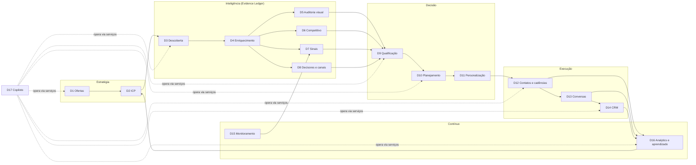

# Domínios e limites entre módulos

> Versão 0.1 · 2026-11-09
> Cada domínio é um módulo com dono claro de dados e regras. Domínios **só** se comunicam por (a) serviços de aplicação tipados, (b) eventos de domínio ou (c) leitura de projeções publicadas — nunca escrevendo nas tabelas de outro domínio.
> Tabelas citadas estão em [06-modelo-de-dados.md](06-modelo-de-dados.md); contratos em [contracts/](contracts/README.md).

## Mapa de contexto

### Núcleo compartilhado (não é domínio de negócio)

| Módulo | Responsabilidade |
|---|---|
| **Evidence Ledger** | Armazena `sources`, `claims`, `claim_evidence`, `claim_dependencies`. Todos os domínios de inteligência **escrevem claims aqui** via um único serviço (`EvidenceService`) que impõe as regras epistemológicas. Ver [08-metodologia-comercial.md §2](08-metodologia-comercial.md). |
| **Tenancy & Access** | Organizações, membros, papéis, RLS. |
| **Agent Runtime** | Gateway de LLM, registro de prompts, execução de agentes, ferramentas, custos. Ver [04-arquitetura-de-agentes.md](04-arquitetura-de-agentes.md). |
| **Workflow Engine** | Execução durável, filas, agendamentos, idempotência. |
| **Governança** | Aprovações, auditoria, orçamentos, supressão, direitos do titular. |

### Legenda de execução

- **DET** — código determinístico (sem LLM).
- **LLM** — chamada única ao modelo com saída estruturada validada.
- **AGT** — loop agêntico com ferramentas (uso restrito; justificar).

---

## D1 — Estratégia e inteligência de ofertas

**Responsabilidade.** Ser a fonte da verdade sobre *o que a agência vende, para quem, por quê e com quais provas*. Tudo o que os agentes argumentam deriva daqui.

| Item | Conteúdo |
|---|---|
| Entradas | Cadastro manual pelo owner/admin; documentos da agência (cases, portfólio, metodologia) para a base de conhecimento. |
| Saídas | `offers` versionadas; `audit_rubrics` por oferta; `proof_assets` (cases); `voice_guide` da agência; base de conhecimento indexada. |
| Dados | `offers`, `offer_versions`, `audit_rubrics`, `proof_assets`, `knowledge_documents`, `knowledge_chunks`, `org_settings.voice_guide`. |
| Dependências | Nenhuma (raiz). |
| Integrações | Storage (anexos); embeddings para busca semântica de cases [DECISÃO: provedor de embeddings]. |
| Execução | DET (CRUD); LLM opcional para sugerir problemas/sinais a partir da descrição da oferta (sempre como rascunho). |
| Regras | Toda oferta tem: problemas que resolve, sinais de necessidade, desqualificadores, entregáveis, faixa de investimento, provas. Alterar oferta cria nova versão; avaliações antigas permanecem ligadas à versão usada. Provas (cases) só podem ser citadas em mensagens se marcadas como `public_ok`. |
| Qualidade | 100% das ofertas ativas com rubrica e ≥ 1 desqualificador; cases com autorização de uso registrada. |

## D2 — Definição e calibração de ICP

**Responsabilidade.** Traduzir estratégia em critérios operacionais e pesos de score, e recalibrá-los com resultados reais.

| Item | Conteúdo |
|---|---|
| Entradas | Oferta (D1); critérios do usuário; histórico de clientes da agência (importação CSV); propostas de calibração (D16). |
| Saídas | `icp_profiles` versionados com filtros firmográficos, sinais desejados, exclusões e `scoring_models` (pesos e limiares). |
| Dados | `icp_profiles`, `scoring_models`, `personas`. |
| Dependências | D1; D16 (propostas). |
| Integrações | CNAE (tabela IBGE/CONCLA) para seleção de segmentos. |
| Execução | DET; LLM para sugerir ICP inicial a partir de clientes atuais (rascunho com justificativa). |
| Regras | Pesos somam 1 por modelo; mudança de pesos nunca é automática — calibração gera *proposta* que um humano aceita. Cada avaliação registra a versão de ICP e de modelo de score usadas. |
| Qualidade | Proposta de calibração só é emitida com amostra mínima (ex.: ≥ 50 desfechos) e mostra o efeito esperado em dados históricos (backtest). |

## D3 — Descoberta de empresas e oportunidades

**Responsabilidade.** Produzir candidatos relevantes, deduplicados e rastreáveis à origem.

| Item | Conteúdo |
|---|---|
| Entradas | ICP (filtros), consulta em linguagem natural (via Copiloto), listas importadas (CSV), sinais (D7), indicações manuais. |
| Saídas | `discovery_runs`, `discovery_candidates` com decisão (`new`, `merged`, `rejected`) e motivo; novas `companies` em estado `candidate`. |
| Dados | `discovery_runs`, `discovery_candidates`, `companies`, `company_identifiers`. |
| Dependências | D2; Evidence Ledger (fonte do registro). |
| Integrações | Base de referência CNPJ (dados abertos da Receita, ingestão mensal) como fonte principal; importação CSV; busca web. Google Places **não** serve para varredura (máx. 60 resultados por busca) — apenas para verificar presença de empresas já conhecidas. Ver [05-integracoes.md](05-integracoes.md). |
| Execução | DET (consultas, normalização, deduplicação); LLM barato para triagem de relevância em lote (fit textual) — saída: `fit_hint` + motivo. |
| Regras | Deduplicação por identificadores fortes (CNPJ raiz, domínio registrável, place_id) e fuzzy (nome normalizado + município + telefone). Empresa já em `customer`, `disqualified` recente ou na supressão não volta como candidata sem aviso. Cada candidato guarda a fonte e o payload original. |
| Qualidade | Taxa de duplicatas pós-merge < 2%; ≥ 60% dos candidatos triados como "relevantes" confirmados por humano em amostra (meta a calibrar). |

## D4 — Enriquecimento de informações

**Responsabilidade.** Completar a ficha da empresa com dados verificáveis de baixo custo antes de qualquer investigação cara.

| Item | Conteúdo |
|---|---|
| Entradas | `company_id` com identificadores mínimos. |
| Saídas | Claims firmográficos (`fact`): razão social, CNAE, porte, data de abertura, situação, endereço, sócios (QSA); presença digital: domínio, site ativo, redes encontradas, tecnologia do site; snapshots salvos como `sources`. |
| Dados | `companies` (projeção), `claims`, `sources`, `company_identifiers`. |
| Dependências | D3; Evidence Ledger. |
| Integrações | API CNPJ, Places, captura de página (fetch/scrape), detecção de tecnologia. |
| Execução | DET em quase tudo; LLM para extrair dados estruturados da home/sobre (descrição do negócio, público, proposta) com citação de trecho. |
| Regras | Dado de registro oficial = `fact` com confiança alta; dado extraído de site = `fact` sobre o que o site *declara* (não sobre a realidade); o conflito entre fontes gera claim `disputed`. Cache por identificador com validade (ex.: cadastro 30 dias, site 7 dias). **Conteúdo do Google Maps (nome, endereço, telefone, site, nota, avaliações) não é persistido** — só `place_id` e metadados próprios (data, score de match); o conteúdo é exibido ao vivo com atribuição "Google Maps" (termos de Places; [research/01 §A3](research/01-dados-empresas-e-decisores.md)). E-mail/telefone cadastrais da Receita são tratados como fracos (frequentemente do contador). |
| Qualidade | ≥ 95% das empresas com CNPJ resolvido quando houver; 0 claims sem `source`. |

## D5 — Auditoria visual de marcas

**Responsabilidade.** Diagnosticar a expressão visual da marca contra a rubrica da oferta, com achados apontando para a evidência visual.

| Item | Conteúdo |
|---|---|
| Entradas | Capturas (site desktop/mobile, logo, favicon, imagens OG, grade de redes quando autorizada), rubrica da oferta (D1), contexto do segmento. |
| Saídas | `visual_audits` com achados por critério (nota, severidade, descrição, evidência = asset + região/trecho), maturidade geral e claims `inference` derivados (ex.: "identidade inconsistente entre site e redes"). |
| Dados | `brand_assets`, `visual_audits`, `claims`, `sources`. |
| Dependências | D4 (URLs e redes), D1 (rubrica). |
| Integrações | Serviço de screenshot por API (ScreenshotOne/ApiFlash); ativos de marca via Logo.dev (armazenamento permitido); cores/fontes do CSS (extração própria ou formato `branding` da Firecrawl); Instagram Business Discovery pela conta profissional da agência; histórico pelo Wayback Machine; Claude (visão). Bibliotecas de anúncios não têm API para anúncios comerciais no Brasil (só link para consulta manual). Ver [05](05-integracoes.md). |
| Execução | DET (captura, normalização, paleta, metadados) + LLM multimodal com saída estruturada por critério. Página inteira fatiada em blocos do tamanho da viewport antes de ir ao modelo (limites de resolução da visão). **Não é agente**: a rubrica define o roteiro. |
| Regras | Achado sem asset de referência é descartado. Juízo estético é sempre `inference` com confiança ≤ 0,8 e deve citar o critério da rubrica. A auditoria registra versão da rubrica e do prompt. Para PMEs sem site, auditoria parcial explicitada (não "nota zero"). |
| Qualidade | Concordância com avaliação de diretor de criação ≥ 75% por critério em conjunto de avaliação; 0 achados sem evidência. |

## D6 — Pesquisa competitiva e posicionamento

**Responsabilidade.** Situar a empresa frente a concorrentes diretos e mostrar contrastes de posicionamento e expressão que sustentem o argumento.

| Item | Conteúdo |
|---|---|
| Entradas | Empresa enriquecida, segmento, localização, investigação (D4/D5). |
| Saídas | `competitor_links` (com base da relação e confiança), comparativo de posicionamento (mensagens-chave, promessa, público, tom) e de maturidade visual; claims `inference` comparativos. |
| Dados | `competitor_links`, `competitive_analyses`, `claims`. |
| Dependências | D4, D5 (reusa o mesmo pipeline de auditoria para concorrentes em modo leve). |
| Integrações | Places (proximidade/categoria), busca web. |
| Execução | LLM + busca para identificar concorrentes (passo do agente de investigação); DET para captura; LLM estruturado para comparativo. |
| Regras | Máximo de N concorrentes por análise (padrão 3) para controlar custo. Concorrente só entra com base explícita (mesma categoria + região, citado em fonte, ou indicado pelo usuário). Comparações nunca depreciam o prospect em mensagens; servem para diagnóstico interno. |
| Qualidade | ≥ 80% dos concorrentes aceitos por humano em amostra. |

## D7 — Detecção de sinais comerciais

**Responsabilidade.** Identificar eventos que indicam *momento* de compra e transformá-los em `signals` com força e decaimento.

| Item | Conteúdo |
|---|---|
| Entradas | Eventos de monitoramento (D15), notícias, vagas, mudanças cadastrais, novos sites/domínios, mudanças em site/redes, informações trazidas pelo usuário. |
| Saídas | `signals` (tipo, força, data de ocorrência, validade, claim de suporte). |
| Dados | `signal_types` (catálogo global + overrides por tenant), `signals`, `claims`. |
| Dependências | D15, D4; catálogo de sinais por oferta (D1). |
| Integrações | Notícias, vagas, cadastro, certificados/domínios, diffs de site. Ver [05-integracoes.md](05-integracoes.md). |
| Execução | DET (regras de detecção, decaimento); LLM para classificar relevância de notícia/vaga e extrair o evento. |
| Regras | Sinal sempre aponta para um claim com fonte e `occurred_at`. Força decai por meia-vida definida no tipo (ex.: expansão 90 dias; vaga de marketing 45 dias). Sinais negativos existem (ex.: rebranding recente < 18 meses reduz timing). |
| Qualidade | Precisão de sinais ≥ 85% em amostra; latência de detecção conforme frequência do monitoramento. |

Catálogo inicial para branding: abertura de nova unidade/expansão, novo site ou domínio, mudança de razão social/nome fantasia, entrada de novo sócio/CEO, captação/investimento, lançamento de produto/linha, contratação de marketing/design, aniversário de marca relevante (10/20/25 anos), mudança de segmento/CNAE, concorrente direto fez rebranding, presença digital desatualizada há > X anos (inferência), avaliações citando aparência/profissionalismo.

## D8 — Inteligência de decisores e canais de contato

**Responsabilidade.** Identificar quem decide e **por qual canal é permitido** falar, com base legal registrada.

| Item | Conteúdo |
|---|---|
| Entradas | Empresa; QSA (sócios); páginas "sobre/equipe"; fontes autorizadas de contato; inserção manual. |
| Saídas | `contacts` com papel na decisão, `contact_channels` com status de verificação, base legal e origem do dado. |
| Dados | `contacts`, `contact_channels`, `suppression_entries`, `legal_basis_assessments`. |
| Dependências | D4; Governança (supressão, LIA). |
| Integrações | Base CNPJ (QSA), provedores de e-mail profissional/verificação [DECISÃO], busca web. LinkedIn **apenas** por consulta manual assistida. |
| Execução | DET (normalização, verificação, checagem de supressão); LLM para inferir papel na decisão a partir de cargo e porte. |
| Regras | Nenhum canal fica "contatável" sem: base legal registrada, origem do dado, verificação e checagem de supressão. Preferir e-mails corporativos genéricos ou do decisor publicados pela própria empresa. Dados pessoais minimizados (sem CPF, sem endereço residencial). |
| Qualidade | Bounce rate < 3%; 100% dos canais com origem e base legal. |

## D9 — Qualificação e priorização multidimensional

**Responsabilidade.** Decidir se há oportunidade sustentada, quão forte e quão confiável — inclusive declarar quando **não há**.

| Item | Conteúdo |
|---|---|
| Entradas | Claims ativos da empresa, sinais, contatos, ICP/score vigentes, oferta. |
| Saídas | `qualification_assessments` com score por dimensão, confiança, cobertura de evidência, recomendação e motivos (cada motivo com `claim_ids`). |
| Dados | `qualification_assessments`, `scoring_models`. |
| Dependências | D2, D4–D8, Evidence Ledger. |
| Integrações | Nenhuma externa. |
| Execução | DET (fit, capacidade, timing, acesso, confiança, gates) + LLM estruturado para necessidade e síntese explicativa, restrito aos claims fornecidos. |
| Regras | Metodologia em [08-metodologia-comercial.md §3](08-metodologia-comercial.md). Desqualificadores são *gates*, não pesos. Score sem cobertura mínima de evidência → `insufficient_evidence`. Nova avaliação substitui a anterior (`is_current`) mas não a apaga. |
| Qualidade | Concordância humana com a recomendação ≥ 80%; calibração (empresas "abordar agora" convertem mais que "monitorar") verificada mensalmente. |

## D10 — Planejamento de abordagens comerciais

**Responsabilidade.** Construir a tese de abordagem: por que esta empresa, por que agora, qual problema, qual prova, para quem, por qual canal, com qual próximo passo.

| Item | Conteúdo |
|---|---|
| Entradas | Avaliação vigente (`pursue`), dossiê, decisor-alvo, oferta, cases, aprendizados aprovados (D16). |
| Saídas | `approach_plans` com tese, ângulo, argumentos (cada um com `claim_ids`), objeções prováveis, canal, sequência e CTA. |
| Dados | `approach_plans`. |
| Dependências | D9, D8, D1, D16. |
| Execução | LLM estruturado (alto raciocínio) com contexto fechado (claims + oferta). |
| Regras | Plano só pode ser gerado com avaliação `pursue` ou `prepare_access` e aprovação explícita do usuário para "forçar" em outros estados (registrada). Argumento baseado em hipótese deve ser formulado como pergunta/observação, nunca como afirmação. |
| Qualidade | ≥ 80% dos planos aprovados sem edição estrutural; 100% dos argumentos com claims. |

## D11 — Personalização linguística e contextual

**Responsabilidade.** Redigir mensagens adequadas ao interlocutor e ao canal, e **verificá-las** contra evidências e regras.

| Item | Conteúdo |
|---|---|
| Entradas | Plano aprovado, persona, canal, voz da agência, histórico de conversa. |
| Saídas | `outbound_messages` em `needs_review` com `claim_refs` e `verification_report`. |
| Dados | `outbound_messages`. |
| Dependências | D10, D1 (voz), D12 (regras de canal). |
| Execução | LLM (redação) + verificador (DET + LLM juiz). |
| Regras | Verificador bloqueia: afirmação factual sem claim; claim com confiança abaixo do limiar; dados pessoais desnecessários; ausência de opt-out onde obrigatório; tamanho fora da norma do canal; padrões proibidos (elogio genérico, urgência falsa, familiaridade fingida). |
| Qualidade | 0 mensagens aprovadas com falha de verificação crítica; taxa de edição humana monitorada. |

## D12 — Gestão autorizada de contatos e cadências

**Responsabilidade.** Executar contatos aprovados com segurança: supressão, limites, janelas, idempotência e rastreio.

| Item | Conteúdo |
|---|---|
| Entradas | Mensagens aprovadas, cadências, conexões de canal autorizadas. |
| Saídas | Envios registrados, `cadence_enrollments`, `tasks` manuais, eventos de entrega/abertura/resposta/bounce. |
| Dados | `cadences`, `cadence_enrollments`, `outbound_messages`, `tasks`, `channel_connections`, `suppression_entries`. |
| Dependências | D11, Governança. |
| Integrações | Gmail API / Microsoft Graph (caixa do usuário) [DECISÃO]; webhooks de entrega; agenda. |
| Execução | DET (outbox + workflow durável). |
| Regras | Checagem de supressão **no momento do envio** (não só no planejamento). Limite diário por caixa e por domínio de destino. Parada automática da cadência em resposta, bounce, opt-out ou reunião marcada. Envio só com `approval_id` válido. Canais sem API permitida viram `tasks` assistidas. |
| Qualidade | 0 envios duplicados; 0 envios para suprimidos; opt-out efetivo em < 24h (meta: imediato). |

## D13 — Análise de conversas e objeções

**Responsabilidade.** Entender respostas e orientar o próximo passo.

| Item | Conteúdo |
|---|---|
| Entradas | Mensagens recebidas (sincronização da caixa), notas de reunião. |
| Saídas | Classificação (intenção, sentimento, objeções, pedido de opt-out, fora do escritório, encaminhamento), próximo passo sugerido, rascunho de resposta. |
| Dados | `conversations`, `conversation_messages`, `objection_catalog`. |
| Dependências | D12, D14. |
| Execução | LLM barato para classificação; LLM principal para rascunho de resposta. |
| Regras | Pedido de opt-out detectado → supressão imediata + confirmação humana posterior (nunca o contrário). Respostas sensíveis (reclamação, menção jurídica) escalam para humano. |
| Qualidade | Recall de opt-out ≥ 99% em conjunto de avaliação; precisão de intenção ≥ 90%. |

## D14 — CRM, reuniões, propostas e negociações

**Responsabilidade.** Registrar e conduzir oportunidades até o fechamento.

| Item | Conteúdo |
|---|---|
| Entradas | Respostas positivas, reuniões, ações do usuário. |
| Saídas | `opportunities`, `meetings`, `proposals`, `activities` (linha do tempo). |
| Dados | `pipelines`, `pipeline_stages`, `opportunities`, `meetings`, `proposals`, `activities`. |
| Dependências | D13, D10 (origem). |
| Integrações | Google Calendar / Cal.com [DECISÃO]. |
| Execução | DET; LLM para resumo pré-reunião (briefing a partir do dossiê) e pós-reunião (a partir de notas). |
| Regras | Toda oportunidade guarda atribuição de origem (descoberta, plano, mensagem). Perda exige motivo codificado. |
| Qualidade | 100% das oportunidades com origem; motivos de perda preenchidos. |

## D15 — Monitoramento contínuo

**Responsabilidade.** Vigiar empresas relevantes e detectar mudanças significativas sem reprocessar tudo.

| Item | Conteúdo |
|---|---|
| Entradas | `watchlists` (empresa, frequência, verificações habilitadas). |
| Saídas | `change_events` com significância; sinais (D7); reavaliação (D9) quando relevante; claims expirados marcados como `stale`. |
| Dados | `watchlists`, `monitor_runs`, `change_events`. |
| Dependências | D4, D7, Workflow Engine (agenda). |
| Execução | DET (hash/diff de conteúdo, checagem cadastral); LLM barato para julgar significância de diffs; processamento em lote (Batch API) quando não urgente. |
| Regras | Frequência por prioridade (ex.: `pursue` semanal, `monitor` mensal). Orçamento mensal de monitoramento por tenant. Mudança só vira sinal com significância ≥ limiar. |
| Qualidade | Falsos positivos de mudança < 20% em amostra; custo de monitoramento dentro do orçamento. |

## D16 — Analytics, avaliação e aprendizado comercial

**Responsabilidade.** Medir funil e qualidade, atribuir resultados e propor melhorias — sem autoajuste silencioso.

| Item | Conteúdo |
|---|---|
| Entradas | Eventos de todo o funil, feedback humano sobre claims/avaliações/mensagens, custos. |
| Saídas | Painéis (funil, coortes, custo por resultado), `calibration_proposals` (pesos de score/ICP), `learnings` (padrões com evidência estatística) para aprovação humana. |
| Dados | `feedback`, `outcome_events`, `calibration_proposals`, `learnings`, visões materializadas de métricas. |
| Dependências | Todos os domínios (leitura de eventos). |
| Execução | DET (métricas, backtest, regressão simples); LLM para sintetizar aprendizados a partir de estatísticas (nunca inventar números). |
| Regras | Aprendizado só entra em prompts após aprovação humana e com amostra mínima. Toda métrica exibe tamanho de amostra e intervalo/aviso quando n é pequeno. |
| Qualidade | Painéis reconciliam com dados brutos (testes); propostas de calibração com backtest. |

## D17 — Copiloto central

**Responsabilidade.** Interface em linguagem natural capaz de operar todos os módulos, com as mesmas permissões e controles da interface estruturada.

| Item | Conteúdo |
|---|---|
| Entradas | Mensagem do usuário, contexto da tela (entidade em foco), histórico da conversa, memória aprovada da organização. |
| Saídas | Respostas com referências a entidades e claims; execuções de ferramentas (leituras imediatas; escritas internas auditadas; ações externas → fila de aprovação); planos de execução com estimativa de custo para operações longas. |
| Dados | `copilot_threads`, `copilot_messages`, `agent_runs`, `tool_calls`. |
| Dependências | Serviços de aplicação de todos os domínios (nunca acesso direto ao banco). |
| Execução | **AGT** (justificado: pedidos abertos, multi-etapa, roteamento entre módulos). |
| Regras | Ferramentas espelham serviços de aplicação com o papel do usuário; nenhuma ferramenta de envio direto — só "propor envio". Operações acima de limiar de custo exigem confirmação. Respostas sobre dados do tenant vêm de ferramentas, não de memória do modelo. |
| Qualidade | Taxa de sucesso de tarefas em conjunto de avaliação; 0 ações externas sem aprovação; latência do primeiro token < 2 s p95. |
