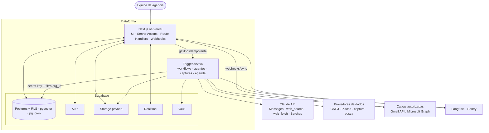

# Arquitetura técnica

> Versão 0.1 · 2026-11-09
> Decisões: [ADR-0001 Monorepo](adr/0001-monorepo-e-fronteiras.md) · [ADR-0002 Evidence Ledger](adr/0002-evidence-ledger.md) · [ADR-0003 Runtime de agentes](adr/0003-runtime-de-agentes.md) · [ADR-0004 Orquestração](adr/0004-orquestracao-duravel.md) · [ADR-0005 Observabilidade](adr/0005-observabilidade.md) · [ADR-0006 Segredos](adr/0006-segredos-e-credenciais.md)
> Fundamentação: [research/04](research/04-infraestrutura-e-execucao.md).
> **Estado real (2026-11-09):** o diagrama abaixo é o alvo original. Hoje o app roda só neste computador ([ADR-0007](adr/0007-uso-interno-local-sem-login.md)), sem Auth, Vercel, Trigger.dev, Langfuse nem Sentry, e a IA roda no Ollama local ([ADR-0008](adr/0008-ia-local-com-ollama.md)). A arquitetura implementada está em [13 §3](13-auditoria-e-evolucao.md#3-arquitetura-atual-o-que-o-código-faz-hoje); a orquestração de tarefas será revista (D-AI-5).

## 1. Visão de contexto

## 2. Componentes e responsabilidades

| Componente | Tecnologia | Responsabilidade | Não faz |
|---|---|---|---|
| **Web** (`apps/web`) | Next.js 16 App Router (versão estável atual), React, Tailwind, shadcn/ui | UI, autenticação de sessão, Server Actions (casos de uso síncronos e curtos), streaming do Copiloto, webhooks de entrada, disparo de workflows | Trabalho longo, chamadas a agentes de investigação |
| **Tasks** (`apps/worker` + `packages/workflows`) | Trigger.dev v4 | Workflows duráveis: descoberta, investigação, abordagem, envio, sync de caixa, monitoramento, aprendizado; capturas de tela via serviço externo (navegador próprio só na fase 2) | UI; decisões de autorização do usuário (recebe contexto já autorizado) |
| **Banco** | Supabase Postgres | Dados de negócio, Evidence Ledger, custos, auditoria, RLS | Lógica de negócio complexa (fica no domínio TS) |
| **Auth** | Supabase Auth | Login (e-mail com link mágico/senha + Google [DECISÃO]), MFA para owner/admin | Autorização fina (RLS + serviços) |
| **Storage** | Supabase Storage | Snapshots de páginas, screenshots, logos, documentos | Arquivos públicos (todos os buckets são privados) |
| **Realtime** | Supabase Realtime | Progresso de workflows e atualizações de filas na UI | Transporte de dados sensíveis volumosos |
| **Vault** | Supabase Vault | Credenciais por tenant | Segredos da plataforma (ficam em env) |
| **LLM** | Ollama local em `127.0.0.1:11434` ([ADR-0008](adr/0008-ia-local-com-ollama.md)); Claude API como opção futura | Capacidades e agentes via LLM Gateway (`packages/agents`): modelo por tarefa, fila, limite de concorrência, VRAM, descarregar sob demanda | Rodar mais de um modelo pesado ao mesmo tempo; encerrar outros programas |

## 3. Padrões de execução

### 3.1 Síncrono (UI → Server Action → serviço)
Leituras e mutações curtas. A Server Action cria um cliente Supabase **com a sessão do usuário** (RLS aplicado), valida entrada com Zod, chama o serviço de aplicação, registra auditoria.

### 3.2 Assíncrono (UI → registro + gatilho → task)
1. Server Action grava a intenção (ex.: `investigations` com `status = queued`) — com RLS.
2. Dispara a task com `idempotencyKey` derivada do registro.
3. A task processa com a secret key, **sempre filtrando `org_id`** recebido no payload e revalidado contra o registro.
4. Progresso gravado no banco → Realtime → UI.
5. Conclusão emite evento de domínio (tabela `domain_events` + gatilho de tasks consumidoras).

### 3.3 Espera humana
`approvals` no banco + token de espera do engine. Aprovar na UI: grava decisão (RLS + papel), confere `payload_hash`, completa o token. Expiração do token = aprovação `expired`.

### 3.4 Agenda
- `monitor.tick` e `learning.monthly` como schedules do engine (por tenant quando precisar de fuso/configuração própria).
- `pg_cron` para manutenção do banco (expurgo de retenção, expiração de aprovações e claims `stale`, refresh de visões materializadas).

## 4. Acesso a dados

| Contexto | Cliente | Garantia |
|---|---|---|
| Server Components/Actions | Supabase com sessão do usuário (chave publishable + cookie) | RLS |
| Tasks/workers | Supabase com secret key | Repositórios exigem `orgId`; teste de que toda consulta filtra `org_id`; nenhuma consulta "global" fora de catálogos |
| Agentes | Nenhum acesso direto | Ferramentas → serviços de aplicação com `ctx.orgId` e papel do usuário que originou a execução |
| Cliente (browser) | Supabase só para Auth e Realtime | Nenhuma escrita direta em tabelas de negócio pelo browser |

**Cache do Next.js:** dados de tenant nunca entram em cache compartilhado entre usuários/organizações; chaves de cache incluem `orgId`; páginas com dados de tenant são dinâmicas por padrão.

## 5. Integrações externas

Todas atrás de portas em `packages/application/ports` e adapters em `packages/integrations`. Catálogo, custos e termos: [05-integracoes.md](05-integracoes.md).

Padrão de chamada: timeout → throttle global por provedor → retry só transitório → validação Zod da resposta → `sources` + claims → `provider_usage`.

**SSRF:** captura e fetch de URLs fornecidas por usuários/fontes bloqueiam IPs privados, `localhost`, metadados de nuvem e esquemas não HTTP(S); seguem no máximo N redirecionamentos.

## 6. Ambientes

| Ambiente | Banco | Engine | Uso |
|---|---|---|---|
| Local | Supabase local (CLI + Docker) **ou** projeto Supabase de desenvolvimento [DECISÃO D-INFRA-2] | Trigger.dev dev | Desenvolvimento |
| Preview | Branch do Supabase (opcional) | Trigger.dev staging | PRs |
| Staging | Projeto Supabase separado | Trigger.dev staging | Validação com dados reais da agência (mesmas regras LGPD de produção) |
| Produção | Projeto Supabase Pro | Trigger.dev prod | Uso real |

Seeds de demonstração apenas em local/preview e sempre com `is_demo = true`.

## 7. CI/CD

- GitHub (repositório privado) [DECISÃO D-OPS-2] + GitHub Actions: pipeline de [11-qualidade-e-testes.md §6](11-qualidade-e-testes.md).
- Deploy web pela integração Vercel; tasks pelo CLI do Trigger.dev em job do CI após testes.
- Migrações aplicadas por job manual/aprovado (nunca automaticamente em produção a partir de PR).
- Versões de prompt registradas em `prompt_versions` no deploy (hash do arquivo).

## 8. Segurança (resumo)

Detalhes em [12-seguranca-e-conformidade.md](12-seguranca-e-conformidade.md).
- RLS em 100% das tabelas de tenant + teste de catálogo.
- Papéis `owner > admin > operator > viewer`; verificação em Server Actions e políticas.
- Segredos conforme ADR-0006; redator de segredos e PII em logs.
- Aprovação obrigatória para ações externas; `payload_hash` impede alteração pós-aprovação.
- Cabeçalhos de segurança (CSP restritiva, HSTS, `frame-ancestors 'none'`), proteção CSRF nativa de Server Actions, rate limit em rotas públicas e webhooks.

## 9. Escalabilidade e limites conhecidos

| Ponto | Limite/risco | Mitigação |
|---|---|---|
| Conexões Postgres | Instância Micro tem poucas conexões diretas | Pooler para tasks; subir instância conforme carga |
| Volume de claims/sources | Crescimento linear por empresa investigada | Índices parciais (`status = 'active'`), arquivamento, particionamento de `audit_log`/`llm_calls` por mês |
| Rate limits de provedores | Variam por provedor | Throttle global + concorrência por tenant |
| Custo de LLM | Domina o custo total | Investigação em camadas, cache de prompt, Batches, orçamentos com corte |
| Realtime | Limites de conexões/mensagens por plano | Agregar atualizações de progresso (no máx. 1/s por execução) |

## 10. Custos de infraestrutura (estimativa da pesquisa, sem LLM e sem provedores de dados)

| Cenário | Estimativa mensal |
|---|---|
| 1 tenant, ~500 empresas/mês | ~US$ 55–115 |
| 20 tenants, ~10.000 empresas/mês | ~US$ 210–440 |

Premissas e fontes em [research/04 §3.1](research/04-infraestrutura-e-execucao.md). Custos de LLM e dados em [10-riscos-custos-decisoes.md](10-riscos-custos-decisoes.md).
