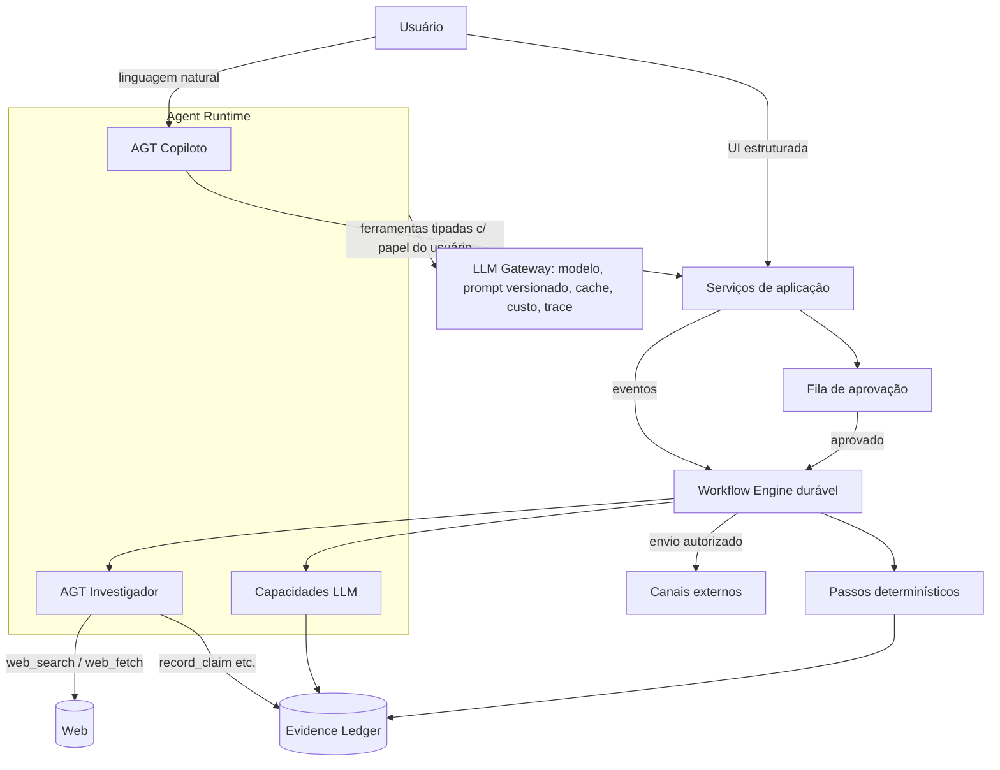
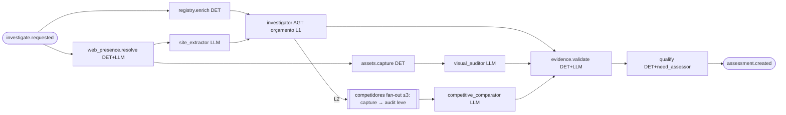

# Arquitetura de agentes

> Versão 0.1 · 2026-11-09
> Referências: [02-dominios.md](02-dominios.md) · [ADR-0003 Runtime de agentes](adr/0003-runtime-de-agentes.md) · [ADR-0004 Orquestração](adr/0004-orquestracao-duravel.md) · [contracts/](contracts/README.md)
> Informações sobre a Claude API verificadas na referência oficial do SDK em 2026-11-09 (modelos, preços, parâmetros). Preços e IDs mudam: o gateway lê a configuração do banco, nunca de constantes espalhadas no código.
> **Emenda de 2026-11-09 ([ADR-0008](adr/0008-ia-local-com-ollama.md)):** o provedor padrão passou a ser o **Ollama local** (`qwen3.5:4b`, reserva `nemotron-3-nano:4b`). As colunas "Modelo proposto" e "Esforço" abaixo valem só se um provedor Claude for adicionado (D-AI-1). A tese, os contratos, os limites de autonomia e a defesa contra injeção continuam iguais. Mapeamento dos 10 especialistas pedidos para estas capacidades e estado real de implementação: [13 §6](13-auditoria-e-evolucao.md#6-arquitetura-de-ia-local).

## 1. Tese: poucos agentes, muitos passos confiáveis

O briefing pede "não multiplicar agentes sem justificativa". A regra adotada:

| Tipo de execução | Quando usar | Exemplos |
|---|---|---|
| **Determinístico (DET)** | O caminho é conhecido e verificável. | Consulta cadastral, deduplicação, captura de tela, cálculo de score, decaimento de sinais, envio, diff de site. |
| **Chamada única de LLM (LLM)** | Transformação/julgamento com entrada fechada e saída estruturada. | Extrair dados do site, auditar visualmente contra rubrica, classificar resposta, redigir mensagem, julgar significância. |
| **Agente com ferramentas (AGT)** | O caminho **não** é conhecido de antemão e exige exploração. | Investigação aberta de uma empresa; Copiloto. |

Resultado: **2 agentes** + **~12 capacidades de LLM** + **workflows determinísticos** que os orquestram. O "orquestrador" de pipelines é código durável (workflow engine), não um LLM — mais barato, previsível, testável e retomável. O Copiloto é o orquestrador *conversacional*: interpreta pedidos e dispara os mesmos workflows que a interface estruturada usa.

## 2. Catálogo de capacidades

Modelo padrão segue a recomendação atual: **Claude Opus 5.5 (`claude-opus-5-5`)** para trabalho de raciocínio. Para passos de alto volume e baixa complexidade, a proposta é usar **Claude Haiku 5.5** ou **Claude Sonnet 5.5** — **[DECISÃO]**: a escolha final de modelo por capacidade é do dono do produto e deve ser validada por avaliação (ver [11-qualidade-e-testes.md](11-qualidade-e-testes.md)). Tudo é configurável por `agent_configs` sem deploy.

| Chave | Tipo | Domínio | Modelo proposto | Esforço | Entrada → Saída (contrato) | Por que não é mais simples / mais complexo |
|---|---|---|---|---|---|---|
| `copilot` | AGT | D17 | Opus 5.5 | medium | conversa → resposta + chamadas de ferramenta | Pedidos abertos e multi-módulo exigem roteamento por modelo. |
| `investigator` | AGT | D4–D8 | Opus 5.5 | high | contexto da empresa + lacunas → claims, concorrentes e contatos propostos, relatório | Lacunas variam por empresa; precisa decidir o que buscar e quando parar. |
| `candidate_triage` | LLM (lote) | D3 | Haiku 5.5 | low | candidatos + ICP → `fit_hint` + motivo | Classificação simples em volume; Batch API quando não urgente. |
| `site_extractor` | LLM | D4 | Sonnet 5.5 | low | texto de páginas → dados do negócio com trechos citados | Extração estruturada, sem exploração. |
| `visual_auditor` | LLM (visão) | D5/D6 | Opus 5.5 | high | capturas + rubrica → achados por critério | Roteiro fixo pela rubrica; qualidade visual exige modelo forte. |
| `competitive_comparator` | LLM | D6 | Opus 5.5 | medium | dossiês resumidos (alvo + concorrentes) → comparativo | Entrada fechada. |
| `signal_classifier` | LLM (lote) | D7/D15 | Haiku 5.5 | low | notícia/vaga/diff → evento, relevância | Volume alto, decisão simples. |
| `need_assessor` | LLM | D9 | Opus 5.5 | high | claims + rubrica da oferta → necessidade + justificativa com `claim_ids` | Julgamento crítico, mas sobre conjunto fechado. |
| `approach_planner` | LLM | D10 | Opus 5.5 | high | avaliação + dossiê + oferta + cases → plano | Raciocínio estratégico com contexto fechado. |
| `message_writer` | LLM | D11 | Opus 5.5 | medium | plano + persona + canal + voz → mensagens | Redação; sem ferramentas. |
| `message_verifier` | DET + LLM juiz | D11 | Sonnet 5.5 | medium | mensagem + claims → relatório de verificação | Juiz independente do redator (modelo/prompt diferentes). |
| `reply_classifier` | LLM | D13 | Haiku 5.5 | low | resposta recebida → intenção, objeções, opt-out | Classificação; opt-out tem também regra DET (palavras-chave) por segurança. |
| `change_significance` | LLM (lote) | D15 | Haiku 5.5 | low | diff + contexto → significância | Volume alto; Batch API. |
| `meeting_briefer` | LLM | D14 | Sonnet 5.5 | medium | dossiê + histórico → briefing de reunião | Síntese. |
| `learning_synthesizer` | LLM | D16 | Opus 5.5 | high | estatísticas calculadas → aprendizados propostos | Interpreta números já calculados; proibido inventar números. |

> Nota técnica (referência oficial do SDK, 2026-11-09): no Opus 5.5 o *thinking* é sempre adaptativo e não pode ser desligado; o controle é `output_config.effort` (padrão `medium`). `tool_choice` forçado (`any`/`tool`) retorna 400 em Opus 5.5 e Sonnet 5.5 — usar `auto` + ferramentas `strict: true` ou saída estruturada (`output_config.format` via `messages.parse` + Zod). Prefill de assistente não é suportado.

## 3. Pipelines (workflows) e paralelismo

### 3.1 Investigação em camadas (custo proporcional ao potencial)

| Nível | Passos | Gatilho para subir | Custo-alvo [a validar] |
|---|---|---|---|
| **L0 Triagem** | cadastro + `candidate_triage` | `fit_hint ≥ médio` | centavos |
| **L1 Padrão** | enriquecimento, presença digital, captura, `site_extractor`, `visual_auditor`, `investigator` com orçamento curto, validação, qualificação | score ≥ limiar **ou** pedido do usuário | ≤ US$ 1,50 |
| **L2 Profunda** | L1 + concorrentes (fan-out) + `investigator` com orçamento maior + decisores | `pursue` com valor alto ou pedido explícito (com aprovação se acima do limite de custo) | ≤ US$ 5 |

**Regras de paralelismo**
- Passos sem dependência rodam em paralelo (ex.: cadastro ∥ presença digital; auditoria visual ∥ investigador).
- Fan-out com teto: concorrentes ≤ 3; empresas por tenant em paralelo limitado por **chave de concorrência** `org_id`; chamadas por provedor limitadas por **throttle** global (respeita rate limits).
- Lotes não urgentes (triagem de centenas de candidatos, significância de diffs) usam a **Message Batches API** (50% do custo, assíncrona) quando a latência não importa.

### 3.2 Outros workflows
- `discovery.run` — consultas por fonte em paralelo → normalização → dedupe → triagem em lote → candidatos.
- `approach.prepare` — `approach_planner` → `message_writer` → `message_verifier` → (falha crítica → uma reescrita guiada pelo relatório → nova verificação) → fila de revisão.
- `outbound.send` — aguardar aprovação (evento) → checar supressão/limites → envio idempotente → registrar → agendar próximo passo.
- `inbox.sync` — sincronizar respostas → `reply_classifier` → opt-out imediato / tarefa / rascunho. No Gmail, ler respostas exige escopo restrito (avaliação de segurança anual); no MVP, app interno no Workspace da agência ou marcação manual (D-CHAN-2, [12 §5](12-seguranca-e-conformidade.md)).
- `monitor.tick` (agenda) — selecionar vencidos → checagens DET → `change_significance` (lote) → sinais → reavaliação se necessário.
- `learning.monthly` (agenda) — métricas → backtest → `learning_synthesizer` → propostas para aprovação.

## 4. Os dois agentes em detalhe

### 4.1 Investigador

**Objetivo:** preencher lacunas do dossiê com evidência verificável, dentro de um orçamento, e parar.

| Aspecto | Definição |
|---|---|
| Entrada | Ficha da empresa, claims existentes, lista explícita de lacunas (gerada DET: "sem decisor", "sem sinal recente", "posicionamento desconhecido"…), oferta e catálogo de sinais. |
| Ferramentas servidor | `web_search` (`web_search_20260209`, `max_uses` por nível), `web_fetch` (`web_fetch_20260209`, `max_uses`, `blocked_domains` da política de conformidade — ex.: redes que proíbem acesso automatizado). |
| Ferramentas cliente (strict) | `get_company_context`, `list_claims`, `record_claim`, `propose_competitor`, `propose_contact`, `request_asset_capture`, `finish_investigation`. |
| Orçamentos | `max_uses` por ferramenta servidor; limite de iterações do tool runner; `task_budget` (beta) quando disponível no modelo; teto em US$ calculado do `usage` a cada turno; timeout de parede do passo. |
| Saída | Claims gravados incrementalmente (não se perde trabalho em falha) + `finish_investigation` com resumo, lacunas remanescentes e confiança geral. Se o loop terminar sem `finish_investigation`, uma chamada de saída estruturada gera o fechamento. |
| Regras de evidência | `record_claim` exige `evidence[]` com URL e trecho literal; o servidor compara o trecho com o conteúdo capturado (resultado do `web_fetch` armazenado como `source`) e rejeita trechos inexistentes. Inferências exigem `depends_on` (claims de fato). |
| Proibições | Não cria contatos com dados pessoais de fontes não autorizadas; não acessa domínios bloqueados; não executa ações externas. |

### 4.2 Copiloto

| Aspecto | Definição |
|---|---|
| Entrada | Mensagem, contexto da tela (`entity_ref`), histórico do thread, configurações e aprendizados aprovados da organização. |
| Ferramentas | Espelho dos serviços de aplicação, agrupadas: *leitura* (buscar empresas, abrir dossiê, explicar score, métricas), *escrita interna* (criar lista, iniciar descoberta/investigação, editar plano, criar tarefa), *ações sensíveis* (propor envio, conectar integração, exportar) — estas só **criam itens na fila de aprovação**. |
| Escala de ferramentas | Ferramentas raras com `defer_loading` + busca de ferramentas, para manter o prefixo pequeno e cacheável. |
| Permissões | Cada ferramenta executa com a sessão e o papel do usuário (RLS se aplica). O Copiloto nunca usa chave de serviço. |
| Custo | Operações longas retornam um **plano de execução** (passos, estimativa de custo e tempo) e pedem confirmação acima do limiar do tenant. |
| Streaming | Respostas em streaming para a UI; progresso de workflows via Realtime. |

## 5. Limites de autonomia

| Nível | O sistema pode | Exemplos | Aprovação |
|---|---|---|---|
| A0 Sugerir | Recomendar | Próxima melhor ação | — |
| A1 Interno | Criar/alterar dados internos | Claims, avaliações, rascunhos, tarefas | Não (auditado) |
| A2 Externo leitura | Consumir APIs pagas / web | Investigação, enriquecimento | Não, dentro do orçamento; **sim** acima do limiar |
| A3 Externo escrita | Agir fora do sistema | Enviar mensagem, agendar reunião com terceiro, publicar | **Sempre**, por item, no MVP |
| A4 Configuração | Mudar regras do sistema | Pesos de score, aprendizados, rubricas | **Sempre** (owner/admin) |

Tipos de aprovação: `outbound_message.send`, `investigation.over_budget`, `calibration.apply`, `learning.activate`, `contact.manual_source`, `data.export`, `integration.connect`. Aprovações expiram (padrão 72 h) e registram quem, quando, o que foi aprovado (hash do payload) e o motivo de rejeição.

## 6. Contratos, validação e reparo

- Todo input/output de capacidade é um schema **Zod** em `packages/contracts` (fonte única) → gera JSON Schema para a API e tipos TS para o app. Ver [contracts/](contracts/README.md).
- Saídas via `messages.parse` + `zodOutputFormat`, ou ferramentas `strict: true`.
- Falha de validação → **1** tentativa de reparo enviando o erro → senão o passo falha com `invalid_output` e fica visível para o operador.
- Contratos têm versão; mudança incompatível = nova versão + migração de leitores.

## 7. Memória e conhecimento

| Camada | Onde vive | Quem escreve | Como é usada |
|---|---|---|---|
| Contexto da execução | mensagens do run | runtime | descartada ao fim (trace guardado) |
| **Memória de entidades** | Evidence Ledger (claims) | agentes/capacidades via `EvidenceService` | recuperada por ferramenta/consulta, nunca "lembrada" pelo modelo |
| Conhecimento da agência | ofertas, rubricas, cases, voz (`knowledge_*` + pgvector) | humanos | injetado de forma determinística ou por busca semântica |
| Aprendizados | `learnings` aprovados | `learning_synthesizer` propõe, humano aprova | injetados nos prompts de planejamento/redação |
| Conversas do Copiloto | `copilot_threads/messages` (IA-2; hoje só na aba) | runtime | histórico + compaction em threads longas |

Não há memória escrita livremente pelo modelo: evita deriva e envenenamento por conteúdo web.

## 8. LLM Gateway (único ponto de chamada)

> Estado em 2026-11-09: implementado para o Ollama local em `packages/agents` (IA-1) com resolução de modelo por tarefa, prompt versionado com hash, streaming, fila e limite de concorrência, tempos limite e erros tipados. Ainda faltam os itens 1 (por `agent_configs`), 3 (cache de prompt não se aplica ao Ollama), 7 (`llm_calls`), 8 e 9 — ver KI-031.

Responsabilidades:
1. Resolver `agent_config` (modelo, esforço, max_tokens, ferramentas, orçamento) por organização com fallback global.
2. Montar prompt a partir do **prompt versionado** (arquivo no repositório com hash registrado em `prompt_versions`).
3. **Prompt caching**: ordem estável `tools → system (estático por versão) → contexto estático do tenant (oferta, rubrica, voz) → dados voláteis`; breakpoint no fim do bloco estático; verificar `cache_read_input_tokens` nas métricas.
4. Streaming para saídas longas; `max_tokens` adequado ao tipo de saída.
5. Tratamento de `stop_reason` (`refusal`, `max_tokens`, `pause_turn`) antes de ler conteúdo; recusas com *fallback* de servidor habilitado (`fallbacks: "default"`, beta) e registradas.
6. Retries: SDK (408/409/429/5xx) + política do workflow; sem retry para 400.
7. Registro de `llm_calls`: tokens de entrada/saída/cache, uso de ferramentas servidor, custo calculado por tabela de preços versionada, latência, `request_id`.
8. Redação de PII em logs/traces (e-mails, telefones) — o conteúdo completo fica só nas tabelas com RLS.
9. Orçamento: bloqueia chamada se o tenant/run excedeu o teto (`budget_exceeded`).

## 9. Defesa contra prompt injection

Conteúdo da web e de e-mails recebidos é **dado não confiável**:
- Delimitado e rotulado no prompt; instruções do sistema dizem explicitamente que texto de fontes nunca é instrução.
- Agentes que leem conteúdo externo **não têm ferramentas de ação externa**; o máximo que fazem é gravar claims revisáveis.
- O Copiloto lê claims e resumos, não HTML bruto; ações externas passam por aprovação humana.
- Mensagens geradas passam pelo verificador (que detecta conteúdo estranho ao plano, links não autorizados, pedidos de dados).
- UI renderiza conteúdo externo como texto (sem HTML), links com `rel="noopener noreferrer"` e aviso de domínio.

## 10. Erros, retries, idempotência e timeouts

| Classe | Exemplo | Política |
|---|---|---|
| `transient_provider` | 5xx, timeout de rede | backoff exponencial com jitter, até 3–5 tentativas no passo |
| `rate_limited` | 429 | respeitar `retry-after`; throttle global por provedor |
| `invalid_output` | schema inválido | 1 reparo; depois falha visível |
| `policy_refusal` | `stop_reason: refusal` | fallback de servidor; se persistir, marcar e seguir sem o passo |
| `budget_exceeded` | teto do run/tenant | parar, salvar parcial, pedir aprovação para continuar |
| `source_unavailable` | site fora do ar, 403 | registrar como claim de presença (fato: "site indisponível em DATA"), não repetir |
| `compliance_block` | domínio bloqueado, supressão | não repetir; registrar motivo |

- **Idempotência:** cada passo tem chave determinística (`{workflow}:{entity}:{versão}`); claims fazem *upsert* por `(subject, key, hash_da_fonte)`; envios usam `idempotency_key` único + outbox com estados (`queued → sending → sent|failed`) e verificação no provedor antes de reenviar um item preso em `sending`.
- **Timeouts:** fetch 30 s; captura 60 s; chamada LLM conforme tipo (streaming para longas); passo do investigador 5 min (L1) / 12 min (L2); workflow com prazo total e alerta.
- **Retomada:** o engine durável repete só o passo que falhou; resultados de passos anteriores são memoizados.

## 11. Observabilidade

- Hierarquia de trace: `workflow_run → step → agent_run → llm_call | tool_call` com `trace_id` propagado (OpenTelemetry).
- Destino de traces de LLM: plataforma de observabilidade de LLM [DECISÃO — ver [ADR-0005](adr/0005-observabilidade.md)]; erros de app no Sentry.
- Painel interno: custo por tenant/agente/operação/provedor; latência p50/p95; taxa de falha por classe; taxa de cache; taxa de reparo; recusas.
- Alertas: custo diário acima do esperado, falha de workflow > X%, fila de aprovação envelhecendo, bounce/complaint acima do limite.

## 12. Avaliações (resumo)

Cada capacidade tem conjunto de avaliação versionado, critérios e limiar mínimo para promover nova versão de prompt/modelo. Detalhes em [11-qualidade-e-testes.md](11-qualidade-e-testes.md).

## 13. Ferramentas de desenvolvimento (Claude Code)

Separadas do runtime do produto:
- `CLAUDE.md` com regras do projeto.
- **Skills** de desenvolvimento em `.claude/skills/` (fatia vertical, migração com RLS, nova capacidade de IA, nova integração, revisão de conformidade).
- **Subagentes** em `.claude/agents/` (revisor de arquitetura, revisor de segurança/RLS, revisor de conformidade, engenheiro de testes, avaliador de prompts).
- **MCPs** úteis em desenvolvimento: Supabase (inspeção e migrações em projeto de dev), navegador para testes visuais. Nenhum MCP de desenvolvimento acessa produção.
- Opcional (fase 3): expor os serviços do produto como **servidor MCP** próprio para operar o Prospector a partir de clientes Claude, com as mesmas permissões e aprovações.
