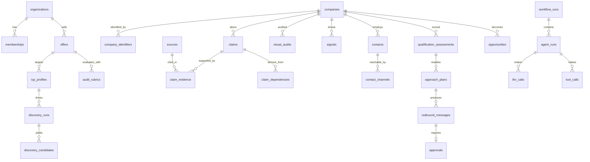

# Modelo de dados

> Versão 0.1 · 2026-11-09 · Postgres (Supabase)
> As migrações SQL serão escritas na fatia F1 a partir deste documento. Marcação: **[MVP]** entra no MVP · **[F2]/[F3]** fases posteriores.

## 1. Convenções

- Chaves primárias `uuid` (`gen_random_uuid()`); `created_at`/`updated_at timestamptz` em todas as tabelas; trigger de `updated_at`.
- **Toda tabela de dados de tenant tem `org_id uuid not null`** referenciando `organizations(id)` e RLS habilitado. Exceções explícitas: catálogos globais somente leitura (`signal_types_global`, `cnae_catalog`, `model_pricing`).
- Enums como `text` + `check` (evoluem sem `ALTER TYPE`), exceto onde o Postgres enum for estável.
- Dados demonstrativos: coluna `is_demo boolean not null default false` nas tabelas de entidades de negócio; a UI exibe selo **DEMO**.
- Exclusão: *soft delete* (`archived_at`) para entidades de negócio; exclusão física apenas no expurgo LGPD (com registro em `audit_log`).
- JSONB apenas para estruturas que variam por oferta/versão (critérios de rubrica, pesos); nada que precise de filtro frequente fica só em JSONB.
- Nomes em inglês no banco (convenção técnica); UI em pt-BR.

## 2. Estratégia multi-tenant e RLS

```sql
-- Função auxiliar (security definer, search_path fixo) usada por todas as políticas
create function app.is_member(p_org uuid, p_min_role text default 'viewer')
returns boolean language sql stable security definer set search_path = '' as $$
  select exists (
    select 1 from public.memberships m
    where m.org_id = p_org
      and m.user_id = (select auth.uid())
      and app.role_rank(m.role) >= app.role_rank(p_min_role)
  );
$$;

-- Padrão por tabela
alter table public.companies enable row level security;
create policy companies_select on public.companies for select to authenticated
  using ( (select app.is_member(org_id)) );
create policy companies_write on public.companies for insert to authenticated
  with check ( (select app.is_member(org_id, 'operator')) );
create policy companies_update on public.companies for update to authenticated
  using ( (select app.is_member(org_id, 'operator')) )
  with check ( (select app.is_member(org_id, 'operator')) );
```

- Índice em `org_id` (ou composto começando por `org_id`) em toda tabela de tenant.
- Workers de workflow usam credencial de serviço **somente no backend** e sempre filtram por `org_id` explicitamente; repositórios recebem `org_id` obrigatório (lint/teste garante).
- `audit_log` e `llm_calls`: sem política de `update`/`delete` para ninguém (append-only); inserção apenas pelo backend.
- Testes de isolamento: para cada tabela, usuário da org A não lê/escreve dados da org B (ver [11-qualidade-e-testes.md](11-qualidade-e-testes.md)).
- Detalhes de performance/segurança de RLS a confirmar com [research/04](research/04-infraestrutura-e-execucao.md).

## 3. Diagrama de entidades (núcleo)



## 4. Tabelas

### 4.1 Tenancy e acesso [MVP]

| Tabela | Colunas principais | Observações |
|---|---|---|
| `organizations` | `id, name, slug unique, plan, settings jsonb, voice_guide jsonb, is_demo, created_by, archived_at` | `settings`: fuso, idioma, limiares, orçamentos padrão. **F1 implementou** `id, name, slug, settings, is_demo, created_by, archived_at`; `plan` e `voice_guide` chegam em F2/F13. Membros editam só `name` e `settings` (grant por coluna). |
| `memberships` | `org_id, user_id → profiles(user_id), role check in (owner,admin,operator,viewer)`, PK `(org_id,user_id)` | FK para `profiles` (não direto para `auth.users`) para permitir o join com nome/e-mail sob RLS; `profiles` é criado por trigger em `auth.users` e removido em cascata. Escritas só por RPC. **Implementado (F1).** |
| `profiles` | `user_id PK → auth.users, email, full_name, avatar_url (https), title` | `email` espelha `auth.users.email` (trigger de insert/update) para exibir membros sem expor `auth`. Visível a quem compartilha organização. **Implementado (F1).** |
| `invitations` | `org_id, email, role (sem owner), token_hash (sha-256), status, invited_by, expires_at (7 dias), accepted_by, accepted_at` | Um pendente por `(org_id, email)`; `token_hash` invisível ao cliente (grant por coluna) e fora do `audit_log`. **Implementado (F1).** |

### 4.2 Estratégia [MVP]

| Tabela | Colunas principais | Observações |
|---|---|---|
| `offers` | `org_id, slug, name, status (draft,active,archived), current_version_id` | |
| `offer_versions` | `offer_id, version int, description, problems jsonb, need_signals jsonb, disqualifiers jsonb, deliverables jsonb, price_range int4range (centavos), value_props jsonb` | imutável após uso |
| `audit_rubrics` | `org_id, offer_id, version, criteria jsonb [{key,label,description,weight,scale,evidence_required}]` | imutável após uso |
| `proof_assets` | `org_id, offer_id, title, summary, segment, results text, public_ok bool, consent_ref, file_path` | só `public_ok` vai para mensagens |
| `icp_profiles` | `org_id, offer_id, name, version, status, filters jsonb (cnae[], uf[], municipios[], porte[], idade_min_anos…), exclusions jsonb, desired_signals text[], scoring_model_id` | |
| `scoring_models` | `org_id, version, weights jsonb, thresholds jsonb, gates jsonb, created_from_proposal_id` | pesos somam 1 (check em app + teste) |
| `personas` | `org_id, offer_id, name, role_patterns text[], concerns jsonb, register` | [F2] |
| `knowledge_documents` / `knowledge_chunks` | `org_id, kind, title, content` / `document_id, chunk, embedding vector(N)` | [F2]; N conforme provedor de embeddings [DECISÃO] |

### 4.3 Empresas e descoberta [MVP]

| Tabela | Colunas principais | Observações |
|---|---|---|
| `companies` | `org_id, display_name, legal_name, cnpj_root text, cnpj text, ref_establishment_id, primary_domain, city, uf, cnae_main, size_band, lifecycle (candidate, investigating, qualified, disqualified, engaged, customer, archived), current_assessment_id, last_investigated_at, is_demo` | projeção para listagem; a verdade detalhada está nos claims. **CNPJ sempre `text`**: CNPJ alfanumérico existe para novas inscrições desde jul/2026 ([research/01 §A1](research/01-dados-empresas-e-decisores.md)) |
| `company_identifiers` | `org_id, company_id, kind (cnpj, cnpj_root, domain, place_id, instagram, phone, linkedin_url), value_normalized, strength (strong, weak), verified, source_id` | `unique (org_id, kind, value_normalized)` para chaves fortes. Telefone e e-mail cadastrais são **fracos** (frequentemente do contador). `place_id` é o **único** dado do Google armazenável sem prazo |
| `discovery_runs` | `org_id, icp_profile_id, query jsonb, sources text[], status, counts jsonb, requested_by, workflow_run_id` | |
| `discovery_candidates` | `org_id, run_id, source, raw jsonb, normalized jsonb, matched_company_id, decision (new, merged, rejected, pending), decision_reason, fit_hint (high, medium, low), fit_reason` | |

### 4.3.1 Base de referência CNPJ (global, somente leitura) [MVP — depende de D-DATA-1]

Dados abertos da Receita Federal ingeridos mensalmente em **tabelas globais** (sem `org_id`), compartilhadas por todos os tenants como catálogo de referência, recortadas por UF/CNAE-alvo, apenas estabelecimentos ativos e **sem MEI** por padrão (razão social de MEI contém nome e CPF da pessoa física).

| Tabela | Colunas principais | Observações |
|---|---|---|
| `ref_cnpj_companies` | `cnpj_root text PK, legal_name, legal_nature, capital_social_cents, size_code, snapshot_month` | |
| `ref_cnpj_establishments` | `cnpj text PK, cnpj_root, is_headquarters, trade_name, status, status_date, activity_start_date, cnae_main, cnae_secondary text[], address jsonb, uf, municipality_code, phones_raw jsonb, email_raw, snapshot_month` | e-mail/telefone tratados como fracos |
| `ref_cnpj_partners` | `cnpj_root, partner_type, name, qualification, entry_date, masked_doc, snapshot_month` | dado pessoal: LIA + minimização; faixa etária **não** é ingerida; CPF mascarado nunca é "desmascarado" |
| `ref_cnpj_changes` | `cnpj, change_kind (opened, renamed, address_changed, capital_changed, branch_opened, status_changed), before jsonb, after jsonb, snapshot_month` | diff mensal → sinais gratuitos |

- Leitura por `authenticated` via RLS de leitura ampla (não é dado de tenant); escrita só pelo job de ingestão.
- Quando um tenant "adota" uma empresa, cria-se `companies` (do tenant) com `ref_establishment_id` e claims `fact` com fonte `api_record` apontando ao snapshot.
- **Licença de redistribuição** dos dados da RFB a clientes do SaaS: não verificada ([research/01 §4](research/01-dados-empresas-e-decisores.md)) — decisão D-DATA-2.

### 4.4 Evidence Ledger [MVP]

| Tabela | Colunas principais | Observações |
|---|---|---|
| `sources` | `org_id, kind (web_page, api_record, screenshot, document, social_post, user_note, search_result), url, provider, captured_at, content_hash, storage_path, mime, http_status, title, excerpt_text, license_note, retention_until` | conteúdo bruto no Storage; texto normalizado para verificação de trechos |
| `claims` | `org_id, subject_type (company, contact, competitor_link), subject_id, domain (firmographic, digital_presence, visual, positioning, signal, contact, competitive, financial_proxy), key, statement, value jsonb, epistemic_type (fact, inference, hypothesis), confidence numeric(3,2), status (active, stale, disputed, rejected, superseded), valid_until, reasoning, produced_by_run_id, prompt_version_id, supersedes_id, reviewed_by, reviewed_at, is_demo` | índice `(org_id, subject_type, subject_id, key)`; upsert por `(subject, key, hash da fonte)` |
| `claim_evidence` | `claim_id, source_id, quote, locator jsonb (selector, bbox, page, timestamp), stance (supports, contradicts), quote_verified bool` | |
| `claim_dependencies` | `claim_id, depends_on_claim_id` | inferências → fatos |

### 4.5 Investigação e auditoria [MVP]

| Tabela | Colunas principais | Observações |
|---|---|---|
| `investigations` | `org_id, company_id, depth (L0, L1, L2), status, requested_by, budget_usd, cost_usd, started_at, finished_at, summary, remaining_gaps jsonb, workflow_run_id` | |
| `brand_assets` | `org_id, company_id, kind (site_desktop, site_mobile, logo, favicon, og_image, social_grid), source_id, storage_path, width, height, palette jsonb, captured_at` | |
| `visual_audits` | `org_id, company_id, rubric_id, rubric_version, findings jsonb [{criterion, score, severity, finding, asset_ids, locator, claim_id}], maturity numeric, coverage (full, partial), run_id` | achados também viram claims |
| `competitor_links` | `org_id, company_id, competitor_company_id, basis (same_category_region, cited_in_source, user), confidence, status` | [MVP leve] |
| `competitive_analyses` | `org_id, company_id, competitor_ids uuid[], findings jsonb, run_id` | [F2] |

### 4.6 Sinais e monitoramento

| Tabela | Colunas principais | Fase |
|---|---|---|
| `signal_types` | `org_id null=global, code, label, domain, default_strength, half_life_days, polarity (+/-)` | MVP |
| `signals` | `org_id, company_id, type_code, occurred_at, detected_at, strength, claim_id, status (new, acknowledged, expired)` | MVP |
| `watchlists` | `org_id, company_id, frequency (weekly, monthly), checks text[], next_run_at, paused` | F2 |
| `monitor_runs` / `change_events` | `org_id, company_id, check, previous_source_id, current_source_id, diff_summary, significance, signal_id` | F2 |

### 4.7 Decisores, contatos e conformidade [MVP]

| Tabela | Colunas principais | Observações |
|---|---|---|
| `contacts` | `org_id, company_id, full_name, role_title, seniority, decision_role (decision_maker, influencer, user, unknown), data_origin (registry_qsa, company_website, user_input, provider:<x>), legal_basis (legitimate_interest, consent, contract), lia_id, do_not_contact, retention_until, last_verified_at, is_demo` | sem CPF; minimização |
| `contact_channels` | `org_id, contact_id, kind (email, phone, whatsapp, linkedin_url), value, verification (unverified, valid, risky, invalid), verified_at, source_id, opted_out_at, is_primary` | |
| `legal_basis_assessments` | `org_id, purpose, description, balancing_test jsonb, approved_by, approved_at, version, review_due_at` | LIA |
| `suppression_entries` | `org_id, kind (email, domain, phone, cnpj, contact), value_hash, reason (opt_out, bounce, complaint, legal_request, manual, customer), source, created_at` | hash com segredo do tenant (HMAC); sobrevive ao expurgo |
| `data_subject_requests` | `org_id, requester_ref, type (access, deletion, correction, opposition, portability), status, received_at, due_at, handled_by, resolution` | |

### 4.8 Qualificação e abordagem [MVP]

| Tabela | Colunas principais | Observações |
|---|---|---|
| `qualification_assessments` | `org_id, company_id, offer_version_id, icp_profile_id, scoring_model_id, dimensions jsonb [{dimension, score, confidence, rationale, claim_ids}], potential, priority, evidence_coverage, recommendation, reasons jsonb, gates_triggered text[], what_would_change jsonb, run_id, is_current` | índice parcial `where is_current` |
| `approach_plans` | `org_id, company_id, assessment_id, offer_version_id, target_contact_id, thesis, angle, arguments jsonb [{text, strength, claim_ids}], objections jsonb, channel, sequence jsonb, cta, risks jsonb, status (draft, approved, rejected, superseded), forced_reason, approved_by, approved_at, run_id` | |
| `outbound_messages` | `org_id, plan_id, contact_id, channel_id, step int, subject, body, claim_refs jsonb, verification jsonb, status (draft, needs_review, approved, queued, sending, sent, failed, cancelled), approval_id, idempotency_key unique, provider_message_id, sent_at, error` | |
| `approvals` | `org_id, action_type, entity_type, entity_id, payload_hash, risk_level, requested_by_user, requested_by_run, status (pending, approved, rejected, expired), decided_by, decided_at, reason, expires_at` | |
| `cadences` / `cadence_enrollments` | passos, condições de parada / `contact_id, cadence_id, step, status, next_action_at, stop_reason` | F2 (MVP: passo único + follow-up manual) |
| `tasks` | `org_id, type (linkedin_manual, call, research, follow_up), title, due_at, assignee_id, status, entity refs` | MVP |

### 4.9 Conversas e CRM

| Tabela | Colunas principais | Fase |
|---|---|---|
| `channel_connections` | `org_id, user_id, provider (gmail, microsoft), status (active, paused, revoked), scopes text[], secret_ref, sender_domain, domain_auth jsonb (spf, dkim, dmarc, checked_at), daily_limit, warmup_stage, paused_reason, connected_at, last_sync_at` | MVP; limites e disjuntores de [12 §5](12-seguranca-e-conformidade.md) |
| `conversations` / `conversation_messages` | `org_id, company_id, contact_id, channel, external_thread_id` / `direction, body, received_at, provider_id, classification jsonb, run_id` | MVP |
| `objection_catalog` | `org_id, code, label, guidance` | F2 |
| `pipelines`, `pipeline_stages` | estágios configuráveis | MVP |
| `opportunities` | `org_id, company_id, offer_id, stage_id, owner_id, value_estimate_cents, probability, source_plan_id, source_message_id, opened_at, closed_at, outcome (won, lost), loss_reason` | MVP |
| `meetings` | `org_id, opportunity_id, starts_at, attendees jsonb, notes, briefing, summary` | MVP leve |
| `proposals` | `org_id, opportunity_id, version, value_cents, status, file_path, sent_at` | F2 |
| `activities` | linha do tempo unificada: `org_id, entity_type, entity_id, kind, actor_type (user, agent, system), actor_id, payload, occurred_at` | MVP |

### 4.10 Aprendizado

| Tabela | Colunas principais | Fase |
|---|---|---|
| `feedback` | `org_id, entity_type (claim, assessment, plan, message, audit), entity_id, rating, correction, reason_code, comment, user_id` | MVP |
| `outcome_events` | `org_id, company_id, message_id, kind (replied, positive, meeting, proposal, won, lost, opt_out, bounce), occurred_at` | MVP |
| `calibration_proposals` | `org_id, scoring_model_id, proposed jsonb, backtest jsonb, sample_size, status, decided_by` | F2 |
| `learnings` | `org_id, statement, scope jsonb, evidence jsonb (n, taxas), status (proposed, active, retired), approved_by` | F2 |

### 4.11 Runtime de agentes, custos e auditoria [MVP]

| Tabela | Colunas principais | Observações |
|---|---|---|
| `agent_configs` | `org_id null=global, agent_key, model, effort, max_tokens, tools jsonb, budget jsonb, version, active` | sem deploy para trocar modelo |
| `prompt_versions` | `agent_key, version, content_hash, path, created_at, eval_summary jsonb` | populado no deploy a partir do repositório |
| `model_pricing` | `model, effective_from, input_per_mtok, output_per_mtok, cache_write_per_mtok, cache_read_per_mtok, server_tool_prices jsonb` | global; custo calculado com o preço vigente na data |
| `workflow_runs` | `org_id, workflow_key, trigger (user, copilot, schedule, event), input jsonb, status, idempotency_key, parent_id, started_at, finished_at, error jsonb, engine_run_id` | |
| `agent_runs` | `org_id, workflow_run_id, agent_key, config_version, prompt_version_id, model, status, input_ref jsonb, output jsonb, error jsonb, attempt, latency_ms, cost_usd` | |
| `llm_calls` | `org_id, agent_run_id, model, input_tokens, output_tokens, cache_write_tokens, cache_read_tokens, server_tool_usage jsonb, stop_reason, cost_usd, latency_ms, request_id` | append-only |
| `tool_calls` | `org_id, agent_run_id, tool, input_redacted jsonb, output_summary, status, duration_ms, provider, provider_cost_usd, approval_id` | |
| `provider_usage` | `org_id, provider, operation, units, cost_usd, occurred_at, ref` | custo de APIs não-LLM |
| `usage_budgets` | `org_id, period (month), limit_usd, hard_stop, alert_at_pct` | |
| `audit_log` | `org_id, actor_type, actor_id, action, entity_type, entity_id, diff jsonb, ip, user_agent, occurred_at` | append-only (trigger bloqueia update/delete/truncate para todos, inclusive `service_role`), particionável por mês. **F1:** escrito por trigger em `organizations`, `memberships` e `invitations` (`action` = `<tabela>.<operação>`, `diff` = linha inserida/removida ou `{campo: {from, to}}`); `ip`/`user_agent` ainda não preenchidos. Leitura: admin/owner. |
| `copilot_threads` / `copilot_messages` | `org_id, user_id, title, entity_ref` / `role, content jsonb, run_id` | |

## 5. Armazenamento de arquivos (Storage)

Buckets privados por tipo, caminho prefixado por `org_id/`:
- `sources/` — HTML/texto bruto e snapshots de páginas.
- `assets/` — screenshots, logos.
- `docs/` — cases, propostas.

Políticas de Storage espelham o RLS (prefixo `org_id`). Acesso do modelo a imagens via URL assinada de curta duração ou base64 a partir do backend.

## 6. Retenção (proposta, validar com jurídico)

| Dado | Retenção padrão |
|---|---|
| Fontes/snapshots de páginas | 12 meses ou até a empresa ser arquivada + 90 dias |
| Contatos sem interação | 12 meses desde a última verificação |
| Contatos com conversa | enquanto houver relação + 24 meses |
| Supressão (hash) | indefinida (necessária para honrar a oposição) |
| `audit_log`, `llm_calls` | 24 meses |
| Traces de LLM com conteúdo | 30–90 dias [DECISÃO] |

Expurgo executado por job agendado, com registro em `audit_log`.

## 7. Índices e desempenho (iniciais)

- `companies (org_id, lifecycle)`, `companies (org_id, uf, cnae_main)`.
- `claims (org_id, subject_type, subject_id, key) where status = 'active'`.
- `qualification_assessments (org_id, priority desc) where is_current`.
- `outbound_messages (org_id, status)`, `approvals (org_id, status, expires_at)`.
- `company_identifiers unique (org_id, kind, value_normalized)`.
- Busca textual em `companies` com `pg_trgm` para dedupe fuzzy.
