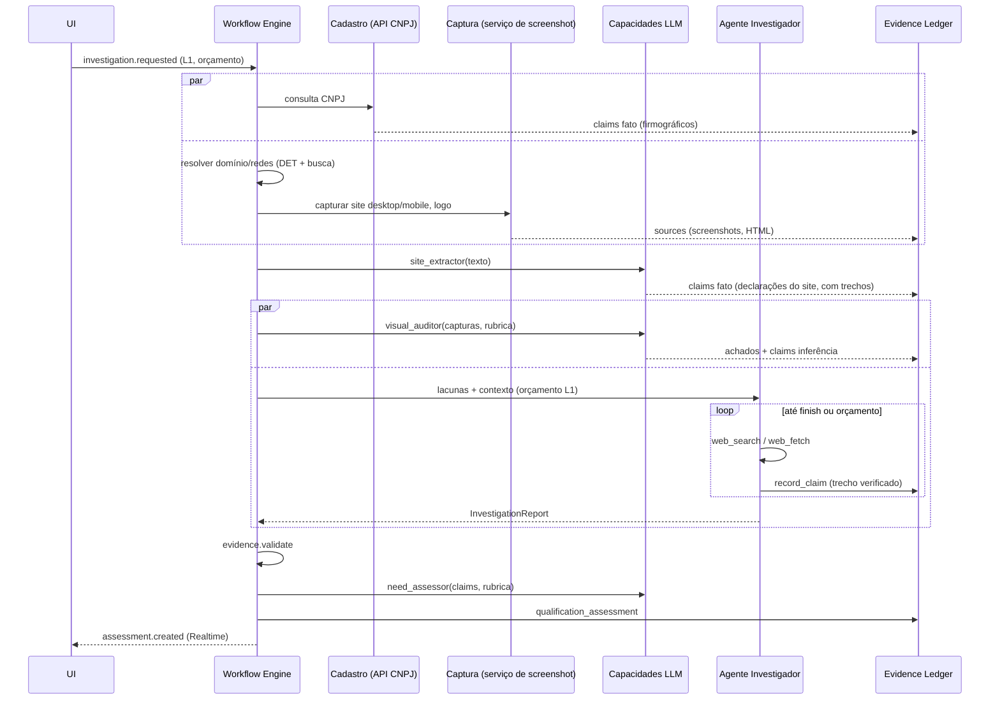
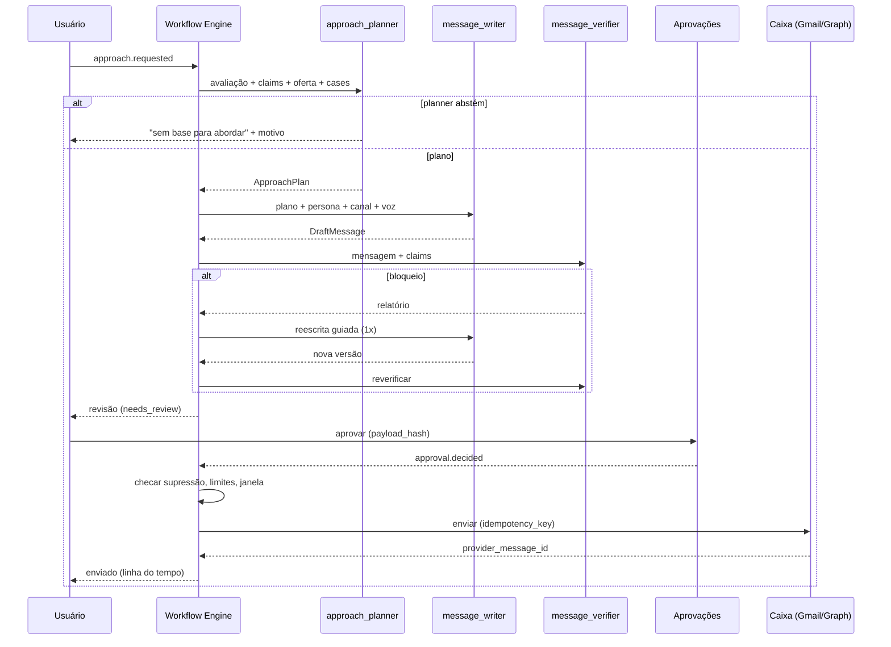

# Fluxos de usuário, fluxos de agentes e UX

> Versão 0.1 · 2026-11-09

## 1. Princípios de experiência

1. **Copiloto no centro, estrutura ao lado.** Linguagem natural para pedir e explorar; telas estruturadas para comparar, editar, revisar e aprovar. Toda resposta do Copiloto leva a uma tela estruturada ("abrir no dossiê") e toda tela tem o Copiloto contextual (`⌘K` / painel lateral).
2. **Toda conclusão tem um "por quê".** Scores, recomendações, achados e frases de mensagens mostram os claims de suporte: tipo (Fato · Inferência · Hipótese), confiança, fonte e data, com acesso ao snapshot.
3. **Fila de decisões, não de dados.** A tela inicial organiza o trabalho do dia em decisões: aprovar, revisar, decidir abordar/descartar, responder.
4. **Progressivo e assíncrono.** Investigações rodam em segundo plano com progresso em tempo real; resultados parciais aparecem assim que existem.
5. **Custo visível.** Ações que gastam mostram estimativa antes e custo real depois.
6. **Editorial, minimalista, premium.** O produto é usado por uma agência de branding: a interface é parte do argumento.

## 2. Arquitetura de informação

```
Início (Hoje)
Copiloto (tela cheia + painel contextual em todas as telas)
Descoberta
  ├─ Nova busca (ICP / linguagem natural / importar lista)
  └─ Execuções → Candidatos (triagem)
Empresas
  └─ Empresa (dossiê)
       Resumo · Evidências · Marca · Concorrência · Sinais · Pessoas · Qualificação · Abordagem · Linha do tempo
Abordagens
  ├─ Planos
  └─ Revisão de mensagens
Aprovações
Conversas (inbox classificada)
Pipeline (oportunidades · reuniões · propostas)
Monitoramento (watchlist · mudanças)
Inteligência (funil · custos · aprendizados · calibração)
Configuração
  Ofertas · Rubricas · ICP · Voz da agência · Cases · Integrações · Equipe
  Conformidade (LIA · supressão · solicitações de titulares · retenção)
  Uso e orçamento · Agentes (modelos, versões de prompt, avaliações)
```

## 3. Fluxos de usuário

### 3.1 Onboarding e configuração estratégica
1. Criar organização → convidar equipe → definir papéis.
2. Cadastrar oferta "Branding e identidade visual": descrição, problemas, sinais, desqualificadores, entregáveis, faixa de investimento.
3. Revisar rubrica de auditoria visual sugerida (modelo padrão editável).
4. Definir ICP inicial: segmentos (CNAE), regiões, porte, exclusões. Opcional: importar clientes atuais (CSV) → sistema sugere ICP com justificativa.
5. Voz da agência (exemplos de mensagens boas e ruins) e cases autorizados.
6. Conformidade: registrar avaliação de legítimo interesse (modelo guiado), texto de opt-out, política de retenção.
7. Integrações: caixa de e-mail (OAuth), chaves de provedores de dados.
8. Orçamento mensal e limiares de aprovação.

**Aceite:** sem oferta ativa, rubrica e LIA aprovada, o sistema não permite gerar abordagens (mostra o que falta).

### 3.2 Descoberta
1. Usuário escolhe ICP ou escreve: "clínicas odontológicas em Curitiba com presença digital fraca".
2. Copiloto converte em filtros explícitos e mostra **plano + estimativa** (fontes, volume esperado, custo).
3. Execução: candidatos aparecem em tabela com origem, dados básicos, `fit_hint` e motivo; duplicatas já agrupadas.
4. Triagem: selecionar → "Investigar (L1)", "Descartar (motivo)", "Monitorar".
5. Lote de investigação mostra progresso por empresa.

### 3.3 Investigação → dossiê
O dossiê é a tela central do produto.

| Aba | Conteúdo |
|---|---|
| **Resumo** | recomendação com motivos, prioridade, lacunas, custo gasto, próximos passos |
| **Evidências** | todos os claims filtráveis por domínio/tipo/confiança/status; ações: confirmar, contestar, corrigir (feedback) |
| **Marca** | capturas lado a lado (desktop/mobile/logo/redes) com achados da rubrica sobrepostos às regiões |
| **Concorrência** | concorrentes com base da relação; comparativo de posicionamento e maturidade visual |
| **Sinais** | linha do tempo de sinais com força atual (decaimento visível) |
| **Pessoas** | decisores, papel, canais, base legal, verificação, supressão |
| **Qualificação** | 7 dimensões (barra + confiança), gates, "o que mudaria a decisão", histórico de avaliações |
| **Abordagem** | plano e mensagens |
| **Linha do tempo** | tudo que aconteceu, por humanos e agentes |

### 3.4 Qualificação e decisão
- Usuário concorda ou discorda da recomendação; discordância exige motivo codificado (vira feedback para calibração).
- `investigate_more` mostra o que falta e o custo para subir de nível.
- `insufficient_evidence` mostra explicitamente: "não há base para abordar esta empresa agora", com as lacunas.

### 3.5 Abordagem → revisão → aprovação → envio
1. "Preparar abordagem" (requer `pursue`/`prepare_access` resolvido).
2. Plano exibido: tese, argumentos (cada um com chips de claims), canal, sequência, riscos. Editar ou aprovar o plano.
3. Mensagens geradas com relatório do verificador: frases sublinhadas ligadas aos claims; bloqueios em vermelho, avisos em âmbar.
4. Edição inline; reverificação automática ao editar.
5. Aprovar → item na fila; envio respeita janela e limites; confirmação na linha do tempo.
6. LinkedIn/telefone: gera **tarefa assistida** (texto pronto para copiar, link do perfil quando houver), marcada como feita pelo usuário.

### 3.6 Conversas
Inbox com classificação (interesse, não agora, objeção, opt-out, fora do escritório). Opt-out: suprimido automaticamente, com banner informando. Respostas positivas → "Criar oportunidade" e rascunho de resposta.

### 3.7 Pipeline
Kanban configurável; cartão mostra origem (descoberta → plano → mensagem), valor, próximo passo. Reunião: briefing gerado do dossiê; pós-reunião: notas → resumo e próximos passos.

### 3.8 Monitoramento e aprendizado
Feed de mudanças significativas com "por que importa"; sinais podem reabrir empresas `monitor`. Inteligência mostra funil, custo por resultado, e propostas de calibração/aprendizado com amostra e backtest para aprovar ou rejeitar.

## 4. Fluxos de agentes (sequências)

### 4.1 Investigação L1



### 4.2 Abordagem e envio



### 4.3 Resposta recebida
`inbox.sync` → regra DET de opt-out ∥ `reply_classifier` → (opt-out → supressão + cancelar pendentes) · (interesse → tarefa + rascunho) · (fora do escritório → reagendar) · (reclamação → escalar).

### 4.4 Copiloto (exemplo)
> "Quais empresas da lista de Curitiba valem uma abordagem esta semana e por quê?"

1. `search_companies` (lista + filtros) → 2. `get_assessments` → 3. resposta com ranking curto, motivos com links para claims, e ações sugeridas ("preparar abordagem para 3 empresas — custo estimado US$ X"). Nenhuma ação é executada sem o usuário pedir; ações externas viram itens de aprovação.

## 5. Linguagem visual (direção inicial)

> A direção final passa por exploração com a equipe de criação da agência. Abaixo, restrições de base para a fundação técnica.

| Elemento | Direção |
|---|---|
| Tipografia | Serifada editorial para títulos e números de destaque; sans grotesca neutra para UI e dados; numerais tabulares em tabelas e scores [DECISÃO: famílias e licenças] |
| Cor | Neutros quentes (papel/grafite) como base; um acento único para ação; cores semânticas apenas para estado (bloqueio, aviso, sucesso) e para o tipo de claim |
| Densidade | Duas densidades: leitura (dossiê, resumo — respiro, colunas de texto ≤ 72 caracteres) e operação (tabelas de triagem, revisão — compactas) |
| Linhas e superfícies | Fios finos e hierarquia por tipografia/espaço em vez de cartões com sombra |
| Movimento | Mínimo e funcional (progresso de investigação, transições de painel) |
| Tema | Claro e escuro desde a fundação (tokens CSS) |
| Componentes | shadcn/ui como base, tematizado via tokens; componentes próprios: `ClaimChip`, `EvidencePopover`, `ConfidenceMeter`, `DimensionBar`, `RecommendationBadge`, `VerifierHighlight`, `CostEstimate`, `DemoBadge` |
| Acessibilidade | WCAG 2.2 AA: contraste, foco visível, navegação por teclado completa nas filas de revisão/aprovação |

### Padrão de explicabilidade (componente-chave)

```
[Inferência · Média 0,68]  Identidade visual inconsistente entre site e Instagram
  ↳ depende de: [Fato · Alta] Logotipo do site ≠ logotipo do perfil (captura 08/11/2026)
                 [Fato · Alta] Paleta do site: #1E3A5F/#F2C14E; Instagram: #8E2A6B/#FFFFFF
  Fontes: site.com.br (08/11) · instagram.com/… (captura autorizada, 08/11)
  [Confirmar] [Contestar] [Ver snapshot]
```

## 6. Responsividade

- Desktop: layouts de duas/três colunas (lista · detalhe · Copiloto).
- Tablet/mobile: navegação inferior com Início, Aprovações, Conversas, Copiloto; dossiê em abas empilhadas; aprovação de mensagem com evidências em painel expansível.
- Tabelas de triagem viram listas com ações por gesto/menus em telas estreitas.
