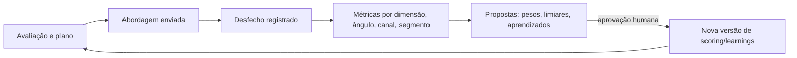

# Metodologia comercial: evidência, qualificação e abordagem

> Versão 0.1 · 2026-11-09
> Este documento define **como o sistema pensa**. É a especificação que os prompts, o motor de score e o verificador implementam. Mudanças aqui exigem atualização de avaliações ([11-qualidade-e-testes.md](11-qualidade-e-testes.md)).

## 1. Princípio

O sistema não é premiado por gerar mais leads, e sim por **acertar onde há oportunidade e dizer a verdade sobre ela**. Três consequências:

1. Tudo que se afirma sobre um prospect é rastreável (claim → fonte → data).
2. Força do argumento e confiança no dado são medidas separadas.
3. "Não abordar" e "não sabemos o suficiente" são saídas de primeira classe.

## 2. Modelo epistemológico (Evidence Ledger)

### 2.1 Tipos de claim

| Tipo | Definição | Exemplo | Requisitos |
|---|---|---|---|
| **Fato** (`fact`) | Observação direta e verificável de uma fonte, na data da coleta. | "O site exibe logotipo diferente do perfil do Instagram (capturas de 2026-11-08)." / "CNAE principal 8630-5/04 segundo a base CNPJ." | ≥ 1 evidência com fonte, `captured_at` e trecho/região. Afirma o que a fonte diz, não a verdade do mundo. |
| **Inferência** (`inference`) | Conclusão derivada de fatos por raciocínio explícito. | "A identidade visual é inconsistente entre canais." | `depends_on` ≥ 1 fato; raciocínio registrado; confiança ≤ 0,9. |
| **Hipótese** (`hypothesis`) | Suposição plausível ainda não sustentada, útil para orientar investigação ou pergunta. | "A empresa pode estar preparando expansão regional." | Marcada como a verificar; **não pode** ser usada como afirmação em mensagem. |

### 2.2 Confiança

Confiança (0–1) é calculada, não "sentida" pelo modelo:

```
confiança_fato = confiabilidade_da_fonte × atualidade × concordância
```

| Componente | Regra inicial (calibrável) |
|---|---|
| Confiabilidade da fonte | registro oficial 0,95 · site da própria empresa 0,85 (para o que ela declara) · imprensa reconhecida 0,8 · agregador/diretório 0,6 · fonte desconhecida 0,4 |
| Atualidade | 1,0 se dentro da validade do tipo de dado; decai linearmente até 0,5 no dobro da validade; depois `stale` |
| Concordância | +0,05 por fonte independente concordante (máx. 1,0); fonte conflitante → claim `disputed` e confiança limitada a 0,5 |

Inferências: `min(confiança dos fatos de base) × fator do raciocínio` (fator proposto pelo modelo, limitado a [0,5; 0,9] e auditado em avaliação). Rótulos na UI: **Alta** ≥ 0,8 · **Média** 0,6–0,8 · **Baixa** < 0,6.

### 2.3 Validade

Cada `key` de claim tem prazo de validade (ex.: dados cadastrais 90 dias, conteúdo de site 30 dias, sinais conforme tipo, auditoria visual 180 dias). Claims vencidos ficam `stale`, não são usados em mensagens e entram na fila de revalidação se a empresa estiver ativa.

### 2.4 Validação de evidências (passo `evidence.validate`)

DET:
- trecho citado existe no conteúdo armazenado da fonte (normalização de espaços/acentos);
- URL da fonte responde ou há snapshot armazenado;
- datas coerentes (`occurred_at ≤ captured_at`);
- inferências têm dependências ativas.

LLM (juiz):
- o trecho realmente sustenta a afirmação (sim / parcial / não);
- detecção de contradição entre claims da mesma `key`.

Resultado: claims rebaixados (`rejected`/`disputed`) com motivo visível.

### 2.5 Regras implementadas e valores decididos (F3a)

Código: regras puras em `packages/domain/src/evidence`; contratos em `packages/contracts/src/evidence.ts`. Os itens da tabela abaixo não estavam fixados nas seções acima: foram propostos na F3a (2026-11-09) e **decididos em 2026-11-10, por delegação do usuário** ([10 D-EVID-1](10-riscos-custos-decisoes.md)). Valem até a calibração com desfechos (§3.5).

**Como o código lê §2.2 e §2.3**

- Concordância é **aditiva**: `confiança_fato = min(1; confiabilidade × atualidade da melhor fonte + 0,05 × origens independentes que concordam)`. A melhor fonte é a de maior confiabilidade × atualidade entre as que sustentam e ainda não venceram; só se todas venceram, entre todas.
- Atualidade: 1,0 até a validade; cai em linha reta até 0,5 no dobro da validade; depois do dobro o claim fica `stale`. `valid_until` = coleta mais recente que sustenta + 2 × validade.
- Fonte não vencida que contradiz → `disputed`, confiança limitada a 0,5. Fonte vencida não contesta nem soma concordância. Se nenhuma fonte de apoio está dentro do dobro da validade, `stale` prevalece sobre `disputed`.
- Inferência: `min(confiança das dependências) × fator`, com o fator limitado a [0,5; 0,9] (sem fator proposto, 0,5) e teto de 0,9. Herda o estado das dependências: alguma vencida, rejeitada ou substituída → `stale`; senão alguma contestada → `disputed` (teto 0,5). `valid_until` = o menor das dependências.
- **Estado efetivo** (`effectiveStatus`): um claim gravado como `active` ou `disputed` cuja `valid_until` já passou conta como `stale` na leitura, mesmo antes de o banco ser atualizado. Vale para as dependências de inferências e hipóteses (no cálculo e na validação) e para o uso em afirmações.
- **Recálculo** (`resolveStatus`): `rejected` (verificação ou revisão) e `superseded` (nova versão) não mudam ao recalcular; nos demais vale o estado calculado. Por isso a contradição achada pelo juiz (§2.4) entra no ledger como evidência que contradiz, e não como estado solto.
- A confiança é gravada com 2 casas, **truncada para baixo**: o valor gravado nunca muda de faixa por arredondamento (0,799 → 0,79, Média).
- A confiança vale para o momento do cálculo; como a atualidade decai, ela precisa ser recalculada com o tempo (KI-071).
- Constantes do contrato (mudam só com nova versão do contrato): teto da inferência 0,9, faixa do fator [0,5; 0,9] e faixas da UI (0,6 e 0,8). Calibráveis em `EvidencePolicy`: confiabilidades, validades, bônus de concordância, teto de contestação e categorias que não somam concordância.

**Valores decididos**

| Item | Valor | Motivo |
|---|---|---|
| Confiabilidade de anotação do usuário (`user_reported`) | 0,7 | observação de quem usa o app, mas de segunda mão; fica em Média |
| Categoria de cada fonte | anotação do usuário → `user_reported`; registro de API de provedor oficial → `official_registry`, de outro provedor → `aggregator`; demais pelo endereço: domínio ou perfil do **sujeito do claim** → `company_owned`, lista de imprensa → `recognized_press`, lista de agregadores → `aggregator`, senão `unknown`; resultado de busca nunca passa de `aggregator`. Domínios comparados em minúsculas e punycode, sem `www.`, `m.`, `mobile.` nem ponto final | o tipo sozinho não diz se uma página é da empresa ou da imprensa; a categoria é decidida pelo sistema, nunca pelo modelo |
| Onde a categoria fica | na evidência (`claim_evidence.reliability_tier`), não na fonte | o site da empresa A é `company_owned` num claim sobre A e fonte de terceiro num claim sobre B |
| Validade por domínio, em dias | `firmographic` 90 · `digital_presence` 30 · `visual` 180 (os três de §2.3) · `positioning` 90 · `signal` 30 · `contact` 90 · `competitive` 180 · `financial_proxy` 180. Uma `key` do catálogo pode ter validade própria (ex.: cada tipo de sinal) | "conteúdo de site 30 dias" (§2.3) foi lido como `digital_presence` (o site existe, o que ele mostra); o que o site diz sobre posicionamento é `positioning`, 90 dias |
| Fonte independente | tudo o que a própria empresa publica (site, subdomínios, perfis) é **uma origem só**; registro de API pelo provedor; o resto pelo domínio normalizado (páginas do mesmo site e perfis da mesma rede social contam uma vez) | mesmo autor não confirma a si mesmo; conservador. Ainda não detecta cópia entre domínios diferentes (KI-074) |
| Fonte desconhecida (`unknown`) | pode ser a base e pode contestar, mas não soma concordância | citar muitos sites fracos não pode levar um claim a Média; contestar com fonte fraca só pede revisão (assimetria registrada em KI-072) |
| Evidência | trecho literal ou região da fonte; captura de tela exige a região (`locator.bbox`), os demais tipos exigem o trecho; cada fonte uma vez por claim (chave `claim_id, source_id`) | §2.1 pede "trecho/região"; fonte repetida inflaria a contagem |
| Data de coleta | `captured_at` é lido da fonte já gravada no ledger, nunca do que o modelo informou; coleta no futuro é recusada | a atualidade depende dela |
| Fonte já vencida ao registrar | o claim é aceito e nasce `stale` | registra o que foi visto sem permitir uso em afirmação |
| Hipótese | sem confiança calculada (`confidence` nulo, rótulo **A verificar**); exige raciocínio (o que a torna plausível e o que verificar); aceita evidências e dependências ativas; vence pela validade do domínio contada da evidência de apoio mais recente ou do registro | §2.1 diz "marcada como a verificar"; um número daria a ela peso de fato |
| Fato | não tem dependências | fato é observação direta de uma fonte |
| Inferência | não cita fontes diretamente (o trecho vira um fato e a inferência depende dele); pode depender também de inferências, nunca de hipóteses; todas as dependências ativas no estado efetivo | impede transformar hipótese em inferência |
| Uso em afirmações | só fato ou inferência ativo no estado efetivo, com confiança ≥ 0,6 recalculada perto do momento do uso (`canSupportAssertion`) | §4.3 e §5.3 |

Erros das regras: `ClaimIssueCode` (código, campo e mensagem em pt-BR). Ainda não implementado (F3/F5): conferência do trecho no conteúdo armazenado (`quote_verified` existe no contrato, mas ainda não entra no cálculo), `occurred_at ≤ captured_at`, URL que responde ou snapshot, contradição entre claims da mesma `key`, motivo visível do rebaixamento e recálculo periódico (KI-071 a KI-074).

## 3. Qualificação multidimensional

### 3.1 Dimensões

| Dimensão | Pergunta | Fontes de evidência | Cálculo |
|---|---|---|---|
| **Adequação (Fit)** | A empresa é do perfil que a oferta atende? | CNAE, porte, região, modelo de negócio, público | DET contra filtros e pesos do ICP |
| **Necessidade (Need)** | Há problema de marca observável que a oferta resolve? | auditoria visual, posicionamento, comparação competitiva, avaliações | LLM (`need_assessor`) restrito aos claims + rubrica; cada ponto cita `claim_ids` |
| **Sinais (Signal)** | Algo mudou que torna o tema relevante agora? | catálogo de sinais | DET: soma ponderada com decaimento |
| **Capacidade (Capacity)** | Consegue contratar no nível de investimento da oferta? | porte, capital social, nº de unidades, presença de mídia paga, posicionamento de preço | DET com proxies; baixa confiança por natureza |
| **Timing** | É o momento? | recência de sinais, rebranding recente (negativo), sazonalidade do segmento | DET |
| **Acesso (Access)** | Sabemos quem decide e temos canal permitido? | contatos, canais verificados, base legal, supressão | DET |
| **Confiança (Evidence)** | Quão sustentado está tudo isso? | cobertura e confiança dos claims usados | DET |

### 3.2 Composição

```
potencial = Σ (peso_d × score_d)  para d ∈ {fit, need, signal, capacity, timing}   (pesos do scoring_model)
prioridade = potencial × fator_confiança × fator_acesso
```

- `fator_confiança` ∈ [0,4; 1,0] a partir da cobertura de evidência (quantas dimensões têm ≥ 1 claim de confiança ≥ média).
- `fator_acesso` ∈ [0,6; 1,0] (sem decisor/canal reduz prioridade, mas não zera: gera `prepare_access`).
- Pesos iniciais propostos para branding (calibrar): fit 0,25 · need 0,30 · signal 0,20 · capacity 0,15 · timing 0,10.

### 3.3 Gates (antes de qualquer score)

Desqualificação imediata com motivo codificado:
- empresa/domínio/contato na supressão;
- fora de região/segmento excluído do ICP;
- situação cadastral inativa;
- cliente atual ou oportunidade aberta;
- concorrente da agência (outra agência de branding/design);
- rebranding concluído há < 18 meses (para oferta de rebranding) — vira `monitor`;
- desqualificadores específicos da oferta.

### 3.4 Recomendação (saída obrigatória)

| Recomendação | Condição (limiares calibráveis) | Ação do sistema |
|---|---|---|
| `pursue` — **Abordar agora** | prioridade ≥ 70, need com ≥ 1 fato/inferência de confiança ≥ média, acesso OK | habilita plano de abordagem |
| `prepare_access` — **Preparar acesso** | potencial ≥ 70, sem decisor ou canal permitido | tarefa de identificar decisor/canal |
| `investigate_more` — **Investigar mais** | potencial promissor, confiança insuficiente | propõe subir de nível (com custo estimado) |
| `monitor` — **Monitorar** | fit bom, sem necessidade ou timing agora | entra em watchlist |
| `discard` — **Descartar** | gate acionado ou potencial < 40 | arquiva com motivo |
| `insufficient_evidence` — **Sem base suficiente** | cobertura de evidência abaixo do mínimo após o nível máximo permitido | explicita o que falta; **não gera abordagem** |

Cada recomendação acompanha: 3–5 motivos (cada um com `claim_ids`), o que mudaria a decisão ("se X, então Y") e o custo já gasto.

### 3.5 Calibração

- Desfechos registrados por empresa abordada: sem resposta, resposta negativa, positiva, reunião, proposta, ganho/perda.
- Mensalmente (D16): taxa de desfecho por faixa de cada dimensão; regressão logística simples quando n ≥ 50 desfechos; backtest dos pesos propostos.
- Saída: **proposta** de novos pesos/limiares com efeito estimado e intervalo; só um owner/admin aplica. Versões antigas permanecem.

## 4. Planejamento de abordagem

### 4.1 Estrutura da tese

```
Observação (fatos) → Implicação para o negócio (inferência) → Como a oferta resolve → Prova (case autorizado) → Próximo passo de baixo atrito
```

Exemplo (fictício, apenas para ilustrar o formato):
> Observação: site e Instagram usam logotipos e paletas diferentes (capturas de 08/11). Implicação: para uma clínica que vende tratamentos de alto valor, inconsistência visual reduz percepção de profissionalismo (inferência, confiança média). Oferta: sistema de identidade unificado. Prova: case autorizado de clínica similar. Próximo passo: enviar diagnóstico visual de 1 página.

### 4.2 Elementos do plano (`approach_plans`)

- **Por que esta empresa** (fit + need) e **por que agora** (sinais/timing) — com claims.
- **Interlocutor-alvo** e papel na decisão; **registro de linguagem** adequado (ver 5.2).
- **Ângulo** principal (ex.: consistência, diferenciação frente a concorrente, preparação para expansão, modernização, valorização de preço).
- **Argumentos** (máx. 3), cada um com `claim_ids` e força.
- **Objeções prováveis** e respostas (do catálogo D13).
- **Canal** permitido e **sequência** (passos, intervalos, condição de parada).
- **Oferta de valor inicial** (diagnóstico, comparativo, conteúdo útil) — preferível a "agendar uma call".
- **Riscos** (ex.: hipótese não confirmada, decisor incerto).

### 4.3 Quando **não** planejar

- Recomendação diferente de `pursue`/`prepare_access` (forçar exige justificativa registrada).
- Necessidade sustentada apenas por hipóteses.
- Contato sem base legal ou canal permitido.
- Claims centrais `stale` ou `disputed`.

## 5. Personalização

### 5.1 Níveis

| Nível | Descrição | Permitido? |
|---|---|---|
| P0 Genérica | Serve para qualquer empresa | Não |
| P1 Firmográfica | Nome, cidade, segmento | Insuficiente sozinha |
| P2 Observacional | Cita algo específico e verdadeiro observado | **Mínimo exigido** |
| P3 Insight | Conecta a observação a uma consequência de negócio relevante para o interlocutor | Meta |

### 5.2 Registro por interlocutor (exemplos)

| Interlocutor | Foco | Registro |
|---|---|---|
| Fundador(a)/sócio(a) de PME | crescimento, reputação, diferenciação local, preço | direto, concreto, sem jargão de branding |
| Diretor(a)/gerente de marketing | consistência, performance, governança de marca, eficiência de produção | técnico-moderado, pode usar termos do ofício |
| C-level de empresa média | expansão, valuation de marca, M&A, posicionamento | executivo, curto, orientado a risco/resultado |

### 5.3 Regras do verificador (bloqueantes)

1. Toda afirmação factual sobre o prospect mapeia para claim `active` com confiança ≥ média.
2. Hipóteses só aparecem como pergunta ou observação condicional ("notei X — faz sentido para vocês?").
3. Proibido: elogio genérico, urgência artificial, familiaridade fingida ("como conversamos"), depreciação do prospect ou de concorrentes nomeados, promessas de resultado não suportadas por case, dados pessoais desnecessários.
4. Identificação clara do remetente e da agência; na primeira mensagem, motivo do contato e origem do dado de contato; mecanismo de opt-out conforme canal (ver [12 §4](12-seguranca-e-conformidade.md)).
5. Tamanho e formato conforme canal (e-mail inicial ≤ 120 palavras; nota de conexão manual ≤ 300 caracteres).
6. Links apenas de domínios da agência ou da própria empresa prospectada.

Não bloqueantes (avisos): legibilidade, repetição com mensagens anteriores ao mesmo contato, tom fora da voz da agência.

## 6. Ciclo de aprendizado



Aprendizados (ex.: "em clínicas, ângulo de consistência teve 2× a taxa de resposta do ângulo de modernização; n = 64") só são usados após aprovação e exibem tamanho de amostra.
