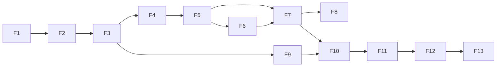

# MVP, roadmap e critérios de aceite

> Versão 0.1 · 2026-11-09
> Implementação em **fatias verticais** pequenas e verificáveis (skill `fatia-vertical`). Cada fatia termina com software utilizável, testes passando e documentação atualizada. Tamanho relativo: P (pequena) · M (média) · G (grande).

## 1. Estratégia de priorização

O valor do produto depende de **dossiês e recomendações confiáveis**. Enviar mensagens antes disso só escala erro. Por isso o MVP tem três marcos, e cada marco é validado com dados reais da agência antes do próximo:

| Marco | Fatias | Pergunta que responde | Validação |
|---|---|---|---|
| **M1 — Dossiê confiável** | F1–F8 | O sistema encontra e explica oportunidades melhor/mais rápido que a pesquisa manual? | 50 empresas reais investigadas; avaliação da equipe ≥ 4/5 em ≥ 70%; concordância de recomendação ≥ 80% |
| **M2 — Abordagem verdadeira** | F9–F10 | As abordagens são específicas, verdadeiras e aprovadas com pouca edição? | 30 planos/mensagens revisados; 0 afirmações sem evidência; taxa de edição estrutural < 20% |
| **M3 — Operação** | F11–F13 | O ciclo completo gera conversas e reuniões com custo conhecido? | 4 semanas de uso; critérios de sucesso do PRD §11 |

Pós-MVP (Fase 2/3) na seção 4.

## 2. Fatias do MVP

### F1 — Fundação técnica (G)
**Objetivo:** base segura e verificável sobre a qual tudo é construído.

> Escopo revisto em 2026-11-09 pelo [ADR-0007](adr/0007-uso-interno-local-sem-login.md): uso interno, só neste computador, **sem login, organizações, convites ou papéis**. A versão multiempresa implementada antes está no commit `a5f6c51` (referência para quando houver publicação).

- Monorepo (ADR-0001), TypeScript strict, lint de fronteiras, Vitest, Playwright, CI.
- Next.js com shell da aplicação (navegação da AI, tema claro/escuro, tokens de design iniciais, `DemoBadge`), servindo só em `127.0.0.1` e recusando `Host` não local.
- Supabase (Postgres) acessado só pelo servidor do app com a secret key; banco fechado para a API pública (RLS sem políticas, nenhum privilégio para `anon`/`authenticated`); `audit_log` append-only com ator e `traceId`.
- Teste de catálogo do banco.
- Esqueleto de `packages/contracts`, `domain`, `application`, `db`.
- Runbook de ambiente local e de segredos.

**Aceite**
1. O app abre em `http://127.0.0.1:3000` sem login, mostra o estado do banco (não configurado, conectado, migrações pendentes, inacessível) e recusa requisições com `Host` externo.
2. Teste automático falha se alguma tabela de `public` estiver sem RLS, tiver política ou der privilégio a `anon`/`authenticated`.
3. A secret key só é lida no servidor (módulo `server-only`), nunca vai ao navegador, e a web não acessa o Supabase fora da raiz de composição (lint).
4. CI executa typecheck, lint, unit, db e e2e smoke com sucesso.
5. `audit_log` grava ator (usuário, agente ou sistema) e `traceId`; `update/delete/truncate` falham; a tela de auditoria lista as entradas.

**Depende de:** projeto Supabase de desenvolvimento ou Docker (D-INFRA-2) para os critérios com banco real; GitHub para o CI (D-INFRA-1); R-OPS-1 (pasta fora do OneDrive).

**Status em 2026-11-09: implementada localmente; NÃO concluída.** Falta executar contra um banco Supabase real e rodar o CI.

| Critério | Situação | Evidência |
|---|---|---|
| 1. App local sem login, estado do banco, recusa de host externo | **Atendido sem banco** | `apps/web/e2e/smoke.spec.ts` (14 testes, incluindo 403 para `Host` externo e acessibilidade axe); `apps/web/src/lib/host.test.ts`. Estado "Conectado" só em `e2e/database.spec.ts`, **nunca executado** (exige banco). |
| 2. Teste de catálogo do banco | **Atendido (PGlite)** | `packages/db/tests/db/catalog.test.ts`, com auto-provas (tabela nova nasce fechada; política ou privilégio concedido é detectado). Nunca executado contra Supabase real (KI-008). |
| 3. Secret key só no servidor; Supabase fora da web | **Atendido** | `scripts/check-boundaries.mjs` (credenciais só em `src/server/env.ts`, sem `NEXT_PUBLIC_*`, sem `@supabase/*` na web) e `eslint.config.mjs`; `pnpm lint` verde. |
| 4. CI verde | **Não atendido** | `.github/workflows/ci.yml` escrito, nunca executado; sem repositório remoto (KI-003, KI-009). Localmente: typecheck, lint, format, unit, db (PGlite) e e2e smoke verdes. |
| 5. `audit_log` com ator e trace, append-only, tela | **Parcial** | Banco: `packages/db/tests/db/audit-log.test.ts` (PGlite). Serviço: `packages/application/tests/audit-service.test.ts`. Adaptador PostgREST: `packages/db/tests/unit/supabase-adapters.test.ts` (respostas simuladas). Tela: só o estado "não configurado" foi visto; lista real nunca executada. Nada na F1 grava no `audit_log` ainda (os produtores chegam com F2+). |

Pendências: `docs/known-issues.md`.

### IA-1 — IA local no Copiloto (P)

> Trilha de IA local ([ADR-0008](adr/0008-ia-local-com-ollama.md)), intercalada às fatias F. Plano completo (IA-1.1 a IA-5) em [13 §7](13-auditoria-e-evolucao.md#7-plano-incremental).

**Objetivo:** comunicação funcional entre o app e um modelo local, com respostas reais no Copiloto.

**Status em 2026-11-09: concluída e verificada** (sem banco; o Copiloto ainda não tem ferramentas nem histórico persistente — KI-032). A integração funciona; a **qualidade** das respostas ainda não passou o limiar: na avaliação local, com corretores corrigidos, o `qwen3.5:4b` fez 69% (limiar 75%). O Copiloto v1 fica como experimental até o prompt v2 da IA-1.1.

| Critério | Situação | Evidência |
|---|---|---|
| 1. Conexão com o Ollama e verificação de disponibilidade | Atendido | `packages/agents/src/ollama/client.ts` (16 testes); painel "IA local"; e2e "Copiloto sem Ollama" |
| 2. Modelo por tarefa com fallback e configuração | Atendido | `model-policy.ts`; variáveis `AI_*` validadas em `apps/web/src/server/env.ts` |
| 3. Endpoint de inferência com streaming | Atendido | `POST /api/copiloto` (NDJSON, contrato `CopilotEvent`); recusas 403/415/400 no e2e |
| 4. Geração real | Atendido | `pnpm ai:live` (5 testes); `E2E_OLLAMA=1 pnpm test:e2e` (resposta real em 7,2 s com métricas) |
| 5. Erros e indisponibilidade | Atendido | `runtime_unavailable`, `model_not_installed`, `busy`, `timeout`, `cancelled` testados (unitários e live) |
| 6. Limites de recursos | Atendido | 1 inferência por vez, fila de 3, `keep_alive` 5 min, descarregar com espera (`gateway.test.ts`) |
| 7. Respostas reais na interface | Atendido | Verificado no navegador em `http://127.0.0.1:3000/copiloto` |

Comandos de 2026-11-09: `pnpm typecheck`, `pnpm lint`, `pnpm test` (154 testes), `pnpm test:db` (13), `pnpm test:e2e` (21 passaram, 3 pulados: banco e Ollama real), `E2E_OLLAMA=1 pnpm test:e2e` (17 passaram, 7 pulados: banco e estados sem Ollama), `pnpm ai:live` (5), `pnpm evals` (resultados e recálculo em [13 §9](13-auditoria-e-evolucao.md#9-testes-e-critérios-de-aceite-da-ia-1)).

### F2 — Estratégia: ofertas, rubrica, ICP, voz (M)
- CRUD versionado de ofertas, rubrica de auditoria (modelo padrão de branding editável), ICP (filtros CNAE/UF/município/porte/idade + exclusões), modelo de score (pesos/limiares), voz da agência, cases com `public_ok`.
- Registro de LIA (modelo guiado) e texto de opt-out.
- **Checklist de prontidão**: o que falta para descobrir/abordar.

**Aceite**
1. O usuário configura oferta + rubrica + ICP + modelo de score; pesos inválidos são rejeitados.
2. Versão usada por qualquer avaliação fica imutável; editar cria nova versão.
3. Sem LIA aprovada e oferta ativa, ações de abordagem ficam bloqueadas com explicação.
4. Seeds de demonstração (se usados) aparecem com selo DEMO.

### F3 — Evidence Ledger + empresas + cadastro (G)
- `sources`, `claims`, `claim_evidence`, `claim_dependencies`, `EvidenceService` com regras e cálculo de confiança.
- `companies`, `company_identifiers`, deduplicação por identificadores fortes.
- Adapter de dados cadastrais (CNPJ) — provedor conforme [05-integracoes.md](05-integracoes.md).
- Adicionar empresa por CNPJ ou domínio; dossiê v0 (abas Resumo e Evidências); componentes `ClaimChip`, `EvidencePopover`, `ConfidenceMeter`.

**Aceite**
1. Adicionar por CNPJ gera claims `fact` firmográficos com fonte, data e confiança calculada.
2. Adicionar a mesma empresa por CNPJ ou domínio já conhecido não cria duplicata.
3. `EvidenceService` rejeita fato sem evidência e inferência sem dependência (testes).
4. Toda informação exibida no dossiê abre a evidência (fonte, data, trecho).
5. Custo da consulta registrado em `provider_usage`.

### F4 — Descoberta + LLM Gateway (G)
- `discovery_runs`/`discovery_candidates`; fontes: base CNPJ por filtros do ICP + importação CSV (+ Places se aprovado em D-DATA-1).
- **LLM Gateway** (ADR-0003): config por capacidade, prompt versionado, cache, `llm_calls` com custo, tratamento de `stop_reason`, redação de PII.
- Capacidade `candidate_triage` (lote) com conjunto de avaliação inicial.
- Tela de execução e triagem (investigar / descartar com motivo / monitorar).

**Aceite**
1. Busca por ICP retorna candidatos com origem e payload original guardados; duplicatas agrupadas.
2. Cada candidato tem `fit_hint` com motivo; avaliação de triagem ≥ limiar definido no doc 11 sobre conjunto real anotado.
3. Estimativa de custo exibida antes de rodar; custo real registrado depois.
4. Nenhuma chamada ao Claude fora do gateway (verificado por lint/teste).

### F5 — Investigação L1 (G)
- Trigger.dev configurado (ADR-0004); workflow `investigate` com passos idempotentes, timeouts e progresso via Realtime.
- Resolução de presença digital, captura de site (desktop/mobile/logo), `site_extractor`.
- Agente **Investigador** (web_search/web_fetch com limites, `record_claim` com verificação de trecho, `finish_investigation`).
- `evidence.validate`; custo e orçamento por investigação.

**Aceite**
1. Investigação L1 de uma empresa real conclui em ≤ 5 min p90 com progresso visível.
2. 100% dos claims gravados têm evidência; trechos inexistentes na fonte são rejeitados (teste com caso real gravado).
3. Reexecutar a investigação não duplica claims nem custos de passos já concluídos.
4. Orçamento excedido interrompe com resultado parcial salvo e aviso.
5. Avaliação do investigador no conjunto inicial: claims sem suporte ≤ 2%.

### F6 — Auditoria visual (M)
- `brand_assets`, extração de paleta, capacidade `visual_auditor` com rubrica da oferta.
- Aba **Marca**: capturas lado a lado com achados sobrepostos às regiões.

**Aceite**
1. Todo achado aponta para pelo menos um asset; achados sem asset são descartados.
2. Empresa sem site recebe auditoria `partial` explícita, nunca nota zero.
3. Concordância com o diretor de criação ≥ 75% (±1 ponto) no conjunto de 30 marcas.

### F7 — Qualificação (M)
- Motor de score no `domain` (dimensões, gates, confiança, acesso), `need_assessor`, recomendação e "o que mudaria a decisão".
- Aba **Qualificação** + feedback (concordo/discordo com motivo).
- Recomendação `insufficient_evidence` e `investigate_more` com custo para subir de nível.

**Aceite**
1. Gates desqualificam antes do score, com motivo codificado (testes unitários de cada gate).
2. Toda recomendação traz 1–5 motivos, cada um com claims.
3. Concordância com decisões humanas ≥ 80% em 40 empresas reais.
4. Necessidade sustentada só por hipóteses nunca resulta em `pursue` (teste).

### F8 — Copiloto v1 (M)
- Thread com streaming; painel contextual (`⌘K`) nas telas; ferramentas de leitura (buscar, dossiê, explicar avaliação, métricas básicas) e de disparo (descoberta, investigação) com estimativa e confirmação.

**Aceite**
1. Respostas sobre dados do tenant vêm de ferramentas e linkam entidades/claims.
2. Operações com custo acima do limiar pedem confirmação.
3. Copiloto só dispara workflows com confirmação explícita do usuário — testes. (Papéis por usuário só se o app deixar de ser individual — ADR-0007.)
4. Avaliação de tarefas do Copiloto (conjunto de 30 pedidos reais) ≥ 80% de sucesso.

**Marco M1 — validação com a agência antes de seguir.**

### F9 — Decisores, canais e conformidade de contato (M)
- `contacts`, `contact_channels` (QSA + página da empresa + inserção manual + provedor se aprovado em D-DATA-3), verificação de e-mail, base legal/origem, `suppression_entries`, solicitações de titulares (registro e atendimento manual assistido).
- Aba **Pessoas**.

**Aceite**
1. Nenhum canal fica contatável sem base legal, origem e verificação.
2. Suprimir e-mail/domínio/CNPJ bloqueia contato em todas as empresas do tenant.
3. Exclusão a pedido do titular remove dados pessoais e mantém o hash de supressão.

### F10 — Planejamento, redação, verificação e aprovação (G)
- `approach_planner`, `message_writer`, `message_verifier`; aba **Abordagem**; tela de revisão com frases ligadas aos claims; fila de **Aprovações** com `payload_hash` e expiração.
- Canal nesta fatia: copiar/exportar e tarefa assistida (sem envio automático).

**Aceite**
1. Planejador se abstém quando a necessidade não está sustentada (teste com casos reais).
2. Verificador bloqueia: afirmação sem claim, hipótese como fato, claim `stale`, ausência de opt-out/identificação (recall ≥ 95% no conjunto com defeitos injetados).
3. Editar mensagem aprovada invalida a aprovação.
4. 30 mensagens reais revisadas com taxa de edição estrutural < 20%.

**Marco M2.**

### F11 — Envio autorizado e conversas (G)
- Conexão OAuth de caixa (provedor conforme D-CHAN-1; escopo mínimo `gmail.send` ou `Mail.Send`), checagem de SPF/DKIM/DMARC do domínio remetente, envio via workflow com espera de aprovação, supressão no envio, limites diários e disjuntores de reputação, idempotência; sync de respostas conforme D-CHAN-2 (app interno no Workspace da agência, `Mail.Read` no Microsoft 365 ou marcação manual); `reply_classifier`; opt-out automático; tarefas assistidas para LinkedIn. Regras em [12 §5](12-seguranca-e-conformidade.md).

**Aceite**
1. Nenhum envio sem aprovação válida (teste de integração e revisão de segurança).
2. Reprocessar o passo de envio não reenvia (teste).
3. Resposta de descadastro → supressão em segundos e cancelamento de pendentes.
4. Limites por caixa e por domínio respeitados; disjuntor pausa a caixa ao ultrapassar o limiar de bounce (teste).
5. Caixa não é liberada sem SPF, DKIM e DMARC válidos no domínio remetente.
6. Checklist de [12 §9](12-seguranca-e-conformidade.md) concluído antes do primeiro envio real.

### F12 — CRM leve e desfechos (M)
- Pipeline configurável, oportunidades com origem, reuniões com briefing gerado, motivos de perda, `outcome_events`, linha do tempo unificada.

**Aceite**
1. Resposta positiva cria oportunidade com atribuição completa (descoberta → plano → mensagem).
2. Briefing de reunião cita claims do dossiê.

### F13 — Custos, orçamento e métricas (M)
- Painel de custos por agente/operação/provedor; orçamentos com alerta e corte; funil básico com tamanhos de amostra.

**Aceite**
1. Custos do painel reconciliam com `llm_calls` + `provider_usage` (teste).
2. Orçamento com corte rígido impede novas execuções pagas e avisa.

**Marco M3 — 4 semanas de operação real; medir critérios do PRD §11.**

## 3. Ordem e paralelismo

F6 e partes de F9 podem correr em paralelo a F7 se houver mais de um desenvolvedor.

Trilha de IA local (doc 13 §7): IA-1 (feita) → IA-1.1 (admissão por VRAM, prompt v2) → IA-2 (histórico e ferramentas de leitura, depende do banco da F1) → IA-3 (fila durável local, antes da F4/F5) → IA-4 (auditoria visual local, junto da F6) → IA-5 (memória semântica, depois da F3). Onde as fatias F citam modelos Claude, vale o modelo local definido pelo ADR-0008 até que uma avaliação justifique outro.

## 4. Pós-MVP

| Fase | Entregas |
|---|---|
| **Fase 2 — Inteligência contínua** | Monitoramento (watchlists, diffs, significância em lote), sinais de notícias/vagas/cadastro, análise competitiva L2, cadências multi-passo, propostas de calibração com backtest, aprendizados aprovados, base de conhecimento com busca semântica (cases), propostas comerciais |
| **Fase 3 — Escala e extensões** | Novas ofertas/serviços e perfis de cliente, servidor MCP do produto, avaliação de Claude Managed Agents para pesquisa agendada, WhatsApp com opt-in (API oficial), integrações com CRMs externos, faturamento multi-tenant |
