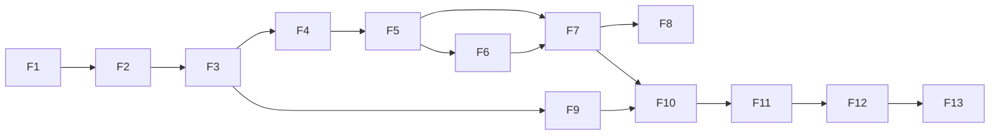

# MVP, roadmap e critérios de aceite

> Versão 0.1 · 2026-11-09
> Implementação em **fatias verticais** pequenas e verificáveis (skill `fatia-vertical`). Cada fatia termina com software utilizável, testes passando e documentação atualizada. Tamanho relativo: P (pequena) · M (média) · G (grande).

## 1. Estratégia de priorização

O valor do produto depende de **dossiês e recomendações confiáveis**. Enviar mensagens antes disso só escala erro. Por isso o MVP tem três marcos, e cada marco é validado com dados reais da agência antes do próximo:

| Marco | Fatias | Pergunta que responde | Validação |
|---|---|---|---|
| **M1 — Dossiê confiável** | F1–F8 | O sistema encontra e explica oportunidades melhor/mais rápido que a pesquisa manual? | 50 empresas reais investigadas; avaliação da equipe ≥ 4/5 em ≥ 70%; concordância de recomendação ≥ 80% |
| **M2 — Abordagem verdadeira** | F9–F10 | As abordagens são específicas, verdadeiras e aprovadas com pouca edição? | 30 planos/mensagens revisados; 0 afirmações sem evidência; taxa de edição estrutural < 20% |
| **M3 — Operação** | F11–F13 | O ciclo completo gera conversas e reuniões com custo conhecido? | 4 semanas de uso; critérios de sucesso do PRD §11 |

Pós-MVP (Fase 2/3) na seção 4.

## 2. Fatias do MVP

### F1 — Fundação técnica (G)
**Objetivo:** base segura e verificável sobre a qual tudo é construído.

> Escopo revisto em 2026-11-09 pelo [ADR-0007](adr/0007-uso-interno-local-sem-login.md): uso interno, só neste computador, **sem login, organizações, convites ou papéis**. A versão multiempresa implementada antes está no commit `a5f6c51` (referência para quando houver publicação).

- Monorepo (ADR-0001), TypeScript strict, lint de fronteiras, Vitest, Playwright, CI.
- Next.js com shell da aplicação (navegação da AI, tema claro/escuro, tokens de design iniciais, `DemoBadge`), servindo só em `127.0.0.1` e recusando `Host` não local.
- Supabase (Postgres) acessado só pelo servidor do app com a secret key; banco fechado para a API pública (RLS sem políticas, nenhum privilégio para `anon`/`authenticated`); `audit_log` append-only com ator e `traceId`.
- Teste de catálogo do banco.
- Esqueleto de `packages/contracts`, `domain`, `application`, `db`.
- Runbook de ambiente local e de segredos.

**Aceite**
1. O app abre em `http://127.0.0.1:3000` sem login, mostra o estado do banco (não configurado, conectado, migrações pendentes, inacessível) e recusa requisições com `Host` externo.
2. Teste automático falha se alguma tabela de `public` estiver sem RLS, tiver política ou der privilégio a `anon`/`authenticated`.
3. A secret key só é lida no servidor (módulo `server-only`), nunca vai ao navegador, e a web não acessa o Supabase fora da raiz de composição (lint).
4. CI executa typecheck, lint, unit, db e e2e smoke com sucesso.
5. `audit_log` grava ator (usuário, agente ou sistema) e `traceId`; `update/delete/truncate` falham; a tela de auditoria lista as entradas.

**Depende de:** projeto Supabase de desenvolvimento ou Docker (D-INFRA-2) para os critérios com banco real; GitHub para o CI (D-INFRA-1); R-OPS-1 (pasta fora do OneDrive).

**Status em 2026-11-09: banco real configurado e verificado; falta só o CI.** Projeto Supabase de desenvolvimento `prospector-dev` (gratuito, `sa-east-1`) com as migrações aplicadas; o Início mostra "Conectado" e `E2E_SUPABASE=1 pnpm test:e2e` passa (28 passaram, 3 pulados). O CI continua sem rodar (KI-009).

| Critério | Situação | Evidência |
|---|---|---|
| 1. App local sem login, estado do banco, recusa de host externo | **Atendido** | `apps/web/e2e/smoke.spec.ts` (14 testes, incluindo 403 para `Host` externo e acessibilidade axe); `apps/web/src/lib/host.test.ts`. Estado "Conectado": `e2e/database.spec.ts`, executado contra o Supabase real em 2026-11-09. |
| 2. Teste de catálogo do banco | **Atendido** | `packages/db/tests/db/catalog.test.ts`, com auto-provas (tabela nova nasce fechada; política ou privilégio concedido é detectado). No Supabase real, conferido por consulta em 2026-11-09 (11 tabelas com RLS, 0 políticas, 0 privilégios para `anon`/`authenticated`); o teste automatizado roda em PGlite porque o modo real cria e apaga tabelas (KI-008). |
| 3. Secret key só no servidor; Supabase fora da web | **Atendido** | `scripts/check-boundaries.mjs` (credenciais só em `src/server/env.ts`, sem `NEXT_PUBLIC_*`, sem `@supabase/*` na web) e `eslint.config.mjs`; `pnpm lint` verde. |
| 4. CI verde | **Não atendido** | `.github/workflows/ci.yml` escrito, nunca executado; sem repositório remoto (KI-003, KI-009). Localmente: typecheck, lint, format, unit, db (PGlite) e e2e smoke verdes. |
| 5. `audit_log` com ator e trace, append-only, tela | **Parcial** | Banco: `packages/db/tests/db/audit-log.test.ts` (PGlite). Serviço: `packages/application/tests/audit-service.test.ts`. Adaptador PostgREST: `packages/db/tests/unit/supabase-adapters.test.ts` (respostas simuladas). Tela: lida do banco real em 2026-11-09, ainda sem registros. Nada na F1 grava no `audit_log` ainda (os produtores chegam com F2+). |

Pendências: `docs/known-issues.md`.

### IA-1 — IA local no Copiloto (P)

> Trilha de IA local ([ADR-0008](adr/0008-ia-local-com-ollama.md)), intercalada às fatias F. Plano completo (IA-1.1 a IA-5) em [13 §7](13-auditoria-e-evolucao.md#7-plano-incremental).

**Objetivo:** comunicação funcional entre o app e um modelo local, com respostas reais no Copiloto.

**Status em 2026-11-09: concluída e verificada** (sem banco; o Copiloto ainda não tem ferramentas nem histórico persistente — KI-032). A integração funciona; a **qualidade** das respostas ainda não passou o limiar: na avaliação local, com corretores corrigidos, o `qwen3.5:4b` fez 69% (limiar 75%). O Copiloto v1 fica como experimental até o prompt v2 da IA-1.1 (resultado: o v2 não passou; ver IA-1.1 abaixo).

| Critério | Situação | Evidência |
|---|---|---|
| 1. Conexão com o Ollama e verificação de disponibilidade | Atendido | `packages/agents/src/ollama/client.ts` (16 testes); painel "IA local"; e2e "Copiloto sem Ollama" |
| 2. Modelo por tarefa com fallback e configuração | Atendido | `model-policy.ts`; variáveis `AI_*` validadas em `apps/web/src/server/env.ts` |
| 3. Endpoint de inferência com streaming | Atendido | `POST /api/copiloto` (NDJSON, contrato `CopilotEvent`); recusas 403/415/400 no e2e |
| 4. Geração real | Atendido | `pnpm ai:live` (5 testes); `E2E_OLLAMA=1 pnpm test:e2e` (resposta real em 7,2 s com métricas) |
| 5. Erros e indisponibilidade | Atendido | `runtime_unavailable`, `model_not_installed`, `busy`, `timeout`, `cancelled` testados (unitários e live) |
| 6. Limites de recursos | Atendido | 1 inferência por vez, fila de 3, `keep_alive` 5 min, descarregar com espera (`gateway.test.ts`) |
| 7. Respostas reais na interface | Atendido | Verificado no navegador em `http://127.0.0.1:3000/copiloto` |

Comandos de 2026-11-09: `pnpm typecheck`, `pnpm lint`, `pnpm test` (154 testes), `pnpm test:db` (13), `pnpm test:e2e` (21 passaram, 3 pulados: banco e Ollama real), `E2E_OLLAMA=1 pnpm test:e2e` (17 passaram, 7 pulados: banco e estados sem Ollama), `pnpm ai:live` (5), `pnpm evals` (resultados e recálculo em [13 §9](13-auditoria-e-evolucao.md#9-testes-e-critérios-de-aceite-da-ia-1)).

### IA-1.1 — Admissão por VRAM, capacidades e prompt v2 (P)

**Status em 2026-11-09: concluída, com o prompt v2 não promovido.** O gerenciador de modelos ganhou estas proteções:

- admissão por VRAM, com reserva de 3 GB para os outros programas;
- escolha do modelo pelas capacidades que o Ollama informa;
- corte do histórico no servidor;
- fila com posição atualizada;
- configuração inválida sem erro 500;
- `Origin` obrigatório na rota do Copiloto.

O `copilot/v2` foi avaliado contra o v1 e ficou abaixo dele no `qwen3.5:4b`: 77% contra 82%, com os corretores corrigidos depois da revisão do `avaliador-ia`. Também recusou redigir mensagens e dobrou o p95. O v1 seguiu em uso até a IA-1.2, que promoveu o v3. Detalhes e números em [13 §9](13-auditoria-e-evolucao.md#ia-11-2026-11-09-admissão-por-vram-capacidades-e-prompt-v2).

| Critério | Situação | Evidência |
|---|---|---|
| 1. Carga recusada com reserva de VRAM insuficiente | Atendido | `admission.ts`; testes em `gateway.test.ts` e `capacity.test.ts` |
| 2. Modelo escolhido por capacidade (`/api/show`, com cache) | Atendido | `model-catalog.ts`, `chooseModel`; `model_unsupported` |
| 3. Prompt v2 ≥ v1 na avaliação | **Não atendido** | `evals/copilot/results/2026-11-09-17-30.regraded.json`; v3 na IA-1.2 |
| 4. Pendências da revisão da IA-1 | Atendido | Orçamento de contexto, sha dos prompts, testes da rota, configuração inválida, `Origin`, fila e `GatewayEvent` |

Comandos de 2026-11-09: `pnpm typecheck`, `pnpm lint`, `pnpm format:check`, `pnpm test` (228), `E2E_PORT=3101 pnpm test:e2e` (22 passaram, 3 pulados: banco e Ollama real), `pnpm ai:live` (5), `pnpm evals` (v1 × v2, 156 respostas) e recálculo sem GPU.

### IA-1.2 — Prompt v3 do Copiloto (P)

**Status em 2026-11-10: concluída; v3 promovido com ressalvas; o Copiloto segue experimental.** O `copilot/v3` fez 89% (51/57; IC 79–95%) contra 60% do v1 (34/57; 47–71%) no `qwen3.5:4b`, em 19 casos sintéticos × 3, seis deles fora da amostra (recalculado depois da revisão do `avaliador-ia`). O p95 sem raciocínio caiu de 3,1 s para 2,6 s. Com raciocínio ligado, o p95 subiu 12% (49,5 → 55,7 s, 10 repetições), dentro da tolerância de 15% do doc 11. O `nemotron-3-nano:4b` saiu da reserva automática (KI-034). O raciocínio tem orçamento e não devolve mais resposta vazia (KI-066). A tela do Copiloto recebeu os ajustes do KI-067. Detalhes em [13 §9](13-auditoria-e-evolucao.md#ia-12-2026-11-10-prompt-v3-nemotron-fora-da-reserva-e-raciocínio-com-orçamento).

| Critério | Situação | Evidência |
|---|---|---|
| 1. v3 ≥ v1 sem regredir o p95 | Atendido | `evals/copilot/results/2026-11-10-16-44.regraded.json` e `2026-11-10-16-57.json` |
| 2. Casos fora da amostra (KI-037, KI-063) | Atendido | 6 casos novos em `evals/copilot/cases.ts`, contraexemplos em `eval-graders.test.ts` |
| 3. Raciocínio não esgota o limite (KI-066) | Atendido | `gateway.test.ts`; 0 respostas vazias em 20 com raciocínio |
| 4. Reserva não orienta guardar dados pessoais (KI-034) | Atendido para a reserva; ressalva no padrão | Nemotron fora da lista automática (`model-policy.ts`). O próprio v3 orientou guardar "essas informações" fora do sistema em 1 de 3 respostas (corretor corrigido; fica para o v4, KI-034) |
| 5. Aprovado pelo `avaliador-ia` | Atendido com ressalvas | Revisão de 2026-11-10: "promover com ressalvas"; achados e o que foi feito no [doc 13 §9](13-auditoria-e-evolucao.md#ia-12-2026-11-10-prompt-v3-nemotron-fora-da-reserva-e-raciocínio-com-orçamento) |

Comandos de 2026-11-10: `pnpm typecheck`, `pnpm lint`, `pnpm format:check`, `pnpm test` (653), `pnpm ai:live` (5) e `pnpm evals` (v1 × v3: 114 respostas, recálculo sem GPU e mais 20 respostas com raciocínio). `pnpm test:e2e` rodou na integração (ver doc 13 §11).

### F2 — Estratégia: ofertas, rubrica, ICP, voz (M)
- CRUD versionado de ofertas, rubrica de auditoria (modelo padrão de branding editável), ICP (filtros CNAE/UF/município/porte/idade + exclusões), modelo de score (pesos/limiares), voz da agência, cases com `public_ok`.
- Registro de LIA (modelo guiado) e texto de opt-out.
- **Checklist de prontidão**: o que falta para descobrir/abordar.

**Aceite**
1. O usuário configura oferta + rubrica + ICP + modelo de score; pesos inválidos são rejeitados.
2. Versão usada por qualquer avaliação fica imutável; editar cria nova versão.
3. Sem LIA aprovada e oferta ativa, ações de abordagem ficam bloqueadas com explicação.
4. Seeds de demonstração (se usados) aparecem com selo DEMO.

**Status em 2026-11-10: concluída e verificada no banco real; falta só o CI (KI-009), como no resto da F1.** A gravação pelo app no Supabase real foi feita e conferida (KI-042), com a auditoria na mesma transação da escrita (KI-041). Os padrões de rubrica, score, LIA e opt-out viraram decisão registrada, por delegação do usuário ([10 D-PROD-2](10-riscos-custos-decisoes.md)). Decisões técnicas: [ADR-0009](adr/0009-versionamento-imutavel-da-estrategia.md).

Estratégia montada no `prospector-dev` em 2026-11-10 (pelo agente, pelo app, com autorização do usuário) e completada no mesmo dia, depois que o usuário aprovou os textos propostos e pediu para preencher o resto:

| Item | Situação |
|---|---|
| Ofertas | Identidade visual, Rebranding e Site institucional, cada uma com a rubrica e o score padrão, **ativas** (v2). Faixas de investimento estimadas pelo agente: R$ 6.000–25.000, R$ 20.000–80.000 e R$ 8.000–30.000 ([10 D-PROD-2](10-riscos-custos-decisoes.md)) |
| ICPs | Um por oferta, todos **ativos**. "Brasil todo" = as 27 UFs (a ativação exige ao menos um CNAE, UF ou município). Portes e idade mínima: ME+EPP; EPP+demais com 5+ anos; todos com 1+ ano. CNAEs escolhidos pelo agente (v2): 20, 18 e 18 subclasses de saúde, beleza, alimentação, varejo, serviços profissionais, educação, imóveis, hotelaria, tecnologia e indústria de bens de consumo |
| Voz da agência | v1 salva, baseada nas regras de mensagem de [08 §5](08-metodologia-comercial.md) |
| LIA | v2 salva em **rascunho**, com a conclusão que registra a aprovação do usuário e mantém o parecer jurídico antes do primeiro envio (KI-051). **Falta o clique do usuário**: marcar "Revisei a LIA v2 e assumo esta avaliação" e aprovar, com revisão em 10/11/2027 (a confirmação é declaração dele; o agente não a marca) |
| Opt-out e canal do titular | v1 salva: agência Found Studio, canal do titular por e-mail informado pelo usuário, texto de opt-out padrão |

Prontidão no banco real: a descoberta está **liberada**. A abordagem só espera a LIA aprovada; case citável é recomendado e não foi criado (exige um case real com autorização do cliente).

| Critério | Situação | Evidência |
|---|---|---|
| 1. Oferta + rubrica + ICP + score; pesos inválidos rejeitados | **Atendido (memória, PGlite e Supabase real)** | Domínio: `packages/domain/tests/strategy/rules.test.ts`. Contratos: `packages/contracts/tests/strategy.test.ts`. Banco: checks de soma 100 e de formatos em `packages/db/tests/db/strategy.test.ts`. E2E: `apps/web/e2e/strategy.spec.ts` (rubrica e score com soma 105 recusados; oferta, ICP e ativação). Tela vista em `http://127.0.0.1:3000` com `PROSPECTOR_STORAGE=memory pnpm dev`: "Os pesos somam 105; precisam somar exatamente 100." |
| 2. Versão usada fica imutável; editar cria nova versão | **Atendido (PGlite e memória)** | Toda versão é imutável, usada ou não (ADR-0009): `packages/db/tests/db/strategy.test.ts` (update/delete/truncate recusados para dono e `service_role`; número e data da versão atribuídos pelo banco em oferta, score, ICP, voz e política de contato; cabeçalho nasce rascunho). Ida e volta das colunas: `packages/db/tests/unit/strategy-rows.test.ts`. Serviço: `packages/application/tests/strategy-service.test.ts` (editar cria v2; salvar sem mudança não cria versão em oferta, rubrica, score, voz e opt-out). As barreiras devolvem os ids das versões em vigor para F4/F7/F10 gravarem (ADR-0009 §7). E2E: editar a oferta gera v2 e mantém v1 no histórico. Supabase real (2026-11-10): as versões gravadas pelo app levam o número dado pelo banco, e cada gravação tem um registro de auditoria. |
| 3. Sem LIA aprovada e oferta ativa, abordagem bloqueada com explicação | **Atendido para a barreira** | `StrategyService.assertReadyToApproach({ offerId, icpId })` confere a oferta e o ICP da ação (`readiness.test.ts`, `strategy-service.test.ts`: bloqueado sem LIA, com oferta em rascunho, arquivada ou de outra oferta, com ICP pausado, sem voz ou opt-out; liberado com tudo; bloqueado de novo ao vencer, no fuso de São Paulo, ou revogar; renovação depois da revogação). Banco: só a versão mais recente pode ser aprovada, datas e instantes do banco (`strategy.test.ts`). Tela `/abordagens` mostra o que falta, com link para resolver. E2E: bloqueado → LIA aprovada (só falta o banco persistente, porque o modo memória nunca libera) → revogada → renovada como v2 → oferta volta a rascunho e bloqueia descoberta e abordagem. A liberação completa (`ready = true`) só foi verificada nos testes de domínio e serviço. As ações de abordagem só existem na F10, que deve chamar a barreira antes de agir (KI-047). |
| 4. Seeds de demonstração com selo DEMO | **Atendido (sem seeds)** | Não há seed na UI (ADR-0009). Ofertas, ICPs e cases com `is_demo` mostram `DemoBadge` nas listas e no detalhe, e " (demo)" nos seletores; demo não conta na prontidão (`readiness.test.ts`, `strategy-service.test.ts`). O seed vive só nos testes (`packages/application/tests/support/demo-seed.ts`). O selo não foi visto na tela nem tem teste de componente, porque nenhum dado demo é criado. |

Verificação local (2026-11-09): `pnpm typecheck`, `pnpm lint`, `pnpm format:check`, `pnpm test` (contratos 46, domínio 59, aplicação 36, web 38, db 39), `pnpm test:db` (37, PGlite) e `pnpm test:e2e` (20 passaram; 2 pulados por exigirem banco real) verdes. Pendências: `docs/known-issues.md` (KI-041 a KI-051).

### F3 — Evidence Ledger + empresas + cadastro (G)
- `sources`, `claims`, `claim_evidence`, `claim_dependencies`, `EvidenceService` com regras e cálculo de confiança.
- `companies`, `company_identifiers`, deduplicação por identificadores fortes.
- Adapter de dados cadastrais (CNPJ) — provedor conforme [05-integracoes.md](05-integracoes.md).
- Adicionar empresa por CNPJ ou domínio; dossiê v0 (abas Resumo e Evidências); componentes `ClaimChip`, `EvidencePopover`, `ConfidenceMeter`.

**Aceite**
1. Adicionar por CNPJ gera claims `fact` firmográficos com fonte, data e confiança calculada.
2. Adicionar a mesma empresa por CNPJ ou domínio já conhecido não cria duplicata.
3. `EvidenceService` rejeita fato sem evidência e inferência sem dependência (testes).
4. Toda informação exibida no dossiê abre a evidência (fonte, data, trecho).
5. Custo da consulta registrado em `provider_usage`.

**Status em 2026-11-09: regras do ledger prontas (F3a); F3 NÃO concluída.** A F3a adiantou, em paralelo à F2, o que não depende da estratégia: contratos e regras puras do Evidence Ledger, sem banco e sem tela. Valores propostos em [08 §2.5](08-metodologia-comercial.md#25-regras-implementadas-e-valores-decididos-f3a).

- **Pronto:** contratos `packages/contracts/src/evidence.ts` (fonte, claim, entrada de claim, evidência com trecho ou região, dependência, erros codificados) e regras `packages/domain/src/evidence` (validação de fato, inferência e hipótese; classificação de fontes por claim, com o que a própria empresa publica contando como uma origem só; confiança com concordância, conflito e teto de inferência; atualidade, `stale` e estado efetivo com relógio injetado; recálculo que preserva `rejected` e `superseded`; rótulos Alta, Média, Baixa e A verificar). O critério 3 está coberto nas regras puras (testes em `packages/domain/tests/evidence`); falta o `EvidenceService` aplicá-las.
- **Falta (F3, depois de juntar a F2):** migração do ledger, `EvidenceService` em `packages/application`, repositórios em `packages/db`, empresas e deduplicação, adaptador de CNPJ, dossiê v0 e componentes `ClaimChip`, `EvidencePopover` e `ConfidenceMeter`; conferência de trechos e recálculo da confiança com o tempo (KI-071 a KI-073).

| Critério | Situação | Evidência |
|---|---|---|
| 1. CNPJ gera claims `fact` com fonte, data e confiança | **Não atendido** | Regra pronta: registro oficial recém-coletado = 0,95 (`packages/domain/tests/evidence/confidence.test.ts`); falta adaptador e serviço. |
| 2. Sem duplicata por CNPJ ou domínio | **Não atendido** | — |
| 3. Rejeita fato sem evidência e inferência sem dependência | **Parcial** | Só na regra de domínio: `validateClaimInput` (`fact_requires_evidence`, `inference_requires_dependencies`, `inference_requires_fact`…) em `packages/domain/tests/evidence/validation.test.ts`. O `EvidenceService` ainda não existe. |
| 4. Dossiê abre a evidência | **Não atendido** | — |
| 5. Custo em `provider_usage` | **Não atendido** | — |

### F4 — Descoberta + LLM Gateway (G)
- `discovery_runs`/`discovery_candidates`; fontes: base CNPJ por filtros do ICP + importação CSV (+ Places se aprovado em D-DATA-1).
- **LLM Gateway** (ADR-0003): config por capacidade, prompt versionado, cache, `llm_calls` com custo, tratamento de `stop_reason`, redação de PII.
- Capacidade `candidate_triage` (lote) com conjunto de avaliação inicial.
- Tela de execução e triagem (investigar / descartar com motivo / monitorar).

**Aceite**
1. Busca por ICP retorna candidatos com origem e payload original guardados; duplicatas agrupadas.
2. Cada candidato tem `fit_hint` com motivo; avaliação de triagem ≥ limiar definido no doc 11 sobre conjunto real anotado.
3. Estimativa de custo exibida antes de rodar; custo real registrado depois.
4. Nenhuma chamada ao Claude fora do gateway (verificado por lint/teste).

**Estado (2026-11-11, M3 — Módulo 01, ADR-0013):** implementada como pesquisa em linguagem natural pela internet (Tavily, ADR-0012) com a IA local, em vez da base CNPJ por filtros (fora do escopo: precisa de fonte autorizada de dados em massa). Fila durável com trabalhador local (ADR-0011). Migração aplicada no `prospector-dev` em 2026-11-11; primeira pesquisa real feita ("Encontre 15 clínicas de saúde em Ribeirão Preto e região.", profundidade rápida: 1 crédito, 6 empresas reais com fonte, persistidas depois de reiniciar o app; achados no KI-117).
1. **Atendido em memória e PGlite:** cada pesquisa guarda o pedido, a interpretação, o plano e cada busca com os resultados (`discovery_run_queries`); empresas deduplicadas pelo CNPJ do site, pelo domínio ou pelo nome com cidade; a mesma empresa em outra pesquisa é atualizada. Testes: `packages/application/tests/discovery-service.test.ts`, `packages/domain/tests/discovery/`, `packages/db/tests/db/discovery.test.ts`; e2e `apps/web/e2e/discovery.spec.ts` (buscador e IA sintéticos).
2. **Parcial:** cada empresa tem prioridade por regras com motivos e fontes (rubrica `discovery-triage/v1`), e a IA tem avaliação própria (`packages/agents/evals/discovery`: intérprete v1 90 de 90, extrator v2 89 de 90, sem falha de tolerância zero), mas sobre casos SINTÉTICOS, não sobre um conjunto real anotado; o `avaliador-ia` achou falhas que os corretores não medem (setor estreitado e UF inventada pelo intérprete, data de hoje em texto sem data), corrigidas no servidor e registradas nos KI-115 e KI-119.
3. **Atendido:** o gasto máximo aparece antes de rodar (profundidade com o número de buscas, rascunho do Copiloto com o teto) e os créditos de cada busca aparecem depois. Custo da IA local é zero em dinheiro.
4. **Atendido:** a IA da Descoberta passa pelo gateway de `packages/agents` (`pnpm lint` com `check-boundaries`).

### F5 — Investigação L1 (G)
- Trigger.dev configurado (ADR-0004); workflow `investigate` com passos idempotentes, timeouts e progresso via Realtime.
- Resolução de presença digital, captura de site (desktop/mobile/logo), `site_extractor`.
- Agente **Investigador** (web_search/web_fetch com limites, `record_claim` com verificação de trecho, `finish_investigation`).
- `evidence.validate`; custo e orçamento por investigação.

**Aceite**
1. Investigação L1 de uma empresa real conclui em ≤ 5 min p90 com progresso visível.
2. 100% dos claims gravados têm evidência; trechos inexistentes na fonte são rejeitados (teste com caso real gravado).
3. Reexecutar a investigação não duplica claims nem custos de passos já concluídos.
4. Orçamento excedido interrompe com resultado parcial salvo e aviso.
5. Avaliação do investigador no conjunto inicial: claims sem suporte ≤ 2%.

**Status em 2026-11-11: versão local feita no Módulo 02, sem commit; aceite parcial.** Implementada na worktree `claude/empresas-brand-714583` ([ADR-0015](adr/0015-investigacao-de-empresas-e-brand-intelligence.md), registro em [doc 14 §M4](14-execucao-e-conclusao.md)). A migração `20261111150000` não está aplicada no banco do usuário e os prompts das análises são v1, sem avaliação. No lugar do Trigger.dev há uma fila em processo com retomada e cancelamento (ADR-0015 §5), até a migração para `ai_jobs` (ADR-0011, outra frente).

| Critério | Situação | Evidência |
|---|---|---|
| 1. ≤ 5 min p90 com progresso | Parcial | Progresso por etapa na tela; duas empresas reais terminaram em poucos minutos no modo memória; p90 não medido |
| 2. Claims com evidência; trecho inexistente rejeitado | Parcial | Conclusões só pelo `EvidenceService`, com fonte; afirmação da IA sem base ou com referência inventada é descartada (`packages/domain/tests/investigation/qualification.test.ts`); teste com caso real gravado ainda não existe |
| 3. Reexecutar não duplica claims nem custos | Atendido (memória) | Teste "cenário H" em `packages/application/tests/investigation-service.test.ts`: segunda rodada sem crédito nem GPU |
| 4. Orçamento excedido interrompe com parcial | Parcial | Limite de buscas da Tavily (ADR-0012) vira lacuna `search_budget` e a investigação termina "com lacunas"; não há orçamento por investigação em tempo de GPU |
| 5. Avaliação do investigador | Não feito | Sem conjunto de avaliação para as análises (KI-131) |

### F6 — Auditoria visual (M)
- `brand_assets`, extração de paleta, capacidade `visual_auditor` com rubrica da oferta.
- Aba **Marca**: capturas lado a lado com achados sobrepostos às regiões.

**Aceite**
1. Todo achado aponta para pelo menos um asset; achados sem asset são descartados.
2. Empresa sem site recebe auditoria `partial` explícita, nunca nota zero.
3. Concordância com o diretor de criação ≥ 75% (±1 ponto) no conjunto de 30 marcas.

**Status em 2026-11-11: versão local feita no Módulo 02, sem commit; aceite parcial.** Implementada na worktree `claude/empresas-brand-714583` ([ADR-0015](adr/0015-investigacao-de-empresas-e-brand-intelligence.md), registro em [doc 14 §M4](14-execucao-e-conclusao.md)). A migração `20261111150000` não está aplicada no banco do usuário e os prompts das análises são v1, sem avaliação. Capturas em JPEG fora do C: (ADR-0015 §6), sem `brand_assets` nem achados sobrepostos às regiões.

| Critério | Situação | Evidência |
|---|---|---|
| 1. Todo achado aponta para um asset | Parcial | Achados da IA ligados às medições e às capturas da execução; referência inventada é descartada; sem marcação de região na imagem |
| 2. Empresa sem site: `partial` explícita | Atendido | Etapas de site, captura e marca ficam "puladas" com o motivo `no_site` e o próximo passo pede para confirmar o site; nenhuma nota zero |
| 3. Concordância com o diretor de criação | Não feito | Sem conjunto de 30 marcas (KI-131) |

### F7 — Qualificação (M)
- Motor de score no `domain` (dimensões, gates, confiança, acesso), `need_assessor`, recomendação e "o que mudaria a decisão".
- Aba **Qualificação** + feedback (concordo/discordo com motivo).
- Recomendação `insufficient_evidence` e `investigate_more` com custo para subir de nível.

**Aceite**
1. Gates desqualificam antes do score, com motivo codificado (testes unitários de cada gate).
2. Toda recomendação traz 1–5 motivos, cada um com claims.
3. Concordância com decisões humanas ≥ 80% em 40 empresas reais.
4. Necessidade sustentada só por hipóteses nunca resulta em `pursue` (teste).

**Status em 2026-11-11: versão local feita no Módulo 02, sem commit; aceite parcial.** Implementada na worktree `claude/empresas-brand-714583` ([ADR-0015](adr/0015-investigacao-de-empresas-e-brand-intelligence.md), registro em [doc 14 §M4](14-execucao-e-conclusao.md)). A migração `20261111150000` não está aplicada no banco do usuário e os prompts das análises são v1, sem avaliação. Fit, Oportunidade e Confiança separados por oferta ativa, no domínio puro; sem feedback concordo/discordo na tela.

| Critério | Situação | Evidência |
|---|---|---|
| 1. Gates antes do score, com motivo codificado | Atendido | `packages/domain/tests/investigation/qualification.test.ts` (situação inativa, exclusão do ICP, filial, rebranding recente; desqualificador apontado só pela IA pede no máximo "Acompanhar", KI-133) |
| 2. Recomendação com 1–5 motivos ligados a claims | Parcial | Motivos e lacunas em texto do sistema, com a leitura por oferta como claim (`readingClaimId`); Fit 100 com um critério conhecido ainda aparece (KI-132) |
| 3. Concordância com decisões humanas | Não feito | Duas empresas reais avaliadas; sem as 40 |
| 4. Necessidade só por hipóteses nunca é `pursue` | Atendido | "necessidade sem claim que sustente não passa de 30" e "bom Fit sem necessidade observada: acompanhar" |

### F8 — Copiloto v1 (M)
- Thread com streaming; painel contextual (`⌘K`) nas telas; ferramentas de leitura (buscar, dossiê, explicar avaliação, métricas básicas) e de disparo (descoberta, investigação) com estimativa e confirmação.

**Aceite**
1. Respostas sobre dados do tenant vêm de ferramentas e linkam entidades/claims.
2. Operações com custo acima do limiar pedem confirmação.
3. Copiloto só dispara workflows com confirmação explícita do usuário — testes. (Papéis por usuário só se o app deixar de ser individual — ADR-0007.)
4. Avaliação de tarefas do Copiloto (conjunto de 30 pedidos reais) ≥ 80% de sucesso.

**Marco M1 — validação com a agência antes de seguir.**

### F9 — Decisores, canais e conformidade de contato (M)
- `contacts`, `contact_channels` (QSA + página da empresa + inserção manual + provedor se aprovado em D-DATA-3), verificação de e-mail, base legal/origem, `suppression_entries`, solicitações de titulares (registro e atendimento manual assistido).
- Aba **Pessoas**.

**Aceite**
1. Nenhum canal fica contatável sem base legal, origem e verificação.
2. Suprimir e-mail/domínio/CNPJ bloqueia contato em todas as empresas do tenant.
3. Exclusão a pedido do titular remove dados pessoais e mantém o hash de supressão.

### F10 — Planejamento, redação, verificação e aprovação (G)
- `approach_planner`, `message_writer`, `message_verifier`; aba **Abordagem**; tela de revisão com frases ligadas aos claims; fila de **Aprovações** com `payload_hash` e expiração.
- Canal nesta fatia: copiar/exportar e tarefa assistida (sem envio automático).

**Aceite**
1. Planejador se abstém quando a necessidade não está sustentada (teste com casos reais).
2. Verificador bloqueia: afirmação sem claim, hipótese como fato, claim `stale`, ausência de opt-out/identificação (recall ≥ 95% no conjunto com defeitos injetados).
3. Editar mensagem aprovada invalida a aprovação.
4. 30 mensagens reais revisadas com taxa de edição estrutural < 20%.

**Marco M2.**

### Relacionamento (módulo 03, 2026-11-11) — adiantamento de F9, F10 e F12, sem envio

Decisão no [ADR-0014](adr/0014-relacionamento-abordagens-conversas-pipeline.md). O módulo **Relacionamento** junta três abas: Abordagens, Conversas e Pipeline. Tem ainda o detalhe da oportunidade, a fila **Aprovações** e o painel no dossiê. O app não envia nada: aprovar libera o texto para uso, a pessoa envia por fora e registra.

| Critério das fatias | Situação | Evidência |
|---|---|---|
| F9.2 Suprimir CNPJ ou domínio bloqueia o contato | **Atendido para empresa, raiz de CNPJ e domínio** (sem e-mail ou pessoa, porque `contacts` não existe ainda) | `packages/application/tests/relationship-service.test.ts`, `packages/db/tests/db/relationship.test.ts`, e2e "pedido para parar" |
| F9.1 e F9.3 Canal com base legal; exclusão a pedido do titular | **Não começado** (sem pessoas nem canais cadastrados) | — |
| F10 Planejador com base em evidências, fila de Aprovações com `payload_hash` e expiração | **Atendido sem o verificador** | Abordagem cita só claims do dossiê, com base "limitada" e lacunas à mostra; aprovação de 72 horas, para um contato só, ligada ao hash; editar cria uma versão nova e invalida a aprovação (testes do serviço e do banco) |
| F10.1, F10.2 e F10.4 Abstenção, `message_verifier`, 30 mensagens reais | **Pendente** | Sem verificador automático; sem conjunto de avaliação (KI-124) |
| F10.3 Editar mensagem aprovada invalida a aprovação | **Atendido** | Testes do serviço e PGlite (versão nova, aprovação antiga deixa de valer) |
| F11.3 Pedido de descadastro → supressão e cancelamento de pendentes | **Atendido para respostas registradas à mão** (regra e IA; follow-ups cancelados na mesma transação) | Serviço, PGlite e e2e |
| F11 envio, caixas, limites | **Fora** (sem envio pelo app) | — |
| F12 Pipeline e linha do tempo | **Parcial**: etapas fixas (não configuráveis), quadro e lista, histórico de etapas, motivo de perda, linha do tempo da oportunidade; sem `outcome_events` nem briefing de reunião | e2e cenários C a F |

Pendências: migração não aplicada ao `prospector-dev` (KI-120); ferramentas do Copiloto atrás de um `copilot-tools/v4` (KI-121); expurgo do texto recebido (KI-122); conjunto de avaliação dos três prompts antes do uso real (KI-124); origem do contato e pedidos de titular (KI-126); gravação em passos da abordagem (KI-127); ajustes de tela depois do merge com a branch de UI (KI-125, KI-128).

### F11 — Envio autorizado e conversas (G)
- Conexão OAuth de caixa (provedor conforme D-CHAN-1; escopo mínimo `gmail.send` ou `Mail.Send`), checagem de SPF/DKIM/DMARC do domínio remetente, envio via workflow com espera de aprovação, supressão no envio, limites diários e disjuntores de reputação, idempotência; sync de respostas conforme D-CHAN-2 (app interno no Workspace da agência, `Mail.Read` no Microsoft 365 ou marcação manual); `reply_classifier`; opt-out automático; tarefas assistidas para LinkedIn. Regras em [12 §5](12-seguranca-e-conformidade.md).

**Aceite**
1. Nenhum envio sem aprovação válida (teste de integração e revisão de segurança).
2. Reprocessar o passo de envio não reenvia (teste).
3. Resposta de descadastro → supressão em segundos e cancelamento de pendentes.
4. Limites por caixa e por domínio respeitados; disjuntor pausa a caixa ao ultrapassar o limiar de bounce (teste).
5. Caixa não é liberada sem SPF, DKIM e DMARC válidos no domínio remetente.
6. Checklist de [12 §9](12-seguranca-e-conformidade.md) concluído antes do primeiro envio real.

### F12 — CRM leve e desfechos (M)
- Pipeline configurável, oportunidades com origem, reuniões com briefing gerado, motivos de perda, `outcome_events`, linha do tempo unificada.

**Aceite**
1. Resposta positiva cria oportunidade com atribuição completa (descoberta → plano → mensagem).
2. Briefing de reunião cita claims do dossiê.

### F13 — Custos, orçamento e métricas (M)
- Painel de custos por agente/operação/provedor; orçamentos com alerta e corte; funil básico com tamanhos de amostra.

**Aceite**
1. Custos do painel reconciliam com `llm_calls` + `provider_usage` (teste).
2. Orçamento com corte rígido impede novas execuções pagas e avisa.

**Marco M3 — 4 semanas de operação real; medir critérios do PRD §11.**

## 3. Ordem e paralelismo

F6 e partes de F9 podem correr em paralelo a F7 se houver mais de um desenvolvedor.

Trilha de IA local (doc 13 §7): IA-1 (feita) → IA-1.1 (feita: admissão por VRAM; prompt v2 não promovido) → IA-1.2 (feita: prompt v3 promovido) → IA-2 (histórico e ferramentas de leitura, depende do banco da F1) → IA-3 (fila durável local, antes da F4/F5) → IA-4 (auditoria visual local, junto da F6) → IA-5 (memória semântica, depois da F3). Onde as fatias F citam modelos Claude, vale o modelo local definido pelo ADR-0008 até que uma avaliação justifique outro.

## 4. Pós-MVP

| Fase | Entregas |
|---|---|
| **Fase 2 — Inteligência contínua** | Monitoramento (watchlists, diffs, significância em lote), sinais de notícias/vagas/cadastro, análise competitiva L2, cadências multi-passo, propostas de calibração com backtest, aprendizados aprovados, base de conhecimento com busca semântica (cases), propostas comerciais |
| **Fase 3 — Escala e extensões** | Novas ofertas/serviços e perfis de cliente, servidor MCP do produto, avaliação de Claude Managed Agents para pesquisa agendada, WhatsApp com opt-in (API oficial), integrações com CRMs externos, faturamento multi-tenant |
