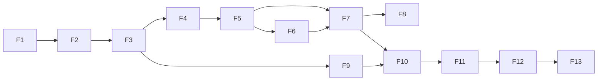

# MVP, roadmap e critérios de aceite

> Versão 0.1 · 2026-11-09
> Implementação em **fatias verticais** pequenas e verificáveis (skill `fatia-vertical`). Cada fatia termina com software utilizável, testes passando e documentação atualizada. Tamanho relativo: P (pequena) · M (média) · G (grande).

## 1. Estratégia de priorização

O valor do produto depende de **dossiês e recomendações confiáveis**. Enviar mensagens antes disso só escala erro. Por isso o MVP tem três marcos, e cada marco é validado com dados reais da agência antes do próximo:

| Marco | Fatias | Pergunta que responde | Validação |
|---|---|---|---|
| **M1 — Dossiê confiável** | F1–F8 | O sistema encontra e explica oportunidades melhor/mais rápido que a pesquisa manual? | 50 empresas reais investigadas; avaliação da equipe ≥ 4/5 em ≥ 70%; concordância de recomendação ≥ 80% |
| **M2 — Abordagem verdadeira** | F9–F10 | As abordagens são específicas, verdadeiras e aprovadas com pouca edição? | 30 planos/mensagens revisados; 0 afirmações sem evidência; taxa de edição estrutural < 20% |
| **M3 — Operação** | F11–F13 | O ciclo completo gera conversas e reuniões com custo conhecido? | 4 semanas de uso; critérios de sucesso do PRD §11 |

Pós-MVP (Fase 2/3) na seção 4.

## 2. Fatias do MVP

### F1 — Fundação técnica (G)
**Objetivo:** base segura e verificável sobre a qual tudo é construído.
- Monorepo (ADR-0001), TypeScript strict, lint de fronteiras, Vitest, Playwright, CI.
- Next.js com shell da aplicação (navegação da AI, tema claro/escuro, tokens de design iniciais, `DemoBadge`).
- Supabase: projeto com chaves novas; Auth (e-mail); `organizations`, `memberships`, `profiles`, `invitations`; `app.is_member`; `audit_log` append-only.
- Teste de catálogo de RLS + testes de isolamento.
- Esqueleto de `packages/contracts`, `domain`, `application`, `db`.
- Runbook de ambiente local e de segredos.

**Aceite**
1. Usuário cria conta, cria organização, convida membro com papel; papéis aplicados nas telas e no banco.
2. Teste automático falha se alguma tabela com `org_id` não tiver RLS.
3. Usuário da org A não acessa nenhum dado da org B (testes passando).
4. CI executa typecheck, lint, unit, db e e2e smoke com sucesso; preview deploy acessível.
5. Ações de convite/mudança de papel registradas em `audit_log`; `update/delete` em `audit_log` falham.

**Depende de:** D-INFRA-1 (contas), D-INFRA-2 (Docker vs projeto dev), R-OPS-1 (pasta fora do OneDrive).

**Status em 2026-11-09: implementada localmente; NÃO concluída.** Faltam infraestrutura e execução contra o Supabase real.

| Critério | Situação | Evidência |
|---|---|---|
| 1. Conta, organização, convite com papel; papéis nas telas e no banco | **Parcial** | Banco: `packages/db/tests/db/tenancy-roles.test.ts` (PGlite). Serviço/domínio: `packages/application/tests`, `packages/domain/tests`. Telas: `apps/web/e2e/tenancy.spec.ts` escrito, **nunca executado** (exige Supabase). Cadastro de ponta a ponta sem teste (KI-026). |
| 2. Teste falha se tabela com `org_id` não tiver RLS | **Atendido (PGlite)** | `packages/db/tests/db/catalog.test.ts`, com auto-prova que cria uma tabela sem RLS. Também barra views sem `security_invoker`, privilégios de anon e funções security definer executáveis por anon. |
| 3. Org A não acessa dados da org B | **Atendido no SQL (PGlite)** | `packages/db/tests/db/tenancy-isolation.test.ts`. Caminho real (PostgREST + sessão) só no E2E não executado; isolamento não parametrizado por tabela (KI-026). |
| 4. CI verde e preview deploy | **Não atendido** | `.github/workflows/ci.yml` escrito, nunca executado; sem repositório remoto nem Vercel (KI-003, KI-009). Localmente: typecheck, lint, format, unit (contracts 18, domain 18, application 8, db 29, web 31), db 46 (PGlite) e e2e smoke 13 + 1 pulado. |
| 5. Convite e papel no `audit_log`; update/delete falham | **Atendido (PGlite)** | `tenancy-roles.test.ts` (bloco `audit_log`): convite, aceite, mudança de papel, remoção e revogação com autor; update/delete/truncate falham para todos os papéis. Tela de auditoria só no E2E não executado. |

Revisões feitas (arquitetura, segurança, testes, UX) e o que ficou pendente: `docs/known-issues.md` KI-008 a KI-027.

### F2 — Estratégia: ofertas, rubrica, ICP, voz (M)
- CRUD versionado de ofertas, rubrica de auditoria (modelo padrão de branding editável), ICP (filtros CNAE/UF/município/porte/idade + exclusões), modelo de score (pesos/limiares), voz da agência, cases com `public_ok`.
- Registro de LIA (modelo guiado) e texto de opt-out.
- **Checklist de prontidão**: o que falta para descobrir/abordar.

**Aceite**
1. Owner configura oferta + rubrica + ICP + modelo de score; pesos inválidos são rejeitados.
2. Versão usada por qualquer avaliação fica imutável; editar cria nova versão.
3. Sem LIA aprovada e oferta ativa, ações de abordagem ficam bloqueadas com explicação.
4. Seeds de demonstração (se usados) aparecem com selo DEMO.

### F3 — Evidence Ledger + empresas + cadastro (G)
- `sources`, `claims`, `claim_evidence`, `claim_dependencies`, `EvidenceService` com regras e cálculo de confiança.
- `companies`, `company_identifiers`, deduplicação por identificadores fortes.
- Adapter de dados cadastrais (CNPJ) — provedor conforme [05-integracoes.md](05-integracoes.md).
- Adicionar empresa por CNPJ ou domínio; dossiê v0 (abas Resumo e Evidências); componentes `ClaimChip`, `EvidencePopover`, `ConfidenceMeter`.

**Aceite**
1. Adicionar por CNPJ gera claims `fact` firmográficos com fonte, data e confiança calculada.
2. Adicionar a mesma empresa por CNPJ ou domínio já conhecido não cria duplicata.
3. `EvidenceService` rejeita fato sem evidência e inferência sem dependência (testes).
4. Toda informação exibida no dossiê abre a evidência (fonte, data, trecho).
5. Custo da consulta registrado em `provider_usage`.

### F4 — Descoberta + LLM Gateway (G)
- `discovery_runs`/`discovery_candidates`; fontes: base CNPJ por filtros do ICP + importação CSV (+ Places se aprovado em D-DATA-1).
- **LLM Gateway** (ADR-0003): config por capacidade, prompt versionado, cache, `llm_calls` com custo, tratamento de `stop_reason`, redação de PII.
- Capacidade `candidate_triage` (lote) com conjunto de avaliação inicial.
- Tela de execução e triagem (investigar / descartar com motivo / monitorar).

**Aceite**
1. Busca por ICP retorna candidatos com origem e payload original guardados; duplicatas agrupadas.
2. Cada candidato tem `fit_hint` com motivo; avaliação de triagem ≥ limiar definido no doc 11 sobre conjunto real anotado.
3. Estimativa de custo exibida antes de rodar; custo real registrado depois.
4. Nenhuma chamada ao Claude fora do gateway (verificado por lint/teste).

### F5 — Investigação L1 (G)
- Trigger.dev configurado (ADR-0004); workflow `investigate` com passos idempotentes, timeouts e progresso via Realtime.
- Resolução de presença digital, captura de site (desktop/mobile/logo), `site_extractor`.
- Agente **Investigador** (web_search/web_fetch com limites, `record_claim` com verificação de trecho, `finish_investigation`).
- `evidence.validate`; custo e orçamento por investigação.

**Aceite**
1. Investigação L1 de uma empresa real conclui em ≤ 5 min p90 com progresso visível.
2. 100% dos claims gravados têm evidência; trechos inexistentes na fonte são rejeitados (teste com caso real gravado).
3. Reexecutar a investigação não duplica claims nem custos de passos já concluídos.
4. Orçamento excedido interrompe com resultado parcial salvo e aviso.
5. Avaliação do investigador no conjunto inicial: claims sem suporte ≤ 2%.

### F6 — Auditoria visual (M)
- `brand_assets`, extração de paleta, capacidade `visual_auditor` com rubrica da oferta.
- Aba **Marca**: capturas lado a lado com achados sobrepostos às regiões.

**Aceite**
1. Todo achado aponta para pelo menos um asset; achados sem asset são descartados.
2. Empresa sem site recebe auditoria `partial` explícita, nunca nota zero.
3. Concordância com o diretor de criação ≥ 75% (±1 ponto) no conjunto de 30 marcas.

### F7 — Qualificação (M)
- Motor de score no `domain` (dimensões, gates, confiança, acesso), `need_assessor`, recomendação e "o que mudaria a decisão".
- Aba **Qualificação** + feedback (concordo/discordo com motivo).
- Recomendação `insufficient_evidence` e `investigate_more` com custo para subir de nível.

**Aceite**
1. Gates desqualificam antes do score, com motivo codificado (testes unitários de cada gate).
2. Toda recomendação traz 1–5 motivos, cada um com claims.
3. Concordância com decisões humanas ≥ 80% em 40 empresas reais.
4. Necessidade sustentada só por hipóteses nunca resulta em `pursue` (teste).

### F8 — Copiloto v1 (M)
- Thread com streaming; painel contextual (`⌘K`) nas telas; ferramentas de leitura (buscar, dossiê, explicar avaliação, métricas básicas) e de disparo (descoberta, investigação) com estimativa e confirmação.

**Aceite**
1. Respostas sobre dados do tenant vêm de ferramentas e linkam entidades/claims.
2. Operações com custo acima do limiar pedem confirmação.
3. Copiloto respeita papel do usuário (viewer não dispara workflows) — testes.
4. Avaliação de tarefas do Copiloto (conjunto de 30 pedidos reais) ≥ 80% de sucesso.

**Marco M1 — validação com a agência antes de seguir.**

### F9 — Decisores, canais e conformidade de contato (M)
- `contacts`, `contact_channels` (QSA + página da empresa + inserção manual + provedor se aprovado em D-DATA-3), verificação de e-mail, base legal/origem, `suppression_entries`, solicitações de titulares (registro e atendimento manual assistido).
- Aba **Pessoas**.

**Aceite**
1. Nenhum canal fica contatável sem base legal, origem e verificação.
2. Suprimir e-mail/domínio/CNPJ bloqueia contato em todas as empresas do tenant.
3. Exclusão a pedido do titular remove dados pessoais e mantém o hash de supressão.

### F10 — Planejamento, redação, verificação e aprovação (G)
- `approach_planner`, `message_writer`, `message_verifier`; aba **Abordagem**; tela de revisão com frases ligadas aos claims; fila de **Aprovações** com `payload_hash` e expiração.
- Canal nesta fatia: copiar/exportar e tarefa assistida (sem envio automático).

**Aceite**
1. Planejador se abstém quando a necessidade não está sustentada (teste com casos reais).
2. Verificador bloqueia: afirmação sem claim, hipótese como fato, claim `stale`, ausência de opt-out/identificação (recall ≥ 95% no conjunto com defeitos injetados).
3. Editar mensagem aprovada invalida a aprovação.
4. 30 mensagens reais revisadas com taxa de edição estrutural < 20%.

**Marco M2.**

### F11 — Envio autorizado e conversas (G)
- Conexão OAuth de caixa (provedor conforme D-CHAN-1; escopo mínimo `gmail.send` ou `Mail.Send`), checagem de SPF/DKIM/DMARC do domínio remetente, envio via workflow com espera de aprovação, supressão no envio, limites diários e disjuntores de reputação, idempotência; sync de respostas conforme D-CHAN-2 (app interno no Workspace da agência, `Mail.Read` no Microsoft 365 ou marcação manual); `reply_classifier`; opt-out automático; tarefas assistidas para LinkedIn. Regras em [12 §5](12-seguranca-e-conformidade.md).

**Aceite**
1. Nenhum envio sem aprovação válida (teste de integração e revisão de segurança).
2. Reprocessar o passo de envio não reenvia (teste).
3. Resposta de descadastro → supressão em segundos e cancelamento de pendentes.
4. Limites por caixa e por domínio respeitados; disjuntor pausa a caixa ao ultrapassar o limiar de bounce (teste).
5. Caixa não é liberada sem SPF, DKIM e DMARC válidos no domínio remetente.
6. Checklist de [12 §9](12-seguranca-e-conformidade.md) concluído antes do primeiro envio real.

### F12 — CRM leve e desfechos (M)
- Pipeline configurável, oportunidades com origem, reuniões com briefing gerado, motivos de perda, `outcome_events`, linha do tempo unificada.

**Aceite**
1. Resposta positiva cria oportunidade com atribuição completa (descoberta → plano → mensagem).
2. Briefing de reunião cita claims do dossiê.

### F13 — Custos, orçamento e métricas (M)
- Painel de custos por agente/operação/provedor; orçamentos com alerta e corte; funil básico com tamanhos de amostra.

**Aceite**
1. Custos do painel reconciliam com `llm_calls` + `provider_usage` (teste).
2. Orçamento com corte rígido impede novas execuções pagas e avisa.

**Marco M3 — 4 semanas de operação real; medir critérios do PRD §11.**

## 3. Ordem e paralelismo

F6 e partes de F9 podem correr em paralelo a F7 se houver mais de um desenvolvedor.

## 4. Pós-MVP

| Fase | Entregas |
|---|---|
| **Fase 2 — Inteligência contínua** | Monitoramento (watchlists, diffs, significância em lote), sinais de notícias/vagas/cadastro, análise competitiva L2, cadências multi-passo, propostas de calibração com backtest, aprendizados aprovados, base de conhecimento com busca semântica (cases), propostas comerciais |
| **Fase 3 — Escala e extensões** | Novas ofertas/serviços e perfis de cliente, servidor MCP do produto, avaliação de Claude Managed Agents para pesquisa agendada, WhatsApp com opt-in (API oficial), integrações com CRMs externos, faturamento multi-tenant |
