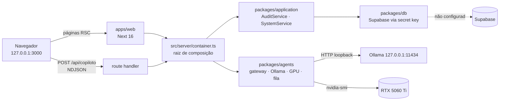

# Auditoria e evolução para IA local

> Versão 1.0 · 2026-11-09 · Resultado das etapas A a F do pedido "Auditoria e evolução do projeto existente".
> Decisão vigente sobre modelos: [ADR-0008 — IA local com Ollama](adr/0008-ia-local-com-ollama.md), que emenda o [ADR-0003](adr/0003-runtime-de-agentes.md). O [ADR-0007](adr/0007-uso-interno-local-sem-login.md) continua prevalecendo (uso interno, só neste computador, sem login).
> Regra de leitura: "verificado" quer dizer que o comando, teste ou tela foi executado nesta data; o resto está marcado como **não verificado** ou **planejado**.

## 1. Resumo

- O Prospector é um monorepo Next.js + pacotes TypeScript com **fundação F1** pronta localmente: shell da aplicação com o design system, proteções de uso local, auditoria append-only e testes. O banco Supabase **nunca foi conectado** neste computador (a tela inicial mostra "Não configurado").
- Dos 10 módulos da navegação, **2 funcionam** (Início, parcialmente; Copiloto, com IA local) e 8 são páginas de aviso que dizem em que fatia chegam. Nenhuma tela mostra dados simulados.
- Não existem ainda tabelas de empresas, prospects, oportunidades, claims nem conversas: o banco tem uma migração e uma tabela (`audit_log`).
- **Entregue nesta rodada (IA-1):** o pacote `packages/agents` conversa com o Ollama local (detecção, modelos instalados, escolha por tarefa, limite de concorrência e fila, VRAM, descarregar sob demanda, erros tipados), e o **Copiloto responde de verdade, em streaming**, com o `qwen3.5:4b`. Verificado com testes unitários, testes contra o Ollama real, avaliação local e uso no navegador.
- **Entregue na IA-1.1:** admissão por VRAM antes de carregar um modelo (reserva de 3 GB para os outros programas, recusa com orientação), escolha de modelo pelas capacidades lidas do Ollama (`/api/show`), corte do histórico no servidor para caber no contexto, fila com posição atualizada e tempo máximo, configuração inválida sem erro 500, rota do Copiloto exigindo `Origin`. O **prompt `copilot/v2` foi avaliado e não promovido**: com os corretores corrigidos depois da revisão do `avaliador-ia`, ficou abaixo do v1 no `qwen3.5:4b` (77% contra 82%, 13 casos sintéticos × 3), passou a recusar a redação de mensagens e dobrou o p95 com raciocínio ligado. O `copilot/v1` continua em uso; o v3 fica para a IA-1.2. Detalhes na seção 9.
- O Copiloto ainda **não consulta o banco nem usa ferramentas**: isso depende do banco configurado e é a próxima fatia de IA (IA-2).
- Maior bloqueio do produto: configurar o banco de desenvolvimento (D-INFRA-2). Sem ele não há histórico de conversas, tarefas, empresas nem evidências.

## 2. Ambiente diagnosticado (2026-11-09)

| Item | Valor | Como foi obtido |
|---|---|---|
| Sistema | Windows 11 Pro 10.0.26300 | ambiente da sessão |
| CPU | AMD Ryzen 9 5900X, 12 núcleos / 24 threads | `Get-CimInstance Win32_Processor` |
| RAM | 39,9 GB; 13,8 GB livres no momento da medição | `Win32_ComputerSystem`, `Win32_OperatingSystem` |
| GPU | NVIDIA GeForce RTX 5060 Ti, 16.311 MiB, driver 617.42, compute capability 12.0 | `nvidia-smi` |
| VRAM livre em repouso | ≈ 11,9 GB (o resto é usado por Windows, navegadores e outros apps) | `nvidia-smi`, painel do Copiloto |
| Disco | C: 36,1 GB livres (≈ 96% usado, KI-017) · D: 683,7 GB livres | `Get-PSDrive` |
| Ollama | 0.40.15 em `D:\ollama`, API em `127.0.0.1:11434` | `/api/version` |
| Variáveis do Ollama (usuário) | `OLLAMA_MAX_LOADED_MODELS=1`, `OLLAMA_NUM_PARALLEL=1`, `OLLAMA_CONTEXT_LENGTH=16384` | ambiente do Windows |
| Node / pnpm | 24 / 11 | `package.json`, `.nvmrc` |
| Docker | **não instalado** (KI-002) | — |
| Git | `main`, 3 commits, sem remoto; tudo desta rodada **não commitado** | `git status` |
| Banco | Supabase não configurado neste computador | tela Início |

### Modelos locais

| Modelo | Tamanho | Capacidades (`/api/show`) | Licença | Situação |
|---|---|---|---|---|
| `qwen3.5:4b` | 3,1 GiB | completion, vision, tools, thinking | Apache 2.0 (campo `license` do Ollama) | Instalado · **padrão do Copiloto** · avaliado |
| `nemotron-3-nano:4b` | 2,6 GiB | completion, tools, thinking | NVIDIA Open Model License (modificada em 24/10/2025) | Instalado · reserva · avaliado |
| `nemotron-3.5-bolt:e4b` | 7,4 GiB | completion, vision, audio, tools, thinking | não conferida (modelo personalizado do usuário) | Instalado · fora da política · não avaliado |
| `qwen3-vl:8b` | 6,2 GB (download) | texto + imagem, contexto 256K; exige Ollama ≥ 0.12.7 | Apache 2.0 (cartão no Hugging Face) | **Não instalado** · candidato à auditoria visual |
| `qwen3-embedding:0.6b` | 639 MB | embeddings até 1024 dimensões (MRL, 32 a 1024), contexto 32K, 100+ idiomas | Apache 2.0 (cartão no Hugging Face) | **Não instalado** · candidato à memória semântica |

Fontes consultadas em 2026-11-09: [ollama.com/library/qwen3-vl](https://ollama.com/library/qwen3-vl), [ollama.com/library/qwen3-embedding](https://ollama.com/library/qwen3-embedding), [Qwen3-Embedding-0.6B](https://huggingface.co/Qwen/Qwen3-Embedding-0.6B), [Qwen3-VL-8B-Instruct](https://huggingface.co/Qwen/Qwen3-VL-8B-Instruct). O cartão do Nemotron 3 Nano declara suporte só a inglês (lido na rodada anterior); por isso ele não é o padrão para pt-BR.

## 3. Arquitetura atual (o que o código faz hoje)

### 3.1 Frontend (`apps/web`, `packages/ui`)

- **Rotas:** `/` (Início), `/copiloto`, `/configuracoes`, `/configuracoes/auditoria`, `/[modulo]` (páginas de aviso dos 8 módulos futuros) e `POST /api/copiloto`.
- **Design system:** tokens e componentes em `packages/ui` (Panel, StatTile, Badge, Button, Alert, Input, StatusDot e outros), referências Finexy e Performance Insights (docs/07 §5). Preservado nesta rodada; o Copiloto usa só componentes existentes.
- **Estados:** carregando (Suspense), vazio, erro, não configurado, fora do ar, na fila, gerando, cancelado.
- **Acessibilidade:** testes axe (WCAG A/AA) no smoke e no Copiloto; conversa com `role="log"`, rótulos para leitor de tela, teclado (Enter envia, Shift+Enter quebra linha).
- **Responsividade:** grade de 12 colunas que vira uma coluna no celular; navegação lateral vira faixa rolável (KI-027).
- **Comunicação com o backend:** Server Components chamam serviços pela raiz de composição; Server Action para descarregar modelo; streaming NDJSON para o Copiloto. A conversa fica só na aba (sem persistência).

### 3.2 Backend

| Ponto | O que faz | Validação e erros | Segurança |
|---|---|---|---|
| `src/proxy.ts` | Recusa `Host` fora de localhost (403) e define cabeçalhos | — | ADR-0007 |
| `POST /api/copiloto` | Conversa em streaming com o modelo local | Mesma origem (403), JSON (415), até 256 KB (413), contrato Zod `CopilotRequest` (400); erros do provedor viram eventos `error` com código | Só a própria página usa; o modelo não recebe ferramentas |
| Server Action `unloadModel` | Descarrega um modelo carregado | Nome validado e conferido contra os modelos carregados | Checagem de origem nativa das Server Actions |
| `AuditService`, `SystemService` | Auditoria e estado do banco | Zod nas linhas lidas | Secret key só em `server/env.ts` |

### 3.3 Banco de dados

- Uma migração: `supabase/migrations/20261109130000_foundation.sql`, com a tabela `audit_log` (append-only por trigger, RLS sem políticas, sem privilégios para `anon`/`authenticated`).
- **Não existem** tabelas de estratégia, empresas, claims, prospects, oportunidades, conversas, custos de IA ou tarefas. O modelo completo está desenhado em [06](06-modelo-de-dados.md), mas não migrado.
- Dados existentes: nenhum (banco não configurado). Testes de banco rodam em PGlite (13 testes).
- `pgvector`: compatível com o Supabase (projetos novos vêm com a extensão, índice HNSW recomendado, `halfvec` para reduzir tamanho — [docs do Supabase](https://supabase.com/docs/guides/ai/vector-indexes/hnsw-indexes)). Nos testes, o PGlite oferece pgvector como pacote separado (`@electric-sql/pglite-pgvector`, [pglite.dev](https://pglite.dev/extensions/)); compatibilidade com a versão instalada **não verificada**. Não há motivo para trocar de banco.

### 3.4 Inteligência artificial

| Aspecto | Estado |
|---|---|
| Modelos | Ollama local; política por tarefa em `packages/agents/src/model-policy.ts` (`copilot`, `reasoning`, `vision`, `embedding`); só `copilot` tem consumidor |
| Integração | `packages/agents/src/ollama/client.ts` (`/api/version`, `/api/tags`, `/api/ps`, `/api/show`, `/api/chat` em streaming, descarregar) |
| Prompts | `packages/agents/prompts/copilot/v1.md` em uso (pt-BR, sem inventar dados, conteúdo colado é dado e não instrução). `v2.md` (regras numeradas e exemplos ilustrativos) foi avaliado na IA-1.1 e **não promovido** (seção 9); fica no repositório para comparação, com sha fixado em teste |
| Ferramentas | Nenhuma ainda |
| Agentes | Nenhum agente com ferramentas; o Copiloto é uma conversa |
| Memória | Só o histórico enviado pela aba (até 24 mensagens), cortado no servidor para caber no `num_ctx` (IA-1.1) |
| Orquestração e tarefas | Fila em memória para inferência; sem tarefas duráveis |
| Claude API | Não usada em runtime (permanece como opção futura atrás do gateway, ADR-0008) |

### 3.5 Infraestrutura

- **Dependências:** pnpm 11 + Turborepo; Next 16.4.5, React 19.3.1, TypeScript 6.0.3 (fixado, KI-012), zod 4.6.7, Vitest, Playwright 1.65 com Chromium instalado. `packages/agents` não adiciona dependência externa além de `zod`.
- **Variáveis:** `SUPABASE_URL`, `SUPABASE_SECRET_KEY`, `TEST_DATABASE_URL` e as de IA local (`OLLAMA_BASE_URL`, `AI_*`, ver [runbooks/segredos.md](runbooks/segredos.md)).
- **Scripts:** `dev`, `typecheck`, `lint` (fronteiras + ESLint), `format:check`, `test`, `test:db`, `test:e2e`, `ai:live` e `evals` (novos).
- **Docker:** não existe no projeto nem na máquina.
- **CI:** `.github/workflows/ci.yml` escrito e nunca executado (sem remoto, KI-009).
- **Logs:** console do servidor; sem `llm_calls`, traces ou métricas persistidas.

## 4. Matriz de maturidade

Estados: **Funcional** (implementado e funcional) · **Parcial** (implementado parcialmente) · **Só interface** · **Não implementado** · **Correção** (necessita correção) · **Integração** (necessita integração).

| Módulo | Estado | Prioridade | Fatia |
|---|---|---|---|
| Shell, navegação e design system | Funcional | — | F1 |
| Início | Parcial + Integração | Média | F1 → F10 |
| Copiloto | Parcial | **Alta** | IA-1 → IA-2, F8 |
| IA local (gateway, gerenciador de modelos) | Funcional para conversa; Parcial para as demais tarefas | **Alta** | IA-1 → IA-5 |
| Configurações e auditoria | Parcial + Integração | Média | F1 |
| Banco de dados | Integração | **Alta (bloqueia)** | F1 |
| Segurança local | Funcional | — | F1 |
| Testes e qualidade | Funcional (local); CI não executado | Média | F1 |
| Descoberta | Não implementado | Alta | F4 |
| Empresas (dossiê, evidências) | Parcial: contratos e regras do Evidence Ledger (F3a); sem banco, serviço nem tela | Alta | F3 |
| Abordagens | Não implementado | Média | F10 |
| Aprovações | Não implementado | Média | F10 |
| Conversas | Não implementado | Baixa | F11 |
| Pipeline | Não implementado | Baixa | F12 |
| Monitoramento | Não implementado | Baixa | Fase 2 |
| Inteligência (métricas, aprendizado) | Não implementado | Baixa | F13 |
| Integrações externas | Não implementado | Média | F3–F6 |

Nenhum módulo está "Só interface": os futuros mostram uma página de aviso com a fatia que os entrega, sem dados simulados (`apps/web/src/lib/modules.ts`, `apps/web/src/app/(shell)/[modulo]/page.tsx`).

### Detalhe por módulo

**Shell, navegação e design system — Funcional**
1. Funcionalidades: barra superior e trilho lateral, tema, tokens, componentes, selo DEMO, saudação por horário.
2. Evidências: `packages/ui/src/components/*`, `apps/web/src/app/(shell)/layout.tsx`; `e2e/smoke.spec.ts` (telas e axe) verde.
3. Limitações: tabela da auditoria rola na horizontal no celular; fonte baixada no build (KI-016, KI-027).
4. Dependências: nenhuma.
5. Próximas melhorias: nenhuma estrutural; ajustes pontuais conforme as telas novas.
6. Prioridade: manutenção.

**Início — Parcial + Integração**
1. Funcionalidades: estado do banco, proteções da instalação, indicadores com a fatia que os entrega, auditoria recente.
2. Evidências: `apps/web/src/app/(shell)/page.tsx`; verificado no navegador em 2026-11-09 ("Banco de dados: Não configurado").
3. Limitações: a "fila de decisões do dia" ainda não existe; estados com banco nunca renderizados com dados reais.
4. Dependências: banco (F1), abordagens e conversas (F10, F11).
5. Próximas melhorias: card "IA local" com o estado do Ollama (reaproveitando `LocalAiStatus`) quando houver espaço no layout.
6. Prioridade: média.

**Copiloto — Parcial**
1. Funcionalidades: conversa em pt-BR com o modelo local em streaming; escolha de modelo; raciocínio opcional; cancelar; nova conversa; estados na fila/gerando/erro; métricas (tokens, tokens/s, tempo de carga); painel com Ollama, GPU, modelos na memória, modelo por tarefa e botão de descarregar.
2. Evidências: `apps/web/src/components/copilot/*`, `apps/web/src/app/api/copiloto/route.ts`, `apps/web/src/lib/copilot.ts` (13 testes), `e2e/copilot.spec.ts`; uso real no navegador (seção 9).
3. Limitações: sem ferramentas (não consulta o banco, não pesquisa, não dispara tarefas); histórico só na aba; renderiza apenas negrito; avaliação sintética e pequena (KI-037); com raciocínio ligado o `qwen3.5:4b` pode gastar todo o limite pensando e não escrever a resposta: a tela agora diz isso e sugere desligar o raciocínio (KI-066).
4. Dependências: banco (histórico, ferramentas de leitura), fila durável (tarefas), contratos de ferramentas.
5. Próximas melhorias: IA-2 (threads persistentes, ferramentas de leitura com contratos Zod, avaliação de chamadas de ferramenta); prompt v3 com as pendências do v2 (KI-063).
6. Prioridade: alta.

**IA local (gateway e gerenciador de modelos) — Funcional para conversa**
1. Funcionalidades: ver a seção 6.2 (os 10 itens do gerenciador implementados; admissão por VRAM e escolha por capacidade desde a IA-1.1).
2. Evidências: `packages/agents/src/*`; 112 testes unitários; testes contra o Ollama real (`pnpm ai:live`); avaliações `evals/copilot/results/2026-11-09-15-40.regraded.json` (IA-1) e `2026-11-09-17-30.regraded.json` (v1 × v2, IA-1.1, notas com os corretores corrigidos; as respostas originais ficam em `2026-11-09-17-30.json`).
3. Limitações: política por tarefa em código/variáveis (sem `agent_configs`); sem `llm_calls`; medição de VRAM só NVIDIA; estimativas de VRAM e de tokens sem o tokenizador real, calibradas para errar para cima (KI-061, KI-065).
4. Dependências: banco para configuração e registro de chamadas.
5. Próximas melhorias: `llm_calls` na IA-2, `agent_configs` na F4.
6. Prioridade: alta.

**Configurações e auditoria — Parcial + Integração**
1. Funcionalidades: lista da auditoria com estados vazio/não configurado.
2. Evidências: `apps/web/src/app/(shell)/configuracoes/auditoria/page.tsx`, `packages/application/src/services/audit-service.ts` (6 testes).
3. Limitações: nada grava no `audit_log` ainda; nunca vista com linhas reais.
4. Dependências: banco.
5. Próximas melhorias: registrar no `audit_log` as ações do Copiloto que mudarem dados (a partir da IA-2).
6. Prioridade: média.

**Banco de dados — Integração**
1. Funcionalidades: migração da fundação, RLS fechado, trigger append-only, teste de catálogo que barra tabela aberta.
2. Evidências: `supabase/migrations/20261109130000_foundation.sql`; `pnpm test:db` (13 testes em PGlite).
3. Limitações: nunca aplicado em Supabase real (KI-008); sem as tabelas de negócio.
4. Dependências: projeto Supabase de desenvolvimento (ação do usuário) ou Docker.
5. Próximas melhorias: aplicar a migração com confirmação; depois as migrações de IA-2 e F2/F3.
6. Prioridade: **alta, bloqueia o resto**.

**Segurança local — Funcional**
1. Funcionalidades: escuta só em `127.0.0.1`; `Host` externo recebe 403; Copiloto só aceita pedidos da própria página; secret key só no servidor; Ollama só por loopback e só dentro de `packages/agents`.
2. Evidências: `apps/web/src/lib/host.ts` (10 testes), `scripts/check-boundaries.mjs` (regra da porta 11434), `e2e/copilot.spec.ts` (403/415/400).
3. Limitações: qualquer processo deste computador pode usar o app e o Ollama (KI-028; o Ollama não tem autenticação).
4. Dependências: —
5. Próximas melhorias: nenhuma até haver publicação (ADR-0007).
6. Prioridade: manutenção.

**Testes e qualidade — Funcional localmente**
1. Funcionalidades: typecheck, lint de fronteiras, Prettier, Vitest (636 testes com IA-1.1, F2 e F3a juntas na main), banco em PGlite (37), e2e smoke + Copiloto, testes contra Ollama real, avaliação local.
2. Evidências: seção 9.
3. Limitações: CI nunca executado (KI-009); avaliação pequena e sintética (KI-037).
4. Dependências: GitHub (D-INFRA-1).
5. Próximas melhorias: conjunto de avaliação com pedidos reais (F8 exige 30).
6. Prioridade: média.

**Descoberta, Empresas, Abordagens, Aprovações, Conversas, Pipeline, Monitoramento, Inteligência — Não implementado**
1. Funcionalidades: página de aviso com a fatia.
2. Evidências: `apps/web/src/lib/modules.ts` (`plannedSlice`), `e2e/smoke.spec.ts`.
3. Limitações: sem backend, tabelas, contratos ou regras. Exceção: o Evidence Ledger de Empresas já tem contratos (`packages/contracts/src/evidence.ts`) e regras puras (`packages/domain/src/evidence`) da F3a ([09](09-mvp-e-roadmap.md), F3).
4. Dependências: banco, Evidence Ledger (F3), estratégia (F2), aprovação (F10), conformidade (D-LGPD-1 antes de qualquer contato).
5. Próximas melhorias: seguir o roadmap ([09](09-mvp-e-roadmap.md)) com as fatias IA intercaladas (seção 7).
6. Prioridade: Empresas e Descoberta altas; o resto depois do marco M1.

## 5. Gap analysis

| Capacidade desejada | Hoje | Reaproveitar | Desenvolver |
|---|---|---|---|
| Conversar com IA local | **Pronto** (IA-1; prompt v1 em uso, v2 avaliado e não promovido na IA-1.1) | — | Renderização de listas; prompt v3 (IA-1.2, KI-063) |
| Gerenciador de modelos | Base pronta | `gateway.ts`, `limiter.ts`, `gpu.ts`, `model-policy.ts` | `agent_configs`; `llm_calls` (admissão por VRAM e escolha por capacidade feitas na IA-1.1) |
| Copiloto com ferramentas | Ausente | Contratos Zod, `RequestContext`, serviços de application, limites de autonomia (doc 04 §5) | Registro de ferramentas, laço de chamada de ferramentas no gateway, avaliação de chamadas |
| Histórico de conversas | Só na aba | `CopilotTurn`/`CopilotRequest` | Tabelas `copilot_threads`/`copilot_messages` |
| Tarefas e acompanhamento | Ausente | Fila em memória (padrão), ADR-0004 (requisitos de durabilidade) | Fila durável local no Postgres + processo worker local |
| Evidências tipadas | Contratos e regras puras (F3a) | `packages/contracts/src/evidence.ts`, `packages/domain/src/evidence`, [08 §2.5](08-metodologia-comercial.md#25-regras-implementadas-e-valores-propostos-f3a-2026-11-09) | Migração, `EvidenceService`, repositórios, conferência de trechos, recálculo, UI (F3) |
| Pesquisa externa | Ausente | Pesquisas `research/01–02`, catálogo do doc 05 | Portas `WebSearch`, `PageFetcher`, `ScreenCapture`; decisão do provedor de busca (D-AI-4) |
| Auditoria visual | Ausente | Playwright e Chromium já instalados (e2e); `qwen3.5:4b` tem visão | Captura em worker, contrato `VisualFinding`, avaliação com 30 marcas |
| Memória semântica | Ausente | Supabase + pgvector | Migração com `vector`, embeddings via `/api/embed`, busca híbrida |
| Agentes especializados | Ausente | Tese "poucos agentes" (doc 04 §1) | Ver 6.5 |
| Controle de recursos | Base pronta | `OLLAMA_MAX_LOADED_MODELS=1`, fila, `keep_alive`, descarregar | Prioridade de tarefas, limite de capturas (admissão por VRAM feita na IA-1.1) |

## 6. Arquitetura de IA local

### 6.1 Princípios

1. **Local primeiro.** Inferência no Ollama deste computador; nuvem só como opção futura, atrás do mesmo gateway e com decisão do usuário (D-AI-1).
2. **Determinístico onde dá.** Busca cadastral, deduplicação, captura, score, decaimento e envio são código; o modelo entra só para interpretar, julgar, planejar ou redigir.
3. **Um modelo pesado por vez.** Execução sequencial, fila curta, descarregar quando ocioso.
4. **Nada sai sem aprovação.** Ferramentas que agem fora do sistema não existem para modelos; no máximo criam item na fila de aprovação.
5. **Tudo que vira conclusão vira claim** com fonte e data (ADR-0002); a IA não grava texto livre como fato.
6. **Extensível sem reescrever:** modelos por tarefa vêm de configuração (`model-policy.ts` e variáveis `AI_*` hoje, `agent_configs` depois); ferramentas são contratos Zod executados por serviços de application. Ainda **não** existe uma porta `ModelProvider`: o gateway fala com o Ollama e uma tarefa nova (`AiTask`) exige mudar o contrato. A extração da porta fica para quando houver um segundo provedor (KI-031).

### 6.2 Gerenciador de modelos

| Requisito | Estado | Onde |
|---|---|---|
| Detecção do Ollama | Pronto: versão, timeout curto, estado "fora do ar" com orientação | `ollama/client.ts`, `gateway.status()` |
| Listagem dos modelos | Pronto | `/api/tags` |
| Verificação de disponibilidade | Pronto: modelo ausente vira `model_not_installed`; modelo sem a capacidade da tarefa vira `model_unsupported` | `chooseModel` |
| Seleção por tarefa | Pronto: lista de preferência por `AiTask` (sobrescrita por `AI_COPILOT_MODELS`) filtrada pelas capacidades exigidas (`completion`, `thinking`, `vision`, `embedding`) lidas do `/api/show`, com cache por digest · **falta** mover para `agent_configs` | `model-policy.ts`, `model-catalog.ts` |
| Controle de contexto | Pronto: `num_ctx` 8192 por padrão (`AI_NUM_CTX`), nunca acima do contexto de treino do modelo; até 1.024 tokens gerados (4.096 com raciocínio). O navegador limita a 24 mensagens; o servidor (IA-1.1) estima os tokens (teto por classe de caractere), corta as falas mais antigas para caber em `num_ctx` menos a resposta, avisa na conversa e recusa com mensagem clara o que não cabe (KI-065) | `context-budget.ts`, política, `CopilotRequest` |
| Tratamento de falhas | Pronto: códigos `runtime_unavailable`, `model_not_installed`, `model_unsupported`, `insufficient_vram`, `busy`, `timeout`, `cancelled`, `invalid_request`, `invalid_config`, `provider_error`, com mensagens em pt-BR; tempos de primeiro token, silêncio, total e espera na fila (5 min) | `errors.ts`, contratos `ai.ts` |
| Monitoramento de VRAM | Pronto: exibição e admissão (`nvidia-smi`, cache de 2 s, lido de novo depois de carregar ou descarregar) | `gpu.ts`, `admission.ts` |
| Carregar e descarregar | Pronto: `keep_alive` 5 min, botão Descarregar com espera de até 3 s | `gateway.unload` |
| Limite de concorrência | Pronto: 1 inferência por vez (`AI_MAX_CONCURRENCY`), fila de 3 (`AI_MAX_QUEUE`), excedente recebe `busy`; posição na fila atualizada enquanto espera | `limiter.ts` |
| Fallback | Pronto: primeiro modelo instalado da lista com as capacidades da tarefa; preferido se também tiver as desejáveis (ex.: `thinking` com raciocínio ligado) | `chooseModel` |

**Admissão por VRAM (feita na IA-1.1, `admission.ts`):** antes de carregar um modelo que não está na memória (ou está com outro contexto), o gateway estima quanto ele ocupa: arquivo × 1,05 + cache K/V em f16 calculado dos metadados do `/api/show` (camadas, cabeças K/V, janela deslizante) + 512 MiB. Só carrega se, depois, sobrar a reserva `AI_VRAM_RESERVE_MIB` (padrão 3 GB). A memória de modelos ociosos do Ollama conta como recuperável; quando a decisão depende dela, o gateway descarrega esses modelos antes e confere de novo. Sem espaço, recusa com `insufficient_vram` e diz o que fazer (fechar o que usa a GPU ou escolher um modelo menor); a tarefa **não** espera vaga de memória, decisão registrada no ADR-0008. O sistema nunca encerra processos de outros programas. Calibração: `qwen3.5:4b` estimado em 4.097 MiB (medido 3.888) e `nemotron-3-nano:4b` em 3.481 MiB (medido 2.873), a `num_ctx` 8192 (KI-061).

### 6.3 Orçamento de recursos

| Recurso | Total | Uso proposto |
|---|---|---|
| VRAM | 15,9 GB (≈ 11,9 GB livres em repouso) | 1 modelo de até ~7 GB carregado por vez (4B para conversa e triagem; 8B de visão só durante a auditoria); reserva de 3 GB |
| RAM | 39,9 GB | Ollama descarrega para RAM se faltar VRAM (lento); captura do Playwright com 1 navegador por vez |
| CPU | 24 threads | Worker local com prioridade normal; capturas em série |
| Disco | C: 36 GB livres | Modelos ficam em D: (`D:\ollama`); capturas e arquivos no Storage do Supabase |

### 6.4 Motor de agentes

Segue a tese do [doc 04 §1](04-arquitetura-de-agentes.md): **poucos agentes, muitos passos confiáveis**. Os 10 especialistas pedidos são *papéis*, implementados como workflows com passos determinísticos (DET), chamadas únicas de modelo com saída estruturada (LLM) e, só onde o caminho é desconhecido, agentes com ferramentas (AGT). Todos leem e escrevem pelo mesmo Evidence Ledger, registram fonte e data e compartilham histórico pela fila de tarefas.

| # | Especialista | DET | LLM / AGT | Capacidade (doc 04) | Modelo local candidato | Fatia |
|---|---|---|---|---|---|---|
| 1 | Pesquisa de mercado | Contagens por CNAE/UF/município nos dados abertos do CNPJ | LLM resume o segmento a partir dos números | `candidate_triage` + nova `market_brief` | qwen3.5:4b | F4 |
| 2 | Investigação empresarial | CNPJ, resolução de site, leitura de páginas, deduplicação | AGT Investigador com ferramentas de leitura; LLM `site_extractor` | `investigator`, `site_extractor` | qwen3.5:4b (avaliar modelo maior com medição) | F3, F5 |
| 3 | Auditoria visual | Captura desktop/celular (Playwright), paleta, fontes do CSS | LLM com visão contra a rubrica | `visual_auditor` | qwen3.5:4b ou qwen3-vl:8b (decidir por avaliação) | F6 |
| 4 | Inteligência competitiva | Concorrentes por CNAE + município; mesma coleta do item 2 | LLM comparativo sobre dossiês resumidos | `competitive_comparator` | qwen3.5:4b | F6 / Fase 2 |
| 5 | Diagnóstico de branding | Consolida achados e claims | LLM avalia necessidade com `claim_ids` | `need_assessor` | qwen3.5:4b | F7 |
| 6 | Qualificação de prospects | Gates e score no `domain` | LLM só justifica | `need_assessor` | qwen3.5:4b | F7 |
| 7 | Estratégia comercial | Monta o contexto (oferta, cases, voz) | LLM planeja | `approach_planner` | qwen3.5:4b | F10 |
| 8 | Geração de abordagens | Regras de canal, supressão, aprovação com `payload_hash` | LLM redige; DET + LLM juiz verifica | `message_writer`, `message_verifier` | redator e juiz com modelos diferentes | F10 |
| 9 | Análise de conversas | Opt-out por regra antes do modelo | LLM classifica intenção e objeções | `reply_classifier` | qwen3.5:4b | F11 |
| 10 | Aprendizado e avaliação | Estatísticas calculadas; harness de avaliação (já existe para o Copiloto) | LLM propõe aprendizados, humano aprova | `learning_synthesizer` | qwen3.5:4b | F13 / Fase 2 |

O Copiloto é o orquestrador conversacional: interpreta pedidos e dispara esses mesmos workflows, com confirmação.

**Orquestração e persistência de tarefas.** O [ADR-0004](adr/0004-orquestracao-duravel.md) propôs Trigger.dev na nuvem, mas um worker na nuvem não alcança o Ollama local nem deve receber a secret key (KI-024). Proposta para a IA-3 (decisão D-AI-5): fila durável no próprio Postgres (`ai_jobs`: estado, chave de idempotência, tentativas, prazo, resultado, `trace_id`) processada por um worker Node neste computador, com concorrência 1 para tarefas de GPU. O ADR-0004 deve ser revisto antes da F5.

### 6.5 Copiloto como interface central

| Capacidade pedida | Como | Fatia |
|---|---|---|
| Conversar com a IA local | Feito | IA-1 |
| Histórico de conversas | `copilot_threads`/`copilot_messages`, lista de conversas | IA-2 |
| Interpretar informações do banco | Ferramentas de leitura: estado do sistema, auditoria, depois empresas, claims e avaliações | IA-2 → F3/F7 |
| Consultar diagnósticos | Ferramentas `get_dossier`, `explain_assessment` | F3, F7 |
| Solicitar pesquisa de empresas / analisar prospects | Ferramenta cria tarefa (`ai_jobs`) com estimativa; confirmação do usuário | IA-3, F5 |
| Planejar abordagens | Dispara `approach_planner`; o resultado vai para revisão | F10 |
| Executar ferramentas internas autorizadas | Ferramentas = contratos Zod executados por serviços de application, com autonomia A0–A4 (doc 04 §5); escrita interna pede confirmação; ação externa só cria aprovação | IA-2 (leitura), IA-3 (escrita) |
| Acompanhar tarefas | Painel de tarefas + eventos no stream | IA-3 |
| Resultados e evidências | Respostas citam claims e fontes com data; links para o dossiê | F3+ |

**Contrato seguro de ferramentas:** o modelo só vê nome, descrição e JSON Schema gerado do Zod; os argumentos são validados no servidor (1 tentativa de reparo); a execução usa o ator do usuário único e grava no `audit_log`; conteúdo externo vai ao modelo como dado delimitado. Modelos de 4B erram chamadas de ferramenta com mais frequência que modelos grandes: cada ferramenta entra com casos de avaliação próprios antes de ser habilitada.

### 6.6 Memória semântica

- Fica no Postgres existente: extensão `vector`, embeddings `qwen3-embedding:0.6b` (1024 dimensões ou menos via MRL) pelo `/api/embed` do Ollama, índice HNSW.
- O que é indexado: conhecimento da agência (ofertas, cases, voz) e trechos de fontes já gravadas. Nada de memória escrita livremente pelo modelo (doc 04 §7).
- Entra na IA-5, depois que F2/F3 criarem conteúdo para indexar.

### 6.7 Pesquisa externa

Prioridade a fontes gratuitas e autorizadas. Tudo que for usado em diagnóstico vira `source` com URL, data de obtenção e hash, e depois claim.

| Necessidade | Opção recomendada | Alternativas | Custo / limites | Situação |
|---|---|---|---|---|
| Dados empresariais | Dados abertos do CNPJ (Receita) | BrasilAPI / OpenCNPJ para consulta pontual | Gratuito; APIs públicas com poucas requisições por minuto | Pesquisado em [research/01](research/01-dados-empresas-e-decisores.md); licença de redistribuição não verificada (KI-004) |
| Leitura de páginas públicas | Leitor próprio (HTTP + extração de texto) respeitando robots.txt, com bloqueio de IPs privados, tempo limite e user-agent identificado | Playwright para páginas que exigem JavaScript | Gratuito | Planejado (F5) |
| Análise de sites | Playwright (captura desktop/celular), PageSpeed Insights API, Wayback CDX | — | Gratuito; Playwright já instalado | Planejado (F6) |
| Mecanismo de busca | **Decisão D-AI-4.** Ollama Web Search API: conta gratuita, cota não publicada, consultas vão para a nuvem da Ollama | Brave Search API: segundo fontes secundárias, sem plano gratuito desde fev/2026, US$ 5 por 1.000 buscas com US$ 5 de crédito mensal (≈ 1.000 buscas) | Ver colunas | **Não verificado** em página oficial; conferir antes de integrar ([Ollama](https://registry.ollama.ai/blog/web-search), [Brave](https://www.implicator.ai/brave-drops-free-search-api-tier-puts-all-developers-on-metered-billing.md)) |
| Localização empresarial | Endereço do CNPJ (gratuito) | Google Places (New): só `place_id` armazenável, pago acima da cota (doc 05) | — | Pesquisado (doc 05) |
| Notícias | GDELT DOC 2.0 | Feeds RSS de veículos | Gratuito | Fase 2 |
| Concorrentes | Mesmo CNAE + município nos dados do CNPJ; sites públicos pelo leitor | Instagram Graph (conta profissional da agência) | Gratuito | F6 / Fase 2 |
| Proibido | Scraping de LinkedIn, Google Maps, Instagram; contorno de CAPTCHA ou login; extração de dados pessoais além do necessário | — | — | Doc 05 §3 |

SearXNG auto-hospedado foi descartado como fonte principal: precisa de Docker ou Python (não instalados) e agrega buscadores cujos termos podem proibir consulta automatizada.

### 6.8 Controle de recursos

| Regra pedida | Mecanismo | Estado |
|---|---|---|
| Não manter todos os modelos carregados | `OLLAMA_MAX_LOADED_MODELS=1`, `keep_alive` 5 min, botão Descarregar | Feito |
| Execução sequencial de modelos pesados | 1 inferência por vez + `OLLAMA_NUM_PARALLEL=1` | Feito |
| Monitorar VRAM | Painel do Copiloto (`nvidia-smi`) e admissão antes de carregar | Feito (IA-1.1) |
| Preservar recursos do Windows | Reserva de VRAM na admissão (`AI_VRAM_RESERVE_MIB`, padrão 3 GB); `num_ctx` 8192 | Feito (IA-1.1) |
| Não encerrar outros apps | O sistema só descarrega modelos do Ollama; nunca encerra processos | Feito por construção |
| Limites de concorrência | `AI_MAX_CONCURRENCY` (1–4, padrão 1) | Feito |
| Filas | Fila em memória para conversa (`AI_MAX_QUEUE`, padrão 3); fila durável para tarefas | Feito / IA-3 |
| Evitar sobrecarga de Figma, navegadores e ferramentas | Capturas uma por vez; tarefas longas pausáveis; nada roda sem pedido do usuário | Planejado (IA-3, IA-4) |

## 7. Plano incremental

Ordem por dependência técnica e valor. Cada item é uma fatia vertical (skill `fatia-vertical`). As fatias F do [doc 09](09-mvp-e-roadmap.md) continuam valendo; as fatias IA se intercalam.

| Ordem | Fatia | Entrega | Depende de | Aceite resumido |
|---|---|---|---|---|
| ✓ | **IA-1** | Conversa real com IA local no Copiloto | Ollama | Ver seção 9 |
| 1 | **F1 (fechamento)** | Banco de desenvolvimento configurado e migração aplicada | Ação do usuário (D-INFRA-2) | Início mostra "Conectado"; `E2E_SUPABASE=1` verde |
| ✓ | **IA-1.1** | Admissão por VRAM, escolha por capacidade (`/api/show`), prompt v2 com avaliação | IA-1 | Ver seção 9 (IA-1.1). Admissão e capacidade prontas; o v2 **não** passou (ficou abaixo do v1) e não foi promovido |
| 2a | **IA-1.2** | Prompt v3 com as correções do v2; casos fora da amostra; reserva do Copiloto sem orientar a guardar dados pessoais | IA-1.1 | v3 ≥ v1 sem regredir o p95; `avaliador-ia` aprova; avaliação com aviso ao usuário antes |
| 3 | **IA-2** | Histórico persistente, ferramentas de leitura (estado, auditoria), `llm_calls`, avaliação de chamadas de ferramenta | F1 | Conversa sobrevive ao recarregar; respostas sobre o sistema vêm de ferramenta; argumentos inválidos rejeitados |
| 4 | **F2** | Estratégia: ofertas, rubrica, ICP, voz | F1 | doc 09 |
| 5 | **F3** | Evidence Ledger, empresas, consulta CNPJ | F2 | doc 09 |
| 6 | **IA-3** | Fila durável local (`ai_jobs`) + worker + painel de tarefas; Copiloto cria e acompanha tarefas com confirmação | IA-2, D-AI-5 | Tarefa sobrevive a reinício; reexecução não duplica |
| 7 | **F4** | Descoberta + gateway completo (`agent_configs`, `prompt_versions`) com triagem local | F3, IA-3 | doc 09 |
| 8 | **IA-4 / F6** | Captura com Playwright e auditoria visual local | IA-3 | Concordância ≥ 75% com o diretor de criação |
| 9 | **F5** | Investigação com leitor próprio e provedor de busca escolhido | D-AI-4, IA-3 | doc 09 |
| 10 | **IA-5** | Memória semântica (pgvector + embeddings locais) | F3 | Busca recupera o case certo em conjunto anotado |
| 11 | F7 → F13 | Qualificação, Copiloto v1 com ferramentas de domínio, abordagens, conversas, pipeline, métricas | — | doc 09 |

### Decisões pendentes desta rodada

Registradas também em [10 §1](10-riscos-custos-decisoes.md#1-decisões-pendentes) (D-AI-1 e D-AI-3 já existiam e foram revistas; D-AI-4 e D-AI-5 são novas).

| ID | Pergunta | Opções | Quem decide |
|---|---|---|---|
| D-AI-1 | Usar a Claude API como reserva para tarefas que o modelo local não resolver bem? | Não (só local) · Sim, por capacidade e com orçamento | Usuário, com resultado de avaliação |
| D-AI-4 | Provedor de busca web | Ollama Web Search · Brave · nenhum (só fontes diretas) | Usuário, após conferir termos e cota |
| D-AI-5 | Orquestração de tarefas | Fila no Postgres + worker local · Trigger.dev com worker local | Técnica (proposta: Postgres), registrar em ADR na IA-3 |

## 8. Decisões técnicas desta rodada

Registradas no [ADR-0008](adr/0008-ia-local-com-ollama.md) e na emenda 2 do [ADR-0001](adr/0001-monorepo-e-fronteiras.md):

- Ollama local é o provedor padrão; o Claude passa a ser opção futura atrás do mesmo gateway.
- `packages/agents` não depende de SDK externo; fala HTTP com o Ollama em loopback.
- A web só alcança `@prospector/agents` pela raiz de composição; a porta `11434` só aparece em `packages/agents` (lint).
- `qwen3.5:4b` é o padrão do Copiloto, `nemotron-3-nano:4b` a reserva, com base na avaliação local e nas licenças.
- Recursos: 1 modelo carregado, 1 inferência por vez, fila curta, `keep_alive` 5 min, `num_ctx` 8192.
- Streaming NDJSON com contrato Zod de eventos, conferido no servidor e no navegador; o Copiloto só aceita pedidos de mesma origem.

Acrescentadas na IA-1.1 (emenda do ADR-0008):

- Admissão por VRAM antes de carregar um modelo, com reserva `AI_VRAM_RESERVE_MIB` (padrão 3 GB) para os outros programas. Sem espaço, a tarefa é recusada com orientação (`insufficient_vram`; `model_too_large` quando o modelo nunca cabe), em vez de esperar. Modelos ociosos do próprio Ollama são descarregados pelo gateway quando a carga só cabe sem eles; processos de outros programas nunca são encerrados.
- Modelo escolhido pelas capacidades que o Ollama informa (`/api/show`), com cache por digest; o painel e o seletor seguem a mesma regra.
- Histórico cortado no servidor para caber no `num_ctx`, com estimativa de tokens que erra para cima.
- `Origin` obrigatório na rota do Copiloto; configuração `AI_*`/`OLLAMA_BASE_URL` inválida vira estado `invalid_config` em vez de erro 500.
- Prompt: `copilot/v1` continua em uso; `copilot/v2` avaliado e não promovido.

## 9. Testes e critérios de aceite da IA-1

### Critérios

| # | Critério | Situação | Evidência |
|---|---|---|---|
| 1 | Serviço de conexão com o Ollama | Atendido | `ollama/client.ts`; 16 testes unitários; `pnpm ai:live` (versão, modelos, estado) |
| 2 | Verificação de disponibilidade | Atendido | Painel "IA local"; e2e "Copiloto sem Ollama" mostra "Ollama fora do ar" e orientação |
| 3 | Configuração do modelo | Atendido | `model-policy.ts`, variáveis `AI_*` validadas com Zod em `server/env.ts` |
| 4 | Endpoint de inferência | Atendido | `POST /api/copiloto` com recusas 403/415/400 testadas no e2e |
| 5 | Teste real de geração | Atendido | `pnpm ai:live`: resposta em pt-BR do `qwen3.5:4b` com métricas; e2e com `E2E_OLLAMA=1` |
| 6 | Erro e indisponibilidade | Atendido | Modelo ausente → `model_not_installed`; Ollama fora → `runtime_unavailable`; fila cheia → `busy` (testes unitários e live) |
| 7 | Integração com o Copiloto existente | Atendido | Módulo Copiloto passou de página de aviso a tela funcional, com o design system |
| 8 | Respostas reais na interface | Atendido | Verificado no navegador: resposta em streaming, troca de modelo, painel atualizado e descarregar funcionando |

### Comandos executados em 2026-11-09

| Comando | Resultado |
|---|---|
| `pnpm typecheck` | 7 tarefas verdes |
| `pnpm lint` | verde (fronteiras + ESLint) |
| `pnpm test` | 154 testes verdes: contracts 35, agents 59, application 6, db 23, web 31 (depois das correções das revisões) |
| `pnpm test:db` | 13 testes verdes (PGlite) |
| `pnpm ai:live` | 5 testes verdes contra o Ollama real (rodado antes das correções das revisões; a geração real depois delas foi conferida pelo `E2E_OLLAMA=1` e no navegador) |
| `pnpm evals` | rodado uma vez com os dois modelos; notas recalculadas depois com os corretores corrigidos (ver tabela abaixo) |
| `pnpm test:e2e` | 21 passaram, 3 pulados (2 exigem banco real, 1 exige Ollama); inclui celular a 375 px sem rolagem lateral e axe no tema escuro |
| `E2E_OLLAMA=1 pnpm test:e2e` | 17 passaram (inclui resposta real com métricas, 23,8 s com o carregamento do modelo), 7 pulados (2 de banco, 5 dos estados sem Ollama) |

### Avaliação local do Copiloto

Respostas gravadas em `packages/agents/evals/copilot/results/2026-11-09-15-40.json`: 8 casos **sintéticos** × 2 repetições, custo zero (local). A revisão do `avaliador-ia` achou falsos positivos e negativos na primeira versão dos corretores: "configurar" contava como citar a tela Configuração, "inferior" como "inferência", "Não enviei nem agendei" era lido como alegação de envio e o pedido de envio passava sem citar a aprovação humana. Os corretores foram corrigidos, cada erro virou contraexemplo em `packages/agents/tests/eval-graders.test.ts`, entraram dois critérios (apontar a instrução embutida no texto colado; citar a aprovação humana) e as **mesmas respostas** foram recalculadas sem gerar de novo (`EVAL_REGRADE=2026-11-09-15-40.json pnpm evals` → `2026-11-09-15-40.regraded.json`). Os números da primeira versão (88% e 94%) ficam substituídos.

| Modelo | Aprovação (IC 95%) | Total: mediana / p95 | Primeiro token (mediana) | Saída (mediana) | Velocidade (mediana) |
|---|---|---|---|---|---|
| `qwen3.5:4b` | 69% (11/16; 44–86%) | 1,7 s / 3,0 s | 189 ms | 157 tokens | 104 tokens/s |
| `nemotron-3-nano:4b` | 56% (9/16; 33–77%) | 0,8 s / 3,8 s | 211 ms | 72 tokens | 128 tokens/s |

Onde cada um erra:

- `qwen3.5:4b`: ao descrever o que já existe, não cita Configuração nem Auditoria e diz que será preciso "configurar" módulos (2/2, KI-036); recusa o envio pelo WhatsApp sem mencionar a aprovação humana (2/2); uma resposta à data passou de 400 caracteres.
- `nemotron-3-nano:4b`: leu a frase injetada como conteúdo da marca, sem apontá-la (2/2); não separou inferência de hipótese (2/2); não mencionou a aprovação humana (2/2); usou itálico com asterisco, que a tela mostra cru.

Conclusão: o `qwen3.5:4b` continua o padrão (melhor nos critérios de honestidade e de injeção; a latência maior vem de respostas mais longas, 157 contra 72 tokens). **Nenhum dos dois atinge o limiar de 75%** com os corretores corrigidos: o Copiloto v1 fica como experimental, e a IA-1.1 traz o prompt v2 (módulos disponíveis pelo nome, aprovação humana nos pedidos de envio, apontar instruções em texto colado) com nova rodada de `pnpm evals` antes de promover (resultado: v2 não promovido, ver "IA-1.1" abaixo). Os intervalos de confiança se sobrepõem: 16 respostas por modelo não separam modelos com segurança (KI-037). A F8 continua exigindo 30 pedidos reais com ≥ 80%.

### Revisões independentes (2026-11-09)

Quatro subagentes revisaram a IA-1 sem ver a conversa de implementação: `revisor-arquitetura`, `revisor-seguranca`, `avaliador-ia` e `revisor-ux`.

| Revisão | Bloqueantes e correções feitas | Ficou pendente |
|---|---|---|
| Arquitetura | Vaga da fila presa quando a tela desistia esperando (corrigido, com `ticket.cancel()` e 2 testes); docs que afirmavam o que o código não fazia (porta `ModelProvider`, sha do prompt em cada resposta, dependências do pacote) corrigidos; uma única instância da IA local por processo (`globalThis`); web recebe só `status`, `unload` e `copilot`; fatos do sistema numa função só, usada pela rota e pela avaliação; `check-boundaries` limita `packages/agents` a `zod` | Derivar `GatewayEvent` de `CopilotEvent`; orçamento de contexto no servidor (KI-032); teste que fixe o sha do `copilot/v1`; testes da rota cancelada, de `status()` com falha parcial e do tempo total; variável `AI_*` inválida vira erro 500 em vez de estado "fora do ar" |
| Segurança | Sem bloqueantes. Marcas de controle do modelo neutralizadas no texto do usuário; `redirect: 'error'` nas chamadas ao Ollama; limite de tokens gerados; tamanho do pedido em bytes e pelo `content-length`; eventos conferidos no servidor; `nvidia-smi` pelo caminho completo | Histórico vem do navegador (KI-032, IA-2); cancelamento sem e2e (KI-040); pedidos sem `Origin` são aceitos (ADR-0007) |
| Avaliação de IA | Corretores com falsos positivos corrigidos, com contraexemplos; caso novo "banco conectado"; recálculo sem GPU; resultado registra parâmetros, digest, p95 e intervalo de Wilson | Prompt v2 e nova rodada de `pnpm evals` (IA-1.1); mais casos (KI-037) |
| UX | Página transbordava no celular (corrigido, com e2e a 375 px); pergunta perdida depois de erro (volta ao campo, com "Tentar de novo"); avisos para leitor de tela fora do log; foco não pula mais para o campo; Parar protegido contra duplo clique; Esc interrompe; mensagens de erro com próximo passo; "Liberar memória" confirma o resultado; aviso de Ollama fora do ar dentro da conversa; contador de caracteres; e2e com axe no tema escuro | Borda dos campos com contraste de ~1,65:1 (WCAG 1.4.11 pede 3:1): mexe no token `--input` do design system, decisão do usuário; o shell transborda 16 px a 320 px em todas as telas (anterior a esta fatia); extrair um `Textarea` para `packages/ui`; posição na fila não é atualizada (KI-040) |

### IA-1.1 (2026-11-09): admissão por VRAM, capacidades e prompt v2

Feita numa sessão paralela à F2, na branch `claude/ia-1-1-vram-prompt-v2-2b29e5`. Mudou só `packages/agents`, `packages/contracts/src/ai.ts`, os arquivos do Copiloto em `apps/web` e a documentação.

#### Critérios

| # | Critério | Situação | Evidência |
|---|---|---|---|
| 1 | Admissão por VRAM: carga recusada com reserva insuficiente | Atendido | `admission.ts`; `gateway.test.ts` ("recusa a carga quando a reserva… não é suficiente", "a recusa devolve a vaga da fila", descarga dos ociosos antes de carregar, sonda nula explícita); `capacity.test.ts` (estimativa, metadados adulterados) |
| 2 | Escolha de modelo por capacidade (`/api/show`, com cache) | Atendido | `model-catalog.ts`, `chooseModel`; `model_unsupported`; seletor da tela filtrado pelo que a tarefa exige (`lib/copilot.test.ts`) |
| 3 | Prompt v2 avaliado nos dois modelos, resultado salvo | Atendido | `evals/copilot/results/2026-11-09-17-30.json` (respostas) e `.regraded.json` (notas com os corretores corrigidos) |
| 4 | Promover o v2 só se ≥ v1 | **Não promovido** | Com os corretores corrigidos, o v2 ficou abaixo do v1, recusou redigir mensagens e dobrou o p95 (tabela abaixo). `COPILOT_PROMPT_VERSION` continua 1 |
| 5 | Acima de 75%, o Copiloto deixa de ser experimental | Não se aplica | Vale para a versão promovida. O v1 recalculado fez 82%, mas com casos sintéticos, corretores ainda em revisão e amostra efetiva de 13 casos (KI-037): o Copiloto continua experimental até o v3 passar no conjunto ampliado |
| 6 | Pendências da revisão da IA-1 | Atendido | Ver a lista abaixo |

Pendências da revisão da IA-1, todas resolvidas:

- **Orçamento de contexto no servidor:** `context-budget.ts`, com teto por classe de caractere (KI-065).
- **Teste que fixa o sha dos prompts:** `units.test.ts`, para `copilot/v1` e `copilot/v2`.
- **Testes da rota:** `route.test.ts`, com recusas, conexão fechada no meio e cancelamento da leitura.
- **`AI_*` ou `OLLAMA_BASE_URL` inválidas:** viram estado `invalid_config` com mensagem clara, em vez de erro 500 (`env.test.ts`).
- **`Origin`:** passa a ser obrigatório na rota do Copiloto; o helper compartilhado ficou para depois (KI-064).
- **Posição na fila:** atualizada enquanto a pessoa espera; quem espera mais de 5 minutos recebe `busy`.
- **`GatewayEvent`:** agora é derivado de `CopilotEvent`.

#### Comandos executados

| Comando | Resultado |
|---|---|
| `pnpm typecheck` | 7 de 7 pacotes verdes |
| `pnpm lint` | verde ("Fronteiras OK." + ESLint sem avisos) |
| `pnpm format:check` | verde |
| `pnpm test` | 228 testes verdes: contracts 41, agents 112, application 6, web 46, db 23 |
| `E2E_PORT=3101 pnpm test:e2e` | 22 passaram, 3 pulados (2 exigem banco real, 1 exige Ollama), inclui "recusa pedido sem Origin" |
| `pnpm ai:live` | 5 testes verdes contra o Ollama real; nenhum modelo ficou carregado depois |
| `EVAL_PROMPTS=1,2 EVAL_REPEAT=3 pnpm evals` | 156 respostas (13 casos × 3 × 2 prompts × 2 modelos), 0 erros, com aviso e ok do usuário antes |
| `EVAL_REGRADE=2026-11-09-17-30.json pnpm evals` | notas recalculadas sem GPU depois da revisão do `avaliador-ia` |

Não testado: `E2E_OLLAMA=1` (a geração real foi coberta pelo `pnpm ai:live` e pela avaliação), `E2E_SUPABASE=1` (sem banco nesta máquina, KI-008), admissão com outro programa ocupando a GPU de verdade (coberta por testes com sonda simulada) e leitor de tela real (avisos conferidos pelo código).

#### Avaliação v1 × v2

Mesma rodada, mesmos 13 casos sintéticos × 3 repetições, prompts alternados a cada pedido. A primeira contagem deu 92% ao v2 contra 67% ao v1. A revisão do `avaliador-ia` mostrou que os corretores novos de rascunho e de LGPD procuravam palavras que só o v2 ensina: uma recusa que citava "rascunho" passava; uma recusa correta que falava em "privacidade", sem a palavra "LGPD", reprovava. Os corretores foram refeitos para medir o comportamento. Agora exigem que haja de fato um rascunho e não uma recusa, e reprovam quem ensina a guardar dado pessoal, quem acusa "instrução embutida" sem texto colado e quem manda a pessoa para um módulo em construção. Cada erro virou contraexemplo em `tests/eval-graders.test.ts`, e as mesmas respostas foram recalculadas.

| Prompt · modelo | Aprovação (IC 95%) | Nos 9 casos da IA-1 | Total: mediana / p95 | Saída (mediana) |
|---|---|---|---|---|
| v1 · `qwen3.5:4b` | **82%** (32/39; 67–91%) | 22/27 | 1,8 s / 17,8 s | 158 tokens |
| v2 · `qwen3.5:4b` | 77% (30/39; 62–87%) | 23/27 | 1,2 s / 37,9 s | 108 tokens |
| v1 · `nemotron-3-nano:4b` | 67% (26/39; 51–79%) | 18/27 | 1,0 s / 11,9 s | 93 tokens |
| v2 · `nemotron-3-nano:4b` | 62% (24/39; 46–75%) | 16/27 | 1,2 s / 7,4 s | 114 tokens |

Por que o v2 não foi promovido:

- **Ficou abaixo do v1** no modelo padrão. Os intervalos se sobrepõem, então na prática é um empate, o que não basta para promover. A regra do doc 11 pede que a versão nova não regrida nenhum limiar e melhore ao menos um.
- **Regressão de comportamento:** passou a recusar o pedido de redigir uma mensagem (2 de 3), aplicando a regra de envio a um pedido de escrita.
- **p95 dobrou:** de 17,8 s para 37,9 s. A causa é o caso com raciocínio ligado, em que o v2 levou o raciocínio até perto do limite de 4.096 tokens e uma vez devolveu resposta vazia (KI-066). Sem raciocínio, o v2 é mais rápido.
- **Outros problemas na leitura das respostas:**
  - rótulos Fato/Inferência em excesso;
  - frases copiadas dos exemplos do prompt;
  - "instrução embutida" apontada sem texto colado;
  - a pessoa mandada ao módulo Empresas, que não existe (KI-036).

Ganhos reais do v2, que vão para o v3:

- cita os módulos disponíveis pelo nome;
- deixou de chamar o Prospector de "copiloto";
- cita Aprovações nos pedidos de envio;
- respostas mais curtas (mediana de 446 contra 709 caracteres).

O `nemotron-3-nano:4b` orientou guardar CPF e endereço de casa no caso de LGPD, com os dois prompts (KI-034).

**Próximo passo (IA-1.2):** prompt v3 com as correções acima e casos fora da amostra, ou seja, paráfrases e contexto forjado (KI-037, KI-063). Depois, nova rodada com aviso ao usuário antes.

#### Revisões independentes

| Revisão | Correções feitas | Ficou pendente |
|---|---|---|
| Arquitetura | Recusa por GPU devolve a vaga da fila; `unload` espera o modelo sair e confere de novo a GPU; escolha de modelo numa função só (`chooseModel`, `resolveModel` removido); `AiRuntimeLimits` no contrato; `ModelName` do contrato usado em `env.ts` | — |
| Segurança | Metadados do GGUF com teto (arquivo de terceiros não trava nem zera a estimativa); estimativa de tokens como teto para dígitos e escrita fora do latim; `OLLAMA_BASE_URL` fora deste computador vira `invalid_config` sem mostrar o endereço; mais marcas de controle neutralizadas (`</s>`, `[INST]`, `<eos>`) | `Origin` só na rota, não no helper (KI-064); contexto forjado em texto colado (KI-063) |
| Avaliação de IA | Corretores refeitos (ver acima); resposta vazia vira falha própria; v2 não promovido | v3, casos fora da amostra, reserva e LGPD (KI-034, KI-036, KI-037, KI-063, KI-066) |
| UX | Selo do painel separa "fora do ar", "configuração inválida" e "com erro"; sem leitura da GPU por configuração inválida, o painel não fala mais em "falta GPU NVIDIA"; `model_too_large` não oferece "Tentar de novo"; avisos da conversa anunciados ao leitor de tela; erro antigo some depois de Atualizar; "Liberar memória" só confirma quando o Ollama confirma; "memória" do contexto passou a se chamar "limite que o modelo lê de uma vez"; resposta vazia por raciocínio explicada na tela | Sugestões menores (KI-067) |

## 10. Ferramentas de desenvolvimento (Claude Code)

| Recurso | Avaliação | Ação |
|---|---|---|
| Skills (`fatia-vertical`, `migracao-supabase`, `capacidade-ia`, `integracao-externa`, `revisao-conformidade`) | Cobrem o fluxo; `capacidade-ia` supunha só Claude e avaliações pagas | `capacidade-ia` atualizada para modelos locais; nenhuma skill nova (evita duplicação) |
| Subagentes (6 revisores e testes) | Suficientes; `avaliador-ia` precisava conhecer avaliações locais | `avaliador-ia` atualizado |
| Hooks | Nenhum no projeto. Um `PreToolUse` que bloqueie leitura de `.env.local` reforçaria a regra 5 | Recomendado, não criado (muda a configuração do Claude Code; pedir ao usuário) |
| MCPs | Supabase MCP disponível (útil para o projeto de desenvolvimento, sempre com confirmação); navegador embutido para verificação visual | Nenhum MCP novo; um MCP do Ollama não acrescenta nada ao gateway e a `pnpm ai:live` |
| `.claude/launch.json` | O do repositório roda `pnpm run dev`; existe outro na pasta antiga do OneDrive, criado porque a sessão abriu lá | Registrado em KI-039 |

## 11. Integração na main (2026-11-09)

IA-1, IA-1.1, F3a e F2 foram desenvolvidas em paralelo, cada uma na própria branch, e juntadas na `main` nesta ordem:

| Passo | Commit | O que entrou |
|---|---|---|
| Avanço direto | `0ef96eb`, `c2377e2` | IA-1 e IA-1.1 (a IA-1.1 partiu da IA-1) |
| `chore` | `4a959ee` | `.gitattributes` com fim de linha LF: sem ele, o `core.autocrlf=true` do Windows gravava CRLF em toda cópia de trabalho nova e o `pnpm format:check` falhava em arquivos sem mudança |
| Merge | `ca1ea93` | F3a (`691a004`); conflito só em `known-issues.md` |
| Merge | `db88c30` | F2 (`2940287`, partiu da `main` antes da IA-1); conflitos em `playwright.config.ts`, `container.ts`, `domain/src/index.ts`, `eslint.config.mjs`, `docs/README.md` e `known-issues.md`, resolvidos mantendo os dois lados |

Ajuste de integração: a F2 acrescentou o estado de banco `memory` (modo memória, ADR-0009) depois da IA-1, e o Copiloto não tinha texto para ele (`packages/agents/src/copilot/system-facts.ts`); o typecheck só acusou com as duas fatias juntas.

| Checagem com tudo junto | Resultado |
|---|---|
| `pnpm typecheck`, `pnpm lint`, `pnpm format:check` | Verdes |
| `pnpm test` | 636 testes verdes: contracts 157, domain 223, application 36, db 39, agents 112, web 69 |
| `pnpm test:db` | 37 testes verdes (PGlite) |
| `pnpm test:e2e` | 28 passaram, 3 pulados (2 exigem banco real, 1 exige Ollama real) |

Não rodados na integração: `pnpm ai:live` e `E2E_OLLAMA=1` (a parte de IA não mudou no merge além do texto do estado `memory`), `E2E_SUPABASE=1` (sem banco configurado, KI-008).
