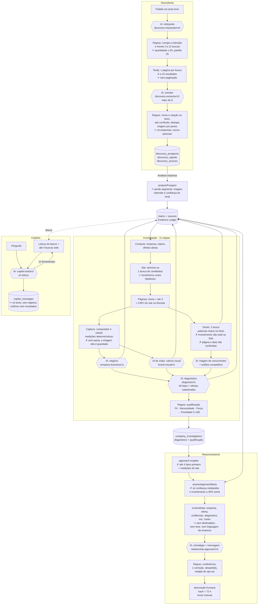
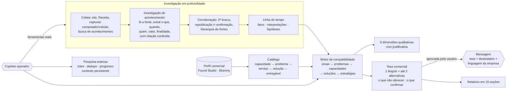

# 15 — Motor de inteligência comercial: diagnóstico e arquitetura

> Versão 1 · 2026-11-26 · Fase 1 da diretriz [Evolução do motor de inteligência comercial](diretrizes/2026-11-26-evolucao-do-motor-de-inteligencia.md) (Parte 2.1 e Parte 10).
>
> **Como foi feito.** Li o código de `packages/*` e `apps/web` e conferi cada ponto citado no arquivo e na linha indicados. A análise real da Flash foi lida no app instalado (`D:\Prospector`, porta 3210) em 26/11/2026, só olhando: nada foi clicado, salvo ou investigado. Nenhum prompt foi rodado e nenhuma avaliação de GPU foi feita.
>
> **O que este documento não é.** Não é a especificação das telas, que já foram aprovadas. Trata do caminho que a informação percorre por trás delas.

## 1. Resumo em doze pontos

1. **O Prospector não sabe quem representa.** Não existe perfil comercial. O nome da agência vem do texto de opt-out, os prompts da Descoberta estão fixos em "agência de branding" e os serviços que o sistema conhece são três: identidade visual, rebranding e site (`ServiceHint`, KI-168). As ofertas cadastradas no banco são as mesmas três. Product Management, produto digital, IA, automação e direção de projetos não existem para o motor. A Blummy não aparece em lugar nenhum do código.
2. **Por isso toda empresa vira "problema de site".** O diagnóstico compara os fatos da empresa só com essas ofertas (`diagnosis/v1`, `analyze.ts:843-899`). Na Flash, a recomendação foi "Vale abordar" com o serviço "Site institucional", sustentada por contraste de texto, alvos de toque pequenos e rolagem lateral no celular.
3. **Acontecimentos são detectados por palavra-chave e nunca investigados.** A investigação faz uma busca (`"Empresa" cidade`, 8 resultados) e procura palavras como "expansão", "vagas" e "lançamento" no título e no trecho (`collect.ts:502-618`). "Investimento", "rodada", "aporte" e "série" não estão na lista. Quando um padrão casa, o resultado vira uma hipótese "pode indicar … — a conferir". A página não é lida e a data não é conferida.
4. **O investimento de R$ 150 milhões da Flash existe no banco, mas não chega à mensagem.** Ele veio da Descoberta (NeoFeed, 19/08/2026), foi gravado como "Movimento recente: Investimento" e recebeu **confiança baixa (40%)**:
   - a fonte é resultado de busca, que nunca passa de "agregador" (`sources.ts:100`);
   - o NeoFeed não está na lista de imprensa.

   A abordagem só usa claims com confiança média ou alta (`isCitableClaim`). Por isso a estratégia gerada diz, ao mesmo tempo, "Nenhum sinal comercial registrado (expansão, contratação, lançamento)" (`rules.ts:481-483`).
5. **A mensagem nasce da auditoria do site, não de uma tese.** A ponte entre diagnóstico e abordagem (`approach-insights.ts:131-148`) põe **primeiro até 4 fatos** do diagnóstico e só depois oportunidades, inferências e hipóteses. Os fatos que o diagnóstico cita são quase sempre medições do site, e o modelo de 4B usa o que é mais concreto. Resultado real, na Flash: "Notei que 24 de cada 139 textos no site da Flash têm contraste abaixo do ideal…".
6. **Confiança e potencial estão misturados num número só.** A "Prioridade 44 de 100" combina "Combina com o cliente ideal 100", "Sinais de necessidade 56" e "Quanto já sabemos 61". Ela não separa:
   - potencial estratégico;
   - qualidade da evidência;
   - momento;
   - acesso ao decisor;
   - viabilidade de execução.
7. **A atualidade conta da coleta, não do acontecimento.** Uma notícia de agosto coletada em novembro vale como "nova" por 30 dias a partir da coleta (`policy.ts:37`, `confidence.ts:55-67`). Ao mesmo tempo, um fato histórico verdadeiro ("a Flash captou R$ 150 milhões em agosto de 2026") perde confiança com o tempo, como se deixasse de ser verdade. Verdade e relevância comercial usam a mesma régua.
8. **Republicações não são reconhecidas.** A independência das fontes é só pelo domínio (`sourceOrigin`, `sources.ts:110-117`). Três portais que copiam o mesmo comunicado contam como três confirmações.
9. **Nomes ambíguos poluem o dossiê.** Na Flash, `dc.com` e `imdb.com` ("The Flash", personagem e filme) ficaram como hipóteses de site oficial. Ninguém as descarta.
10. **Não existe pessoa no modelo de dados.** O sistema não guarda decisores, profissionais nem contatos públicos (KI-190). A mensagem é sempre "para a empresa" e começa com "Olá." sem nome. A Descoberta não pesquisa profissionais: o extrator é instruído a não listar pessoas.
11. **O Copiloto só lê, e não lembra de pesquisas.** O prompt em uso (`copilot-tools/v3`) oferece 8 ferramentas de leitura e 3 de internet (até 4 buscas por pedido). As ferramentas de investigação, Descoberta e Relacionamento já existem no código, mas só entram com um prompt v4 ou mais novo, ainda não avaliado. Não há contexto estruturado da conversa (objetivo, critérios, resultados): "agora priorize SP e MG" depende de o texto anterior caber nas 24 mensagens enviadas ao modelo.
12. **Pesquisas grandes não existem.** O formulário aceita no máximo 50 empresas, e o motor grava no máximo 40 por pesquisa (25 no padrão), tiradas de 3 a 10 buscas de uma página cada, sem paginação. "100 empresas" vira 25.

## 2. Diagrama do fluxo atual

Legenda: retângulo = regra (código determinístico) · hexágono = modelo de IA (`qwen3.5:4b`) · cilindro = banco · ✂ = ponto onde a informação é cortada ou descartada · ✗ = desconexão.

## 3. Etapa por etapa

### 3.1 Como uma empresa é descoberta

| Pergunta da diretriz | Resposta (código) |
|---|---|
| Entrada | Pedido em texto livre, com cidade, UF, quantidade e profundidade opcionais (`discovery-service.ts`) |
| Quem interpreta | IA (`discovery-interpreter/v4`), corrigida por regras: lugar ou sinal que não estava no pedido sai (`discovery-engine.ts:1153-1167`) |
| Quantas buscas | 3, 6 ou 10, conforme a profundidade, com teto de 12 (`contracts/discovery.ts:189, 207-211`) |
| Resultados por busca | 6, 8 ou 10, uma chamada Tavily `basic`, sem segunda página (`tavily.ts:113-124`) |
| Quantidade | Formulário até 50; o motor grava até 15, 25 ou 40 por pesquisa; "100 empresas" sem profundidade dá 25 (`discovery-engine.ts:1012-1014, 1527`) |
| Expansão geográfica | Não existe: cidade fora do pedido é descartada (`discovery-engine.ts:944-956`) |
| Entidades | Só empresas; o extrator é proibido de listar pessoas (`prompts/discovery-extractor/v2.md:18`) |
| Perfil comercial | Não existe; a agência está fixa nos prompts e os serviços são os três de marca (`contracts/discovery.ts:60-67`) |
| Continuidade | Só retomada técnica da mesma execução; não há "ampliar", "excluir o já achado" nem pesquisa derivada |

### 3.2 Que dados são coletados e de quais fontes

- **Descoberta:** título e trecho da Tavily (até 300 caracteres guardados), mais a página inicial do site dos candidatos mais bem colocados, para conferir nome, CNPJ e cidade.
- **Investigação:**
  - páginas do site (home e até 3), com texto e links;
  - Receita Federal pelo CNPJ (BrasilAPI e reserva);
  - captura no computador (1280×800) e no celular (390×844), com até ~2 telas de altura e 30 medições determinísticas (cores, fontes, contraste, alvos de toque, logotipo, H1);
  - 1 busca de sinais e até 3 de concorrentes.
- **Não são coletados:**
  - páginas de notícia sobre a empresa (só o título e o trecho);
  - vagas abertas;
  - comunicados de investidores;
  - perfis de executivos;
  - histórico de lançamentos;
  - a linguagem da empresa além da home e de 3 páginas.

### 3.3 Como as evidências são guardadas

- Ledger de evidências (ADR-0002): `sources` → `claims` (`fact`, `inference` ou `hypothesis`) → `claim_evidence`. A confiança é calculada no servidor como qualidade da fonte × atualidade (`domain/evidence/confidence.ts`).
- Categorias de fonte hoje (`policy.ts:24-31`):

| Categoria | Valor |
|---|---|
| Registro oficial | 0,95 |
| Própria empresa | 0,85 |
| Imprensa reconhecida | 0,80 |
| Agregador | 0,60 |
| Usuário | 0,70 |
| Desconhecida | 0,40 |

- Resultado de busca nunca passa de agregador.
- A hierarquia da diretriz (§3.2: comunicado oficial > relatório institucional > investidor ou parceiro > registro público > páginas de produto e carreiras > executivos > imprensa > pesquisa setorial) **não está representada**. Faltam investidor/parceiro, executivo e pesquisa setorial.
- **Duplicatas:** claim igual é deduplicado pela chave. Republicação da mesma notícia não é detectada.
- **Contradição:** existe o estado `disputed`, com teto de 0,5, quando evidências se opõem. Mas nada procura ativamente a segunda fonte.

### 3.4 Como funciona a investigação

São 11 etapas, com retomada e reaproveitamento por prazo (doc 14 e `investigation/run.ts`). A investigação real da Flash levou cerca de 1 minuto. Pontos de corte:

- **Site:** sem domínio confirmado, uma busca pelo nome devolve candidatos. Na Flash vieram `dc.com` e `imdb.com`, que ficaram registrados.
- **Captura:** a imagem só é guardada com `PROSPECTOR_CAPTURES_DIR` válida. O app instalado não define essa variável, então nenhuma imagem foi guardada ("Imagem não guardada (pasta das capturas não configurada)"). Toda captura nova também **apaga as anteriores** da mesma empresa (`collect.ts:448-450, 478-496`): uma análise antiga perde a imagem.
- **Sinais:** palavra-chave no título ou no trecho, 1 por tipo, como hipótese (`collect.ts:546-618`).
- **Diagnóstico:**
  - o modelo recebe até 40 claims, na ordem segmento, oferta, público, diferencial, proposta de valor, tom, modelo de negócio, região, posicionamento visual, auditoria visual, concorrência e sinais, mais 6 medições reservadas (`analyze.ts:706-750`);
  - as ofertas comparadas são até 6 da Estratégia, cada uma com problemas, sinais de necessidade e desqualificadores;
  - o modelo não conhece capacidades, soluções nem combinações de serviços.

### 3.5 Como são gerados o diagnóstico e a qualificação

- O diagnóstico (IA) devolve síntese, hipóteses e, para cada oferta, relevância (forte, moderada, fraca ou nenhuma), fatos de apoio, desqualificadores, ângulo de abertura, objeções e o que conferir.
- A qualificação (regra, `domain/investigation/qualification.ts`) transforma isso em Fit, Necessidade, Força das evidências, Prioridade (0–100) e Recomendação (`pursue`, `prepare_access`, `monitor`, …). "Abordar agora" exige contato conhecido, que não existe.
- Não há tese comercial: não há um registro que diga qual é a principal oportunidade, por que agora, com quem falar, o que **não** oferecer e o que confirmar antes.

### 3.6 Como a oferta é escolhida para a mensagem

Na ordem (`relationship-service.ts`, doc auditoria §6.2):
1. a oferta que o usuário pediu;
2. a da oportunidade;
3. a recomendada pelo diagnóstico;
4. a única ativa.

Sempre é **uma** das três ofertas de marca, nunca uma solução composta.

### 3.7 Como o contexto chega ao gerador de mensagens

`contextData()` (`agents/src/relationship/relationship-ai.ts`) envia:
- empresa (nome, cidade, atividade, porte, site);
- oferta (problemas, sinais, entregáveis, proposta de valor);
- evidências citáveis (só confiança média ou alta);
- até 12 achados do diagnóstico, rotulados como "leitura interna";
- serviço recomendado e qualificação;
- até 5 cases autorizados (hoje nenhum);
- guia de voz (sem os exemplos ruins);
- lacunas, tipo e tom.

**Não envia, porque não existe:**
- destinatário;
- tese;
- estratégia de aproximação escolhida entre alternativas;
- linguagem da empresa prospectada;
- linha do tempo;
- o acontecimento que justifica o contato.

### 3.8 Que informações são descartadas

| Onde | O que se perde |
|---|---|
| Descoberta → Empresas (`analyze-prospect.ts`) | Segmento, descrição, triagem, motivos, lacunas, bloqueios, `relation` da fonte, confiança e atualidade do sinal, `rationale` do sinal confirmado, o pedido e a intenção da pesquisa |
| Sinal da Descoberta → ledger | Vira hipótese, ou fato com confiança baixa quando a citação não cabe nos 300 caracteres do trecho |
| Sinais da investigação | Só o título; a página nunca é lida |
| Diagnóstico → abordagem | Tudo com confiança baixa; a ordem põe medições antes dos movimentos |
| Captura | A imagem, quando não há pasta; as imagens antigas, sempre |
| Copiloto | Os resultados das ferramentas (só um resumo de 500 caracteres fica na conversa, e ele não volta ao modelo) |

### 3.9 O que fica disponível ao Copiloto

- **Leitura** (8 ferramentas):
  - prontidão;
  - ofertas;
  - ICPs;
  - cases;
  - conformidade;
  - atividade recente;
  - lista de empresas (até 20);
  - dossiê (até 25 fatos).
- **Internet:** busca (até 4 por pedido) e leitura de página (até 4).
- **Não estão disponíveis no prompt em uso:**
  - investigação;
  - oportunidades;
  - agenda;
  - Descoberta;
  - qualquer ação.

## 4. O caso real da Flash (26/11/2026)

Lido no app instalado. Resumo do que o sistema sabe e do que fez com isso:

| Informação | Onde estava | O que o sistema fez |
|---|---|---|
| Série D de R$ 150 milhões, liderada por Battery Ventures e Kevin Efrusy (NeoFeed, 19/08/2026) | Fonte da Descoberta; claim "Movimento recente: Investimento", **Fato, confiança baixa (40%)** | Não investigou: não leu a matéria, não buscou a finalidade dos recursos nem outra fonte. Não entrou no diagnóstico nem na abordagem. A estratégia diz "Nenhum sinal comercial registrado" |
| "Não precisava de dinheiro" (título da matéria) | Título da fonte | Ignorado. É justamente o contexto que impede tratar o investimento como orçamento para serviços |
| Produto: "Next by Flash", jornada de contratação com IA nativa; "Novidades de Produto" com roteirização de VT | Fatos do site (85%) | Usados só como "o site oferece". Não foram lidos como sinais de evolução de produto |
| Plataforma B2B de benefícios, pessoas e despesas | Inferência (72%) | Usada como contexto da mensagem |
| 24 de 139 textos com contraste baixo; 48 alvos de toque pequenos; rolagem lateral no celular | Fatos de medição (alta) | **Viraram a tese:** "Site institucional, Vale abordar", "o site institucional é urgente…" |
| `dc.com` e `imdb.com` como possível site oficial | Hipóteses da etapa de site | Continuam no dossiê como "a confirmar" |
| Imagens das capturas | Analisadas pela IA de visão | Não guardadas: "Imagem não guardada (pasta das capturas não configurada)" |

Mensagem gerada (rascunho real, ainda não aprovado):

> Olá. Sou da Found Studio. Notei que 24 de cada 139 textos no site da Flash têm contraste abaixo do ideal, o que pode dificultar a leitura em telas. […] Faz sentido conversarmos brevemente para ver se isso está alinhado com o foco atual da Flash?

É exatamente o que a diretriz proíbe no Caso 1: "não deve concluir automaticamente que o site precisa de rebranding ou que a empresa necessita de melhorias de contraste".

## 5. Onde exatamente está a desconexão

O diagnóstico não "perde" a tese: **ela nunca é construída**. Há cinco pontos, em ordem de impacto:

| # | Ponto | Arquivo | Efeito |
|---|---|---|---|
| D1 | Catálogo de serviços reduzido a 3 entregáveis de marca, sem capacidades nem perfil | `contracts/src/discovery.ts:60-67`, ofertas da Estratégia | Toda oportunidade só pode ser site, identidade ou rebranding |
| D2 | Acontecimentos não investigados; padrões de sinal sem investimento; a página nunca é lida | `investigation/collect.ts:502-618` | O fato mais relevante da Flash fica como trecho de busca |
| D3 | Confiança de notícia lida por busca = agregador ou desconhecida (0,4–0,6); atualidade contada da coleta | `domain/evidence/sources.ts:100`, `policy.ts:24-41` | O investimento fica com confiança baixa e não é citável |
| D4 | Filtro de citabilidade (≥ média) e ordem "fatos primeiro" na ponte diagnóstico → abordagem | `domain/relationship/rules.ts:449-492`, `application/services/approach-insights.ts:131-148` | A mensagem recebe medições do site como os achados mais fortes |
| D5 | A mensagem é gerada da oferta + achados, sem tese aprovada, destinatário nem linguagem da empresa | `agents/src/relationship/relationship-ai.ts` (`contextData`) | O texto abre com o defeito técnico mais concreto |

Mais instrução no prompt não resolve D1 a D4: os dados certos não chegam ao modelo. A diretriz proíbe esse caminho, e ele só deslocaria o problema.

## 6. Limitações estruturais

- **Sem entidade de perfil comercial.** Estratégia, ofertas, ICP, voz, cases, opt-out e LIA são globais. Duas operações (Found Studio e Blummy) se misturariam.
- **Sem entidade de pessoa.** Sem ela não há decisores, profissionais nem destinatário. Ela exige migração, base legal por contato e revisão de conformidade (regra 7).
- **Sem entidade de acontecimento.** Sinais são claims soltos, sem data do acontecimento, participantes, finalidade ou relação entre si. Não dá para montar uma linha do tempo.
- **Pesquisa limitada por desenho:** uma página por busca, quantidade ≤ 50 e teto de 40 gravados.
- **Copiloto sem estado.** Não há objetivo, critérios nem resultados guardados por conversa; as ferramentas de ação estão atrás de prompts não avaliados.
- **Um modelo de 4B para tudo.** Interpretação, extração, visão, diagnóstico, redação e conversa usam o `qwen3.5:4b`. Os prompts mais novos da investigação (v2/v3) e do Relacionamento (v4) não foram promovidos por falta de avaliação. Trocar modelo exige `pnpm evals` com autorização (ADR-0008).
- **Capturas dependem de uma variável que ninguém configurou**, e a política apaga as imagens antigas.

## 7. Arquitetura de inteligência proposta

Princípio: **evoluir os serviços existentes, não criar um motor paralelo** (diretriz 2.1). O gateway de IA, os contratos Zod, as fronteiras do ADR-0001 e o ledger continuam iguais. Regras determinísticas fazem busca, extração verificável, dedupe, cálculo e persistência. O modelo interpreta e escreve, sempre com referências conferidas pelo código.

### 7.1 Entidades (nomes conceituais; os definitivos seguem os padrões do banco)

| Entidade | Como entra | Precisa de migração? |
|---|---|---|
| Perfil comercial (`commercial_profiles`) | Identidade, posicionamento, público, ICPs, proposta de valor, diferenciais, linguagem, restrições. Ofertas, ICPs, voz, cases, opt-out e LIA passam a pertencer a um perfil | Sim: tabela nova + `profile_id` nas tabelas da Estratégia. **Até a migração ser autorizada**, os dois perfis ficam como dado versionado no código (`packages/domain/src/commercial`), e as ofertas atuais do banco são tratadas como da Found Studio |
| Capacidade, problema, serviço, solução, entregável | Catálogo do perfil, com modo de entrega (direto, dirigido, com parceiros, não comprovado) | Não na primeira versão (dado versionado no código, validado por contrato Zod) |
| Acontecimento empresarial | Claim do ledger com domínio `signal` e chave `event.<tipo>.…`, com valor estruturado (data do acontecimento, participantes, valor, modalidade, finalidade declarada ou "desconhecida") | Não: o ledger já guarda valor estruturado, fonte e citação |
| Linha do tempo | Derivada dos acontecimentos (consulta, não tabela) | Não |
| Hipótese comercial e tese | Resultado do motor de compatibilidade, guardado na investigação (`company_investigations` já tem colunas JSON de diagnóstico e qualificação) | Talvez: uma coluna `thesis jsonb` (migração pequena) ou dentro de `diagnosis` |
| Decisor ou profissional | Pessoa pública profissional, com fonte, base legal e origem | Sim, com revisão de conformidade. **Bloqueio documentado** |
| Pesquisa do Copiloto | Objetivo, perfil, critérios, quantidade, resultados, fontes, etapa, ligada à conversa | Sim (`copilot_research` ou extensão de `discovery_runs` com `thread_id`). **Bloqueio documentado** |

### 7.2 O que é regra e o que é IA

| Tarefa | Quem faz |
|---|---|
| Identificar o perfil a partir do pedido | Regra (palavras do catálogo e público do perfil); IA só se ambíguo |
| Detectar acontecimento num título ou trecho | Regra (padrões por tipo, incluindo investimento e rodada) |
| Extrair valor, rodada, investidores, data e finalidade de uma matéria | Regra com citação literal conferida; IA opcional, sempre com citação conferida pelo código |
| Republicação, contradição e hierarquia de fontes | Regra |
| Sinal → problema → capacidade → solução | Regra (o catálogo diz quais sinais sustentam cada problema e quais evidências exigem) |
| Dimensões qualitativas e justificativas | Regra (faixas com motivo e evidências citadas) |
| Narrativa da tese e do relatório | IA, sobre a estrutura pronta e com as referências conferidas |
| Linguagem da empresa | Regra para medidas (formalidade, termos recorrentes) + IA para a leitura |
| Mensagem | IA, a partir da tese aprovada |

## 8. Plano por fases, com dependências

| Fase | Entrega | Depende de | Autorização necessária |
|---|---|---|---|
| 13 (antes de tudo) | Capturas guardadas de verdade, retenção e computador/celular completos; inventário de prontidão | — | Nenhuma (sem migração) |
| 6.1 (adiantada) | Copiloto com layout de chat, sem a página inteira rolar | — | Nenhuma |
| 2 | Perfis Found Studio e Blummy, catálogo de capacidades, identificação do perfil | — | Migração dos perfis no banco (tabela + `profile_id`) |
| 3 | Acontecimentos investigados, hierarquia de fontes, republicação, linha do tempo | 2 (o catálogo diz o que procurar) | Nenhuma para o ledger; créditos Tavily (plano gratuito) |
| 4 | Motor de compatibilidade, 6 dimensões e tese; ponte nova para a abordagem | 2, 3 | Nenhuma, se a tese ficar no JSON do diagnóstico |
| 5 | Mensagem a partir da tese aprovada + linguagem da empresa | 4 | Prompt novo só promovido depois de `pnpm evals` (GPU) |
| 6 | Copiloto operador: ferramentas de ação, pesquisa extensa com contexto persistente | 2, 4 | Migração da pesquisa do Copiloto e da entidade de pessoa; prompt novo do Copiloto com avaliação; revisão LGPD |
| 7 | Seis cenários com métricas e revisão humana | 2 a 6 | GPU para as avaliações completas |

O estado de cada fase, com evidência, fica na [§9](#9-estado-da-execução).

## 9. Estado da execução

Atualizado ao fim de cada entrega desta diretriz.

| Fase | Estado | Evidência |
|---|---|---|
| 1 — Diagnóstico | Feito | Este documento |
| Parte 13 — Persistência das capturas (13.2 a 13.4, 13.7) | Feito e validado no `pnpm dev` (modo memória, sites reais); app instalado e banco real pendentes de autorização | ADR-0015 emenda 6a; runbook §5 item 3 e §7; KI-136, KI-204, KI-205, KI-206; testes em `packages/integrations/tests` (armazenamento, navegador real com rodapé e menu, captura, leitor) e `packages/application/tests/investigation-service.test.ts` |
| 6.1 — Tela de chat do Copiloto | Feito e testado | Só o histórico rola; campo de mensagem sempre à vista; conversas salvas e IA local em coluna própria (gaveta no celular). E2E `copilot.spec.ts` (computador e celular) |
| 2 — Perfis e catálogo | Feito no código, sem migração | ADR-0019; `packages/domain/src/commercial/profiles.ts` e `identify.ts`; contrato `CommercialProfile`; testes em `packages/domain/tests/commercial`. Pendente: confirmação dos modos de entrega e dos dados da Blummy (KI-207); tabela `commercial_profiles` só com autorização |
| 3 — Investigação de acontecimentos | Feito (parcial) | Leitura da matéria de origem; valor e rodada só de frases que citam a empresa; extração com trecho literal; republicação × confirmação, com as confirmações como evidência no ledger; divergências; imprensa reconhecida; texto dirigido a máquinas fora do enunciado; `noarchive` respeitado; linha do tempo na página da empresa (painel Oportunidade). Testes: caso Flash e injeção/noarchive em `investigation-service.test.ts`; domínio em `packages/domain/tests/commercial`; renderização em `apps/web/src/components/companies/thesis-render.test.ts`. Falta: segunda busca de corroboração e matérias em inglês (KI-208); termos dos veículos (KI-213) |
| 4 — Compatibilidade e tese | Feito (regra) | `buildCommercialThesis`: 6 dimensões qualitativas com as evidências de cada uma, ângulo principal + até 2 alternativas, o que não oferecer (regras do perfil) e o que confirmar; sem data conferida, "aprofundar"; tese no diagnóstico e no painel Oportunidade. Casos 1, 3, 4 e 6 da Parte 8 cobertos por teste. Falta: narrativa pela IA (Fase 5) e decisores (KI-210) |
| 5 — Mensagem a partir da tese | Não iniciado | KI-209: exige prompt novo e `pnpm evals` com autorização |
| 6 — Copiloto operador (pesquisa extensa, contexto persistente) | Não iniciado | Depende de migração da pesquisa do Copiloto e da entidade de pessoa, com revisão LGPD |
| 7 — Seis cenários com métricas | Parcial (regras) | Casos 1, 3, 4 e 6 testados nas regras; casos 2 e 5 e as métricas com revisão humana dependem das Fases 5 e 6 e de GPU |
| Parte 7 — Relatório em 15 seções | Parcial (sem reorganizar a página aprovada) | Já na página da empresa: perfil (Cadastro e Receita), momento e estratégia (tese: "por que agora", ângulo, dimensões), linha do tempo, mercado, marca e posicionamento, oportunidades e necessidades potenciais (tese e serviços), compatibilidade (dimensões), fontes e evidências (Evidências), incertezas ("O que ainda não sabemos" e "O que confirmar antes"). Faltam: resumo executivo com as cinco perguntas (depende da narrativa da Fase 5), produto e tecnologia, estrutura organizacional e pessoas para abordar (KI-210) |
