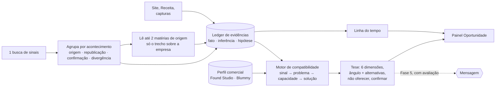

# 17 — Entrega da diretriz de 26/11/2026: motor de inteligência comercial

> Entrega ao responsável pelo produto (diretriz [Parte 12](diretrizes/2026-11-26-evolucao-do-motor-de-inteligencia.md#parte-12--entrega-ao-responsável-pelo-produto)) e fechamento da Parte 13 (13.11). Estado em **2026-11-26**, no `pnpm dev` e nos testes. Nada foi commitado; o app instalado em `D:\Prospector` não foi atualizado; nenhum dado do banco real foi gravado ou apagado. Detalhes técnicos: [doc 15](15-motor-de-inteligencia.md) (diagnóstico, arquitetura e estado por fase), [ADR-0019](adr/0019-motor-de-inteligencia-comercial.md) (decisão) e [doc 16](16-prontidao-operacional.md) (prontidão).

## 1. Em uma tela

**Feito e testado**
- **Capturas guardadas de verdade** (Parte 13): pasta criada sozinha, imagens de computador e celular com rodapé, menu e página interna, retenção de 12 meses sem apagar as antigas, tela anti-robô recusada. Validado no `pnpm dev` com sites reais.
- **Copiloto com tela de chat** (Parte 6.1): o documento não rola, só o histórico; o campo de mensagem fica sempre à vista. Em tela estreita, conversas salvas e IA local abrem numa gaveta por cima da conversa: Esc fecha, a conversa coberta sai do alcance do teclado e a escolha de uma conversa fecha a gaveta.
- **Perfis comerciais** Found Studio e Blummy, independentes, com a hierarquia capacidade → problema → serviço → solução → entregável e o modo de entrega de cada capacidade (Parte 1).
- **Acontecimentos investigados** (Parte 2.3): a análise lê a matéria de origem, extrai valor, rodada, investidores, modalidade, finalidade e contexto com trecho literal, separa republicação de confirmação, registra divergências e monta a linha do tempo.
- **Evidências** (Parte 3): fato, interpretação e hipótese separados; imprensa reconhecida acima de título de busca; confirmações no ledger; potencial separado de confiança.
- **Tese comercial** (Parte 4): seis dimensões qualitativas com motivo e evidência, um ângulo principal e até duas alternativas, o que não oferecer e o que confirmar, e a recomendação (abordar, aprofundar ou não priorizar). Aparece no painel Oportunidade da empresa.

**Feito em parte**
- Relatório em 15 seções (Parte 7): a maior parte das seções já tem conteúdo na página aprovada; faltam resumo executivo com as cinco perguntas, produto e tecnologia, estrutura organizacional e pessoas (§6).
- Seis cenários (Parte 8): casos 1, 3, 4 e 6 testados nas regras; 2 e 5 dependem das Fases 5 e 6.

**Não iniciado (depende de autorização)**
- Mensagem a partir da tese (Parte 5): exige prompt novo avaliado com `pnpm evals` (GPU).
- Copiloto operador com pesquisa extensa e contexto persistente (Partes 6.2 a 6.5): exige migração e revisão LGPD.

## 2. Diagnóstico do funcionamento atual (antes desta entrega)

Resumo do [doc 15 §1 a §6](15-motor-de-inteligencia.md#1-resumo-em-doze-pontos):

- O catálogo eram três entregáveis de marca; não havia perfil comercial nem Blummy.
- Um acontecimento ficava no título de um resultado de busca, sem leitura da matéria, sem data, valor ou finalidade.
- A notícia valia como agregador (confiança baixa) mesmo vinda de imprensa reconhecida: a Série D de R$ 150 milhões da Flash virou "fato, confiança baixa".
- A ponte para a abordagem punha as medições do site na frente: a mensagem da Flash abriu pelo contraste.
- O Copiloto rolava a página inteira e não guarda pesquisa, critério nem resultado por conversa.
- As capturas dependiam de uma variável que ninguém configurou: nenhuma imagem era guardada.

## 3. Arquitetura de inteligência (o que roda agora)

- **Tudo o que é novo é regra testável**, sem chamada a modelo: detecção do acontecimento, extração com trecho conferido, agrupamento, hierarquia de fontes, dimensões e tese. O modelo entra na Fase 5, escrevendo a narrativa e a mensagem a partir da tese.
- **Nenhuma tabela nova.** Acontecimento é claim do ledger (`signal.web.*`) com valor estruturado; a tese fica no JSON do diagnóstico; os perfis são dado versionado no código, validado por contrato.
- **Fronteiras do ADR-0001 mantidas:** regras em `packages/domain`, contratos em `packages/contracts`, orquestração em `packages/application`, tela em `apps/web`.

## 4. Mapa de capacidades comerciais

Modo de entrega **provisório e conservador** ("direto" só onde há portfólio publicado). Precisa da confirmação do usuário (KI-207).

| Família | Direto | Dirigido | Com parceiros | Não comprovado |
|---|---|---|---|---|
| A — Estratégia e Inteligência de Marca | Diagnóstico de marca, análise competitiva, posicionamento, proposta de valor, personalidade e território, naming, arquitetura de marca | Pesquisa de mercado, pesquisa de público, estratégia de comunicação | — | — |
| B — Branding e Sistemas de Identidade | Identidade visual, rebranding, sistemas gráficos, tipográfico e cromático, direção visual, brandbook, guidelines, aplicações, consistência entre pontos de contato | — | — | — |
| C — Direção Criativa e Comunicação | Direção de arte, key visuals, materiais comerciais | Campanhas, comunicação institucional, narrativas, conteúdo | Direção fotográfica, direção audiovisual | — |
| D — Produto e Experiência Digital | Product discovery, product design, UX/UI, arquitetura da informação, user flows, wireframes, design systems, prototipagem, websites | Product management, roadmaps | MVPs, plataformas, aplicativos, portais, e-commerce | — |
| E — Tecnologia, IA e Inovação | — | Estruturação de soluções tecnológicas | — | Consultoria de IA, workflows, agentes, integrações, automação, sistemas internos, SaaS, IA para comunicação e para operações |
| F — Direção de Projetos e Estruturação Operacional | Gestão de projetos, coordenação multidisciplinar | Arquitetura de processos, gestão de demandas, fluxos de aprovação | — | Centrais de projetos |
| G — Blummy: gestão para a área terapêutica | Gestão da rotina de atendimento (funcionalidades a confirmar) | — | — | — |

**Problemas e soluções da Found Studio** (o problema é sempre hipótese até ser confirmado):

| Problema | Sinais que o tornam plausível | Solução |
|---|---|---|
| Produto digital em estruturação | Investimento, lançamento, contratação, liderança, novo mercado, aquisição | Estruturação e evolução do produto digital (diagnóstico, discovery, roadmap, UX/UI, design system, direção de implementação) |
| Marca depois de mudança estrutural | Aquisição, fusão, novo mercado, parceria, expansão | Marca para a nova estrutura da empresa |
| Marca desalinhada ao momento | Liderança, reestruturação, expansão, aniversário | Marca para a nova estrutura da empresa |
| Comunicação de lançamento | Lançamento, expansão, novo mercado, prêmio | Comunicação do lançamento ou da expansão |
| Operação em crescimento | Expansão, investimento, reestruturação, contratação, fusão, aquisição | Estruturação da operação de projetos |
| IA aplicada à operação | Reestruturação, investimento, lançamento | IA aplicada à operação (capacidades ainda não comprovadas: a tese manda não vender como experiência) |
| Experiência digital com falhas | Só medições do site | Ajustes de experiência no site (nunca disputa o ângulo quando há acontecimento) |

**Blummy:** clínica em crescimento e rotina do profissional → assinatura da Blummy (para clínicas ou para profissionais independentes). Faltam funcionalidades, planos, preços, cases e tom; nada disso foi inventado.

**Identificação da operação:** `identifyCommercialProfile` reconhece a operação pelo nome e depois pelas palavras do público; empate devolve "perguntar". Ainda não está ligada ao Copiloto (Fase 6).

## 5. Modelo de compatibilidade

1. **Ranking dos problemas:** força do sinal (investimento, aquisição e fusão pesam mais; medição do site, menos), ordem do sinal no problema, recência, qualidade da evidência e se o acontecimento cita a área do problema (contratação de engenharia → produto). Problema só de site sai do ranking quando há acontecimento.
2. **Seis dimensões qualitativas** (alto, médio, baixo, indeterminado), cada uma com motivo e as evidências:
   - potencial estratégico;
   - qualidade das evidências (divergência entre fontes → baixa);
   - compatibilidade comercial (quanto da solução é entrega direta);
   - momento (até 180 dias, até 540, mais antigo, ou sem data);
   - acesso a quem decide (nunca "alto" sem decisores, KI-210);
   - viabilidade de execução.
3. **Recomendação:** sem ângulo → aprofundar; só site → não priorizar; divergência, evidência fraca, acontecimento antigo ou sem data → aprofundar; senão → vale preparar a abordagem, confirmando os pontos abertos.
4. **O que não oferecer:** investimento como orçamento; auditoria do site quando há acontecimento; o que o perfil evita depois de certos acontecimentos (ex.: rebranding depois de troca de marca); capacidade não comprovada como experiência; o portfólio inteiro.
5. **O que confirmar:** pontos do problema, finalidade e modalidade do investimento, divergências, leitura da matéria original, outra fonte independente e quem decide.

## 6. Fluxo completo de investigação

1. **Contexto:** dossiê e estratégia.
2. **Site oficial e páginas:** leitor do Prospector (robots.txt, `noai`, `noarchive`, SSRF).
3. **Capturas:** computador e celular, rodapé, menu, página interna, todas guardadas com metadados (Parte 13).
4. **Acontecimentos (novo):**
   - uma busca;
   - agrupa as matérias de cada acontecimento;
   - lê até 2 matérias de origem e guarda só título e trechos citados;
   - valor e rodada só de frases que citam a empresa;
   - grava fato (matéria lida) ou hipótese (título), com confirmações como evidência e divergências no raciocínio;
   - texto que se dirige a máquinas fica fora do enunciado;
   - `noarchive` guarda só o título.
5. **Concorrentes.**
6. **Análise da IA:** posicionamento, sinais do site e leitura visual.
7. **Diagnóstico e tese (novo):** linha do tempo, motor de compatibilidade e tese, guardados no diagnóstico.

O relatório da empresa, pela Parte 7:

| Seção | Onde está hoje |
|---|---|
| 1. Resumo executivo | Parcial: "leitura do topo" do diagnóstico; as cinco perguntas dependem da narrativa (Fase 5) |
| 2. Perfil da empresa | Cadastro e Receita |
| 3. Momento empresarial | Tese: "por que agora" e dimensão Momento |
| 4. Linha do tempo | **Nova**, no painel Oportunidade |
| 5. Mercado | Painel Mercado |
| 6. Produto e tecnologia | Falta |
| 7. Marca e posicionamento | Painel Marca |
| 8. Estrutura organizacional | Falta |
| 9 e 10. Oportunidades e necessidades potenciais | Tese (problema provável) e serviços |
| 11. Compatibilidade | Dimensões da tese |
| 12. Estratégia recomendada | Ângulo principal e alternativas |
| 13. Pessoas para abordar | Bloqueado: sem entidade de pessoa (KI-210) |
| 14. Fontes e evidências | Painel Evidências e "Em que se apoia" em cada bloco |
| 15. Incertezas | "O que ainda não sabemos" e "O que confirmar antes" |

## 7. Fluxo de geração de mensagens

- **Hoje (sem mudança):** o Relacionamento parte da oferta escolhida e dos achados do diagnóstico, sem a tese, o destinatário ou a linguagem da empresa. Uma abordagem preparada agora ainda pode abrir pela medição do site (KI-209). Aprovação humana, hash do conteúdo, supressão e auditoria seguem iguais (regra 2).
- **Proposto (Fase 5):** a mensagem parte da tese **aprovada pelo usuário**: o ângulo principal, o assunto de abertura, o que não oferecer e o que confirmar entram no prompt como estrutura. A linguagem da empresa entra como medida (formalidade, termos recorrentes). Prompt novo só é promovido depois de `pnpm evals` com casos da Parte 8.

## 8. Arquitetura do Copiloto

- **Hoje:**
  - tela de chat nova;
  - conversas salvas (IA-2);
  - prompt `copilot/v3` preservado;
  - ferramentas só de leitura (empresas, Descoberta e pesquisa na internet com Tavily);
  - não altera dados e não envia mensagens.
- **Proposto (Fase 6):**
  - identificar a operação pelo pedido (`identifyCommercialProfile`, pronto);
  - pesquisa extensa em lotes, com dedupe e progresso;
  - contexto persistente por conversa (objetivo, perfil, critérios, resultados), que exige tabela nova (`copilot_research` ou `thread_id` na Descoberta);
  - para o caso Blummy (100 terapeutas ocupacionais), entidade de pessoa com base legal por contato.
  - Bloqueios: migração, revisão LGPD e prompt novo avaliado.

## 9. Alterações implementadas

| Área | Arquivos |
|---|---|
| Contratos | `packages/contracts/src/commercial.ts` (perfil, acontecimento, investimento, tese); `investigation.ts` (`Diagnosis.thesis`) |
| Regras | `packages/domain/src/commercial/`: `profiles.ts`, `identify.ts`, `events.ts` (detecção e extração), `reports.ts` (fontes e republicação), `timeline.ts` (linha do tempo e duplicidade), `compatibility.ts` (tese), `text.ts` |
| Investigação | `packages/application/src/services/investigation/collect.ts` (etapa de acontecimentos e página interna da captura), `qualify.ts` (tese no diagnóstico), `evidence-service.ts` (imprensa reconhecida) |
| Capturas (Parte 13) | `packages/integrations/src/capture-store.ts`, `web/brand-capturer.ts`, `web/browser.ts`, `web/html.ts`, `web/page-reader.ts`; instalador e desinstalador em `scripts/app/` |
| Telas | `apps/web/src/components/companies/thesis-section.tsx` e `timeline-section.tsx` (novas), `investigation-panels.tsx`; Copiloto: `copiloto/page.tsx`, `copilot/side-column.tsx`, `copilot-chat.tsx`; Configurações › Sistema (pasta das capturas) |
| Documentos | doc 15, doc 16, este doc, ADR-0019 (novo), ADR-0015 (emenda 6a), runbook, `known-issues.md` (KI-204 a KI-213), checklist de leitura de imprensa no doc 05 |

**Revisões independentes** (subagentes de arquitetura, segurança, conformidade e UX), todas corrigidas ou registradas:
- **Arquitetura:** o valor era lido da página inteira, e podia vir de outra matéria → agora só de frases que citam a empresa. As confirmações não entravam no ledger → entram. Trechos cortados e evento sem conferência → todos na fonte, com contrato conferido antes de gravar. Regra de perfil escrita no código → foi para o perfil. Chave que colidia → inclui o título. Duplicidade entre análises → removida. Acontecimento sem data levava a "abordar" → agora leva a "aprofundar".
- **Segurança:** o texto da matéria chegava ao enunciado, que vai para a IA da mensagem → filtro de instrução embutida e título da página lida. O nome do veículo entra escapado na expressão regular. Expressões regulares testadas contra entradas de 100 mil caracteres (no máximo 60 ms).
- **Conformidade:** com `noarchive`, agora fica só o título. Nomes de pessoas sem prazo → KI-212. Restrições da Blummy só no texto → KI-207. Termos dos veículos e base legal → KI-213, com validação jurídica.
- **UX:**
  - Gaveta do Copiloto: com `inert`, Esc, foco e fechamento ao escolher uma conversa.
  - Altura correta entre 640 e 767 px.
  - Aviso "conversa não é salva" visível no celular.
  - Dimensões com evidência e aviso quando a evidência foi substituída.
  - Textos longos no celular, títulos navegáveis e estados vazios com próxima ação.
  - "Acesso a quem decide" no lugar de "Acessibilidade".

## 10. Evidências dos testes

Rodada final de 2026-11-26, depois das correções das revisões:

| Verificação | Resultado |
|---|---|
| `pnpm typecheck` | 9 de 9 pacotes |
| `pnpm lint` | Fronteiras do ADR-0001 e ESLint sem erro |
| `pnpm format:check` | Sem diferença |
| `pnpm test` | **2.063 testes passando** (domínio 555, aplicação 370, agentes 346, integrações 226, contratos 195, web 194, banco em PGlite 137, programa de desktop 40) |
| `pnpm test:e2e` (`E2E_PORT=3120`, `E2E_MEMORY_PORT=3130`, sem Ollama e sem banco real) | 103 passando, 3 pulados (os que exigem Ollama real ou banco real). Inclui o Copiloto em 1280, 700 e 375 px, a gaveta do celular (Esc devolve o foco, conversa inerte enquanto aberta) e o aviso das capturas na tela de Configurações |

Casos da Parte 8 cobertos (dados sintéticos, marcados como tal):

| Caso | Onde | O que o teste garante |
|---|---|---|
| 1 — Flash | `packages/domain/tests/commercial/events.test.ts`, `compatibility.test.ts`; `packages/application/tests/investigation-service.test.ts` | Valor, rodada, investidores e modalidade com trecho literal; finalidade "não documentada"; contexto "não precisava de dinheiro"; a matéria de origem é lida e vira fato com confiança acima de agregador; republicação não confirma, apuração própria confirma e entra no ledger; o valor de outra matéria da mesma página não entra; a tese não abre pelo site e diz para não tratar investimento como orçamento |
| 3 — Startup contratando | `compatibility.test.ts` | Contratação de produto e engenharia leva a "produto em estruturação", não a marca |
| 4 — Só problema de site | `compatibility.test.ts` | Recomendação "não priorizar agora" |
| 6 — Fontes divergentes | `compatibility.test.ts` | Divergência registrada, evidência "baixa", recomendação "aprofundar" e confirmação da versão |
| Segurança e conformidade | `investigation-service.test.ts` | Título com instrução para máquinas fica fora do enunciado; página com `noarchive` guarda só o título |
| Tela | `apps/web/src/components/companies/thesis-render.test.ts`; `apps/web/e2e/copilot.spec.ts` | Tese com seis dimensões e aviso de evidência substituída; linha do tempo em ordem, sem duplicar a mesma rodada e sem link perigoso; Copiloto sem rolagem do documento em 1280, 700 e 375 px, gaveta com Esc e foco |

Casos 2 (Blummy, 100 terapeutas) e 5 (demanda explícita) e as métricas com revisão humana dependem das Fases 5 e 6 e da GPU.

## 11. Limitações

- **KI-207:** perfis no código e modos de entrega provisórios; restrições da Blummy só no texto.
- **KI-208:**
  - um acontecimento vale 30 dias como sinal;
  - a corroboração usa só a mesma busca (teto de 3 buscas por análise);
  - a extração funciona só com matérias em português.
- **KI-209:** a mensagem ainda não usa a tese.
- **KI-210:** sem decisores; "acesso a quem decide" nunca é alto.
- **KI-211:** lista de imprensa proposta; claims antigos não são recalculados.
- **KI-212:** nomes de pessoas em fatos de acontecimento ficam sem prazo até existir o expurgo.
- **KI-213:** termos dos veículos e base legal para nomes de terceiros sem validação jurídica.
- **Parte 13:** capturas ainda não chegaram ao app instalado (KI-205); o banco não tem backup.
- **Sem teste com o modelo real nesta entrega:** a tese é regra. A investigação completa com Ollama e banco real não foi rodada depois das mudanças (§12).

## 12. Decisões pendentes (dependem do usuário)

1. **Aceitar o ADR-0019** e confirmar o modo de entrega de cada capacidade (§4) e os dados da Blummy.
2. **`pnpm app:install`:** leva capturas, tese e Copiloto ao app instalado e cria `D:\Prospector-dados`. Fecha e reabre o Prospector.
3. **Uma análise real com o banco `prospector-dev`** (grava dados do usuário) para validar ponta a ponta com a Flash, depois da instalação.
4. **Autorizar a GPU** para `pnpm evals`, condição da Fase 5 (mensagem a partir da tese) e da troca de modelo.
5. **Migrações** (skill `migracao-supabase`): `commercial_profiles` + `profile_id` na Estratégia; pesquisa do Copiloto; entidade de pessoa, com revisão LGPD.
6. **Validação jurídica** (KI-213): termos dos veículos de imprensa; base legal para nomes de investidores e executivos; citação de trechos.
7. **Backup do banco:** plano pago ou `pg_dump` com a senha do Postgres.
8. **Limpeza opcional:** apagar `D:\prospector-validacao-13-7` e as versões antigas do Chromium no C:.

## 13. Parte 13 (13.11), atualizada

O inventário completo está no [doc 16 §4](16-prontidao-operacional.md#4-entrega-da-parte-13-1311). Esta entrega acrescenta:

- **Problemas encontrados e corrigidos nesta etapa:**
  - o teste de fumaça das Configurações falhava porque o estado da pasta de capturas usava o mesmo marcador do estado do banco (`data-status`);
  - o valor de outra matéria podia virar fato da empresa;
  - texto externo chegava ao enunciado lido pela IA.
- **Integrações validadas:** as mesmas do doc 16. A leitura de matérias usa o leitor já validado, sem crédito de busca a mais.
- **Funcionalidades aprovadas pelo 13.10 no `pnpm dev`:** capturas (doc 16) e a tela de chat do Copiloto (e2e em computador, tela média e celular).
- **Funcionalidades implementadas e testadas, mas não aprovadas pelo 13.10:** tese e linha do tempo. Falta a validação de ponta a ponta com Ollama e banco real, que depende das decisões 2 e 3.
