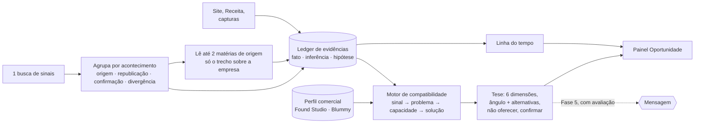

# 17 — Entrega da diretriz de 26/11/2026: motor de inteligência comercial

> Entrega ao responsável pelo produto (diretriz [Parte 12](diretrizes/2026-11-26-evolucao-do-motor-de-inteligencia.md#parte-12--entrega-ao-responsável-pelo-produto)) e fechamento da Parte 13 (13.11). Estado em **2026-11-27**. As Partes 1 a 5 estão commitadas no ramo `conclusao-produto` até `1993c7e`; as Partes 6.2 a 8, as correções das revisões e as da validação da Flash entram nos commits de 27/11 do mesmo ramo. As migrações de 27/11 estão aplicadas no `prospector-dev`. A primeira análise real (Flash, no app instalado) foi feita pelo usuário; o que ela mostrou e o que mudou por causa dela estão no §11a. Nenhum dado do banco real foi apagado. Detalhes técnicos: [doc 15](15-motor-de-inteligencia.md) (diagnóstico, arquitetura e estado por fase), [ADR-0019](adr/0019-motor-de-inteligencia-comercial.md) (decisão) e [doc 16](16-prontidao-operacional.md) (prontidão).

## 1. Em uma tela

**Feito e testado**
- **Capturas guardadas de verdade** (Parte 13): pasta criada sozinha, imagens de computador e celular com rodapé, menu e página interna, retenção de 12 meses sem apagar as antigas, tela anti-robô recusada. Validado no `pnpm dev` com sites reais.
- **Copiloto com tela de chat** (Parte 6.1): o documento não rola, só o histórico; o campo de mensagem fica sempre à vista. Em tela estreita, conversas salvas e IA local abrem numa gaveta por cima da conversa: Esc fecha, a conversa coberta sai do alcance do teclado e a escolha de uma conversa fecha a gaveta.
- **Perfis comerciais** Found Studio e Blummy, independentes, com a hierarquia capacidade → problema → serviço → solução → entregável e o modo de entrega de cada capacidade (Parte 1).
- **Acontecimentos investigados** (Parte 2.3): a análise lê a matéria de origem, extrai valor, rodada, investidores, modalidade, finalidade e contexto com trecho literal, separa republicação de confirmação, registra divergências e monta a linha do tempo.
- **Evidências** (Parte 3): fato, interpretação e hipótese separados; imprensa reconhecida acima de título de busca; confirmações no ledger; potencial separado de confiança.
- **Tese comercial** (Parte 4): seis dimensões qualitativas com motivo e evidência, um ângulo principal e até duas alternativas, o que não oferecer e o que confirmar, e a recomendação (abordar, aprofundar ou não priorizar). Aparece no painel Oportunidade da empresa.

- **Mensagem a partir da tese** (Parte 5): Preparar abordagem oferece o ângulo da tese (principal, alternativas ou "sem a tese"); a base aprovada fica gravada e a nova versão continua no mesmo ângulo. Prompts `relationship-approach/v5` e `relationship-message/v5` promovidos pelo doc 11 §4.3 com `pnpm evals` (estratégia 89–90% → 96–97%, mensagem 95% → 96–97%, 0 erros de formato).
- **Copiloto que opera a pesquisa extensa** (Partes 6.2 a 6.5): "Quero encontrar 100 terapeutas ocupacionais no Brasil para apresentar a Blummy." vira uma pesquisa ligada à conversa, com perfil, premissas, plano por profissão e região e teto de buscas; roda em lotes na fila (continua se o app fechar); pedidos seguintes na mesma conversa ("agora priorize SP e MG", "mais 50", "só no Paraná", "pare", "continue") mudam a mesma pesquisa sem refazer o que foi achado. Cada achado tem fonte, trecho, papel para o perfil (usuário, comprador, influenciador) e se pode ser abordado. Revisão em Copiloto › Pesquisas, com CSV auditado. Testado com buscador sintético (unitários, rota e e2e); falta a rodada com a Tavily e o banco real (§12).

**Feito em parte**
- Relatório em 15 seções (Parte 7): resumo executivo com as cinco perguntas, produto e tecnologia e estrutura organizacional feitos em 27/11; só "Pessoas para abordar" segue bloqueada (§6).
- Seis cenários (Parte 8): os seis testados com dados sintéticos (caso 2: distribuição da pesquisa extensa por região, segmento e papel; caso 5: demanda declarada com o que procura, prazo e canal). As doze métricas têm revisão humana com instrumento próprio (`pnpm review:quality`), ainda não preenchida pelo usuário (KI-231).

## 2. Diagnóstico do funcionamento atual (antes desta entrega)

Resumo do [doc 15 §1 a §6](15-motor-de-inteligencia.md#1-resumo-em-doze-pontos):

- O catálogo eram três entregáveis de marca; não havia perfil comercial nem Blummy.
- Um acontecimento ficava no título de um resultado de busca, sem leitura da matéria, sem data, valor ou finalidade.
- A notícia valia como agregador (confiança baixa) mesmo vinda de imprensa reconhecida: a Série D de R$ 150 milhões da Flash virou "fato, confiança baixa".
- A ponte para a abordagem punha as medições do site na frente: a mensagem da Flash abriu pelo contraste.
- O Copiloto rolava a página inteira e não guarda pesquisa, critério nem resultado por conversa.
- As capturas dependiam de uma variável que ninguém configurou: nenhuma imagem era guardada.

## 3. Arquitetura de inteligência (o que roda agora)

- **Tudo o que é novo é regra testável**, sem chamada a modelo: detecção do acontecimento, extração com trecho conferido, agrupamento, hierarquia de fontes, dimensões e tese. O modelo entra na Fase 5, escrevendo a narrativa e a mensagem a partir da tese.
- **Nenhuma tabela nova.** Acontecimento é claim do ledger (`signal.web.*`) com valor estruturado; a tese fica no JSON do diagnóstico; os perfis são dado versionado no código, validado por contrato.
- **Fronteiras do ADR-0001 mantidas:** regras em `packages/domain`, contratos em `packages/contracts`, orquestração em `packages/application`, tela em `apps/web`.

## 4. Mapa de capacidades comerciais

Modo de entrega **provisório e conservador** ("direto" só onde há portfólio publicado). Precisa da confirmação do usuário (KI-207).

| Família | Direto | Dirigido | Com parceiros | Não comprovado |
|---|---|---|---|---|
| A — Estratégia e Inteligência de Marca | Diagnóstico de marca, análise competitiva, posicionamento, proposta de valor, personalidade e território, naming, arquitetura de marca | Pesquisa de mercado, pesquisa de público, estratégia de comunicação | — | — |
| B — Branding e Sistemas de Identidade | Identidade visual, rebranding, sistemas gráficos, tipográfico e cromático, direção visual, brandbook, guidelines, aplicações, consistência entre pontos de contato | — | — | — |
| C — Direção Criativa e Comunicação | Direção de arte, key visuals, materiais comerciais | Campanhas, comunicação institucional, narrativas, conteúdo | Direção fotográfica, direção audiovisual | — |
| D — Produto e Experiência Digital | Product discovery, product design, UX/UI, arquitetura da informação, user flows, wireframes, design systems, prototipagem, websites | Product management, roadmaps | MVPs, plataformas, aplicativos, portais, e-commerce | — |
| E — Tecnologia, IA e Inovação | — | Estruturação de soluções tecnológicas | — | Consultoria de IA, workflows, agentes, integrações, automação, sistemas internos, SaaS, IA para comunicação e para operações |
| F — Direção de Projetos e Estruturação Operacional | Gestão de projetos, coordenação multidisciplinar | Arquitetura de processos, gestão de demandas, fluxos de aprovação | — | Centrais de projetos |
| G — Blummy: gestão para a área terapêutica | Gestão da rotina de atendimento (funcionalidades a confirmar) | — | — | — |

**Problemas e soluções da Found Studio** (o problema é sempre hipótese até ser confirmado):

| Problema | Sinais que o tornam plausível | Solução |
|---|---|---|
| Produto digital em estruturação | Investimento, lançamento, contratação, liderança, novo mercado, aquisição | Estruturação e evolução do produto digital (diagnóstico, discovery, roadmap, UX/UI, design system, direção de implementação) |
| Marca depois de mudança estrutural | Aquisição, fusão, novo mercado, parceria, expansão | Marca para a nova estrutura da empresa |
| Marca desalinhada ao momento | Liderança, reestruturação, expansão, aniversário | Marca para a nova estrutura da empresa |
| Comunicação de lançamento | Lançamento, expansão, novo mercado, prêmio | Comunicação do lançamento ou da expansão |
| Operação em crescimento | Expansão, investimento, reestruturação, contratação, fusão, aquisição | Estruturação da operação de projetos |
| IA aplicada à operação | Reestruturação, investimento, lançamento | IA aplicada à operação (capacidades ainda não comprovadas: a tese manda não vender como experiência) |
| Experiência digital com falhas | Só medições do site | Ajustes de experiência no site (nunca disputa o ângulo quando há acontecimento) |

**Blummy:** clínica em crescimento e rotina do profissional → assinatura da Blummy (para clínicas ou para profissionais independentes). Faltam funcionalidades, planos, preços, cases e tom; nada disso foi inventado.

**Identificação da operação:** `identifyCommercialProfile` reconhece a operação pelo nome e depois pelas palavras do público; empate devolve "perguntar". Ainda não está ligada ao Copiloto (Fase 6).

## 5. Modelo de compatibilidade

1. **Ranking dos problemas:** força do sinal (investimento, aquisição e fusão pesam mais; medição do site, menos), ordem do sinal no problema, recência, qualidade da evidência e se o acontecimento cita a área do problema (contratação de engenharia → produto). Problema só de site sai do ranking quando há acontecimento.
2. **Seis dimensões qualitativas** (alto, médio, baixo, indeterminado), cada uma com motivo e as evidências:
   - potencial estratégico;
   - qualidade das evidências (divergência entre fontes → baixa);
   - compatibilidade comercial (quanto da solução é entrega direta);
   - momento (até 180 dias, até 540, mais antigo, ou sem data);
   - acesso a quem decide (nunca "alto" sem decisores, KI-210);
   - viabilidade de execução.
3. **Recomendação:** sem ângulo → aprofundar; só site → não priorizar; divergência, evidência fraca, acontecimento antigo ou sem data → aprofundar; senão → vale preparar a abordagem, confirmando os pontos abertos.
4. **O que não oferecer:** investimento como orçamento; auditoria do site quando há acontecimento; o que o perfil evita depois de certos acontecimentos (ex.: rebranding depois de troca de marca); capacidade não comprovada como experiência; o portfólio inteiro.
5. **O que confirmar:** pontos do problema, finalidade e modalidade do investimento, divergências, leitura da matéria original, outra fonte independente e quem decide.

## 6. Fluxo completo de investigação

1. **Contexto:** dossiê e estratégia.
2. **Site oficial e páginas:** leitor do Prospector (robots.txt, `noai`, `noarchive`, SSRF).
3. **Capturas:** computador e celular, rodapé, menu, página interna, todas guardadas com metadados (Parte 13).
4. **Acontecimentos (novo):**
   - uma busca;
   - agrupa as matérias de cada acontecimento;
   - lê até 2 matérias de origem e guarda só título e trechos citados;
   - valor e rodada só de frases que citam a empresa;
   - grava fato (matéria lida) ou hipótese (título), com confirmações como evidência e divergências no raciocínio;
   - texto que se dirige a máquinas fica fora do enunciado;
   - `noarchive` guarda só o título.
5. **Concorrentes.**
6. **Análise da IA:** posicionamento, sinais do site e leitura visual.
7. **Diagnóstico e tese (novo):** linha do tempo, motor de compatibilidade e tese, guardados no diagnóstico.

O relatório da empresa, pela Parte 7:

| Seção | Onde está hoje |
|---|---|
| 1. Resumo executivo | **Feito (27/11):** no topo ("Vale abordar?"), as cinco perguntas respondidas por regra a partir do ledger, dos acontecimentos e da tese (`executiveSummary`, `packages/domain/src/commercial/report-sections.ts`), cada uma com o caminho para a seção completa; sem base, a resposta diz o que falta |
| 2. Perfil da empresa | Cadastro e Receita |
| 3. Momento empresarial | Tese: "por que agora" e dimensão Momento |
| 4. Linha do tempo | **Nova**, no painel Oportunidade |
| 5. Mercado | Painel Mercado |
| 6. Produto e tecnologia | **Feito (27/11):** painel próprio com o que o site oferece (`positioning.offering.*`, que saiu de Mercado) e lançamentos, parcerias e investimentos ligados a produto, com o destino declarado da rodada. As ferramentas e linguagens que a empresa usa não são levantadas (a tela diz) |
| 7. Marca e posicionamento | Painel Marca |
| 8. Estrutura organizacional | **Feito (27/11):** painel próprio com natureza jurídica, porte, matriz ou filial, início de atividade, capital social e sede (Receita), mudanças de liderança, equipe e estrutura, e o papel a procurar pela tese. Nomes e cargos de pessoas da empresa não são levantados |
| 9 e 10. Oportunidades e necessidades potenciais | Tese (problema provável) e serviços |
| 11. Compatibilidade | Dimensões da tese |
| 12. Estratégia recomendada | Ângulo principal e alternativas |
| 13. Pessoas para abordar | Parcial: a página mostra o papel a procurar pela tese (topo, Estrutura organizacional e Com quem falar). A tabela de pessoas existe desde a pesquisa do Copiloto (ADR-0020), mas não é ligada a empresas; levantar quem trabalha numa empresa analisada segue fora (KI-210) |
| 14. Fontes e evidências | Painel Evidências e "Em que se apoia" em cada bloco |
| 15. Incertezas | "O que ainda não sabemos" e "O que confirmar antes" |

## 7. Fluxo de geração de mensagens

- **Antes:** o Relacionamento partia da oferta escolhida e dos achados do diagnóstico, sem a tese; uma abordagem podia abrir pela medição do site (KI-209).
- **Agora (Fase 5, commit `1993c7e`):** a mensagem parte do ângulo da tese **escolhido pelo usuário** em Preparar abordagem: o assunto de abertura, a estratégia por acontecimento, o que não oferecer e o que confirmar entram no prompt como estrutura (`thesisBasis` gravado com a abordagem). A linguagem pública da empresa entra como medida (formalidade, tratamento, termos recorrentes). Prompts v5 promovidos pelo doc 11 §4.3. Aprovação humana, hash do conteúdo, supressão e auditoria seguem iguais (regra 2).

## 8. Arquitetura do Copiloto

- **Hoje:**
  - tela de chat nova;
  - conversas salvas (IA-2);
  - prompt `copilot/v3` preservado;
  - ferramentas só de leitura (empresas, Descoberta e pesquisa na internet com Tavily);
  - não altera dados e não envia mensagens.
- **Agora (Fase 6):**
  - **Operador por regra, antes do modelo** (`runResearchTurn`): pedido de pesquisa cria; mudança pedida na mesma conversa muda a pesquisa mais recente dela. A resposta diz o que foi entendido, as premissas e o plano, e aponta "Ver a pesquisa"; fica salva no histórico, então a pergunta seguinte ao modelo já sabe da pesquisa. O prompt `copilot/v3` continua o mesmo.
  - **Pesquisa em lotes** (`copilot_research`, um lote por tarefa da fila `ai_jobs`): 5 buscas por lote, 10 resultados por busca, versão otimista contra mudança no meio do lote, nova tentativa sem avançar quando o buscador cai, parada com motivo (quantidade atingida, teto de buscas, orçamento do mês, fontes esgotadas, busca indisponível, cancelada).
  - **Extração por regra** (`packages/domain/src/research/`): só o título e o trecho do buscador, nunca a página de diretório; nome conferido no trecho; nada de e-mail deduzido; redes sociais e sites que não permitem coleta descartados; descartes contados por motivo.
  - **Pessoas com base legal por linha:** deduplicação e supressão por HMAC com a chave do servidor (KI-222); a pessoa só fica abordável se a LIA aprovada cobrir a fonte e os dados; sem isso, fica 90 dias só para revisão. Opt-out e supressão conferidos antes de gravar.
  - **Sem nomes no chat** (KI-217): a conversa leva contagens e o link; a lista fica na tela da pesquisa, lida das tabelas.
  - **Demonstração:** `PROSPECTOR_DISCOVERY=fixture` em memória usa um buscador sintético com selo DEMO.

## 9. Alterações implementadas

| Área | Arquivos |
|---|---|
| Contratos | `packages/contracts/src/commercial.ts` (perfil, acontecimento, investimento, tese); `investigation.ts` (`Diagnosis.thesis`) |
| Regras | `packages/domain/src/commercial/`: `profiles.ts`, `identify.ts`, `events.ts` (detecção e extração), `reports.ts` (fontes e republicação), `timeline.ts` (linha do tempo e duplicidade), `compatibility.ts` (tese), `text.ts` |
| Investigação | `packages/application/src/services/investigation/collect.ts` (etapa de acontecimentos e página interna da captura), `qualify.ts` (tese no diagnóstico), `evidence-service.ts` (imprensa reconhecida) |
| Capturas (Parte 13) | `packages/integrations/src/capture-store.ts`, `web/brand-capturer.ts`, `web/browser.ts`, `web/html.ts`, `web/page-reader.ts`; instalador e desinstalador em `scripts/app/` |
| Telas | `apps/web/src/components/companies/thesis-section.tsx` e `timeline-section.tsx` (novas), `investigation-panels.tsx`; Copiloto: `copiloto/page.tsx`, `copilot/side-column.tsx`, `copilot-chat.tsx`; Configurações › Sistema (pasta das capturas) |
| Documentos | doc 15, doc 16, este doc, ADR-0019 (novo), ADR-0015 (emenda 6a), runbook, `known-issues.md` (KI-204 a KI-213), checklist de leitura de imprensa no doc 05 |

**Revisões independentes** (subagentes de arquitetura, segurança, conformidade e UX), todas corrigidas ou registradas:
- **Arquitetura:** o valor era lido da página inteira, e podia vir de outra matéria → agora só de frases que citam a empresa. As confirmações não entravam no ledger → entram. Trechos cortados e evento sem conferência → todos na fonte, com contrato conferido antes de gravar. Regra de perfil escrita no código → foi para o perfil. Chave que colidia → inclui o título. Duplicidade entre análises → removida. Acontecimento sem data levava a "abordar" → agora leva a "aprofundar".
- **Segurança:** o texto da matéria chegava ao enunciado, que vai para a IA da mensagem → filtro de instrução embutida e título da página lida. O nome do veículo entra escapado na expressão regular. Expressões regulares testadas contra entradas de 100 mil caracteres (no máximo 60 ms).
- **Conformidade:** com `noarchive`, agora fica só o título. Nomes de pessoas sem prazo → KI-212. Restrições da Blummy só no texto → KI-207. Termos dos veículos e base legal → KI-213, com validação jurídica.
- **UX:**
  - Gaveta do Copiloto: com `inert`, Esc, foco e fechamento ao escolher uma conversa.
  - Altura correta entre 640 e 767 px.
  - Aviso "conversa não é salva" visível no celular.
  - Dimensões com evidência e aviso quando a evidência foi substituída.
  - Textos longos no celular, títulos navegáveis e estados vazios com próxima ação.
  - "Acesso a quem decide" no lugar de "Acessibilidade".

## 10. Evidências dos testes

Rodada final de 2026-11-26, depois das correções das revisões:

| Verificação | Resultado |
|---|---|
| `pnpm typecheck` | 9 de 9 pacotes |
| `pnpm lint` | Fronteiras do ADR-0001 e ESLint sem erro |
| `pnpm format:check` | Sem diferença |
| `pnpm test` | **2.063 testes passando** (domínio 555, aplicação 370, agentes 346, integrações 226, contratos 195, web 194, banco em PGlite 137, programa de desktop 40) |
| `pnpm test:e2e` (`E2E_PORT=3120`, `E2E_MEMORY_PORT=3130`, sem Ollama e sem banco real) | 103 passando, 3 pulados (os que exigem Ollama real ou banco real). Inclui o Copiloto em 1280, 700 e 375 px, a gaveta do celular (Esc devolve o foco, conversa inerte enquanto aberta) e o aviso das capturas na tela de Configurações |

Casos da Parte 8 cobertos (dados sintéticos, marcados como tal):

| Caso | Onde | O que o teste garante |
|---|---|---|
| 1 — Flash | `packages/domain/tests/commercial/events.test.ts`, `compatibility.test.ts`; `packages/application/tests/investigation-service.test.ts` | Valor, rodada, investidores e modalidade com trecho literal; finalidade "não documentada"; contexto "não precisava de dinheiro"; a matéria de origem é lida e vira fato com confiança acima de agregador; republicação não confirma, apuração própria confirma e entra no ledger; o valor de outra matéria da mesma página não entra; a tese não abre pelo site e diz para não tratar investimento como orçamento |
| 3 — Startup contratando | `compatibility.test.ts` | Contratação de produto e engenharia leva a "produto em estruturação", não a marca |
| 4 — Só problema de site | `compatibility.test.ts` | Recomendação "não priorizar agora" |
| 2 — Blummy, pesquisa extensa | `packages/domain/tests/research/research.test.ts`; `apps/web/e2e/copilot-research.spec.ts` | Interpretação do pedido, buscas pelas capitais primeiro, extração por região com descarte de listagens, distribuição real por região, estado, segmento e papel provável (só o que está gravado; opt-out fora; estado vindo só da região da busca contado à parte); a tela da pesquisa mostra "Como os achados se distribuem" |
| 5 — Demanda declarada | `packages/domain/tests/commercial/demand.test.ts`; `investigation-service.test.ts` | "Procura estúdio", "concorrência para agências" e "solicitação de propostas" viram demanda (vaga de emprego e "procura por crédito" não); o que procura, o prazo (com o ano da publicação) e o canal saem com trecho literal; e-mail de pessoa nunca vira canal; a tese responde ao pedido (prazo e canal no "por que agora" e no "para abrir"), escolhe a área pedida (identidade visual é marca, mesmo com "lançamento" no texto), aprofunda se o prazo passou e não vira ângulo fora do portfólio |
| 6 — Fontes divergentes | `compatibility.test.ts` | Divergência registrada, evidência "baixa", recomendação "aprofundar" e confirmação da versão |
| Segurança e conformidade | `investigation-service.test.ts` | Título com instrução para máquinas fica fora do enunciado; página com `noarchive` guarda só o título |
| Tela | `apps/web/src/components/companies/thesis-render.test.ts`; `apps/web/e2e/copilot.spec.ts` | Tese com seis dimensões e aviso de evidência substituída; linha do tempo em ordem, sem duplicar a mesma rodada e sem link perigoso; Copiloto sem rolagem do documento em 1280, 700 e 375 px, gaveta com Esc e foco |

**Rodada de 2026-11-27**, depois das Partes 6.2 a 8, das revisões e das correções da Flash: `pnpm typecheck`, `pnpm lint` e `pnpm format:check` sem erro; `pnpm test` com **2.185 testes passando** (domínio 613, aplicação 416, agentes 348, integrações 226, web 210, contratos 195, banco em PGlite 137, programa de desktop 40), depois das correções da rodada final da Flash; `pnpm test:e2e` (`E2E_PORT=3120`, `E2E_MEMORY_PORT=3130`) com **107 passando e 3 pulados** (os que exigem Ollama ou banco real), incluindo a pesquisa extensa do Copiloto. A tabela acima é a rodada de 26/11.

**Métricas com revisão humana (2026-11-27):** as doze métricas da Parte 8 têm instrumento próprio, sem modelo julgando o próprio trabalho (`pnpm review:quality`, doc 11 §4.3a). A página dos cinco casos sintéticos foi gerada e já mostrou um defeito, corrigido: uma demanda por identidade visual caía em "comunicação do lançamento". Nenhuma revisão humana foi feita ainda (KI-231).

## 11. Limitações

- **KI-207:** perfis no código e modos de entrega provisórios; restrições da Blummy só no texto.
- **KI-208:**
  - um acontecimento vale 30 dias como sinal;
  - a corroboração usa só a mesma busca (teto de 3 buscas por análise);
  - a extração funciona só com matérias em português.
- **KI-209:** a mensagem parte do ângulo da tese aprovado (Parte 5); falta validar no app instalado.
- **KI-210:** sem decisores; "acesso a quem decide" nunca é alto.
- **KI-211:** lista de imprensa proposta; claims antigos não são recalculados.
- **KI-212:** nomes de pessoas em fatos de acontecimento ficam sem prazo até existir o expurgo.
- **KI-213:** termos dos veículos e base legal para nomes de terceiros sem validação jurídica.
- **KI-230:** demanda declarada só por regra em português e só em páginas que citam a empresa; sem busca própria em portais de compras.
- **KI-231:** revisão humana das doze métricas com instrumento pronto, mas ainda não feita; só casos sintéticos na página.
- **Parte 13:** capturas ainda não chegaram ao app instalado (KI-205); o banco não tem backup.
- **KI-233 a KI-242:** achados da validação da Flash e das revisões de 27/11 (§11a).

## 11a. Validação real da Flash (2026-11-26, 23:06) e o que mudou

Primeira análise de ponta a ponta com Ollama, Tavily e o banco `prospector-dev`, feita pelo usuário no app instalado (versão `1993c7e`).

| O que apareceu | O que mudou (27/11) | Estado |
|---|---|---|
| A matéria da Série D, já no ledger desde a Descoberta, não virou acontecimento; a busca de sinais fez uma consulta só e a tese saiu "Não priorizar agora" com momento indeterminado | As matérias dos sinais da Descoberta entram como candidatas e são lidas; sem acontecimento na primeira consulta, vem uma segunda voltada a acontecimentos (dentro do teto de 3 buscas); "levantar/levantará/levantando" reconhecidos (método de sinais 3). Na nova análise no app instalado (27/11, 01:30) a Série D virou fato e a tese passou a "Vale aprofundar", com o ângulo de produto digital; o acontecimento saiu sem data, corrigido em seguida (métodos 4 e 5: a menção, o sinal e o resultado de busca da mesma matéria ficam com a data de publicação do sinal, 19/08/2026) | KI-233: resolvido e validado no app (01:48: fato de 19/08/2026, "Vale preparar a abordagem", momento alto) |
| Topo "Vale abordar" e tese "Não priorizar agora" | A tese aparece como ressalva logo abaixo do título, com o motivo; "O que mudou" diz quando o veredito ou a tese mudam | KI-234: qual regra manda no título é decisão do usuário |
| "Site institucional" na oferta, "Site" na tese | — | KI-235 |
| alertalicitacao.com.br como concorrente | — | KI-236 |
| "Não tem favicon" com confiança alta | O enunciado diz o que foi medido (o HTML não declara) | KI-237: parcial |
| O Copiloto inventou uma tese e disse que conferiu o dossiê sem chamar ferramenta | A ferramenta da empresa entrega a tese gravada | KI-238: o resto pede prompt novo com `pnpm evals` (`copilot/v3` mantido) |
| Histórico do Copiloto com 40 px na janela mínima | Altura mínima com rolagem da página | KI-239: falta conferir na janela do app |
| dc.com e imdb.com em "A confirmar" com o site já confirmado | Candidatos fora das hipóteses quando há site confirmado | KI-240 |
| Na rodada final: um executivo ("a startup liderada por") virou investidor; a tese disse que a finalidade não estava documentada, e a NeoFeed a trazia | Corrigidos (método de sinais 6) | KI-242 |
| Na rodada final: "Flash investe R$ 400 mi" lido como rodada; a mesma Série D em dois veículos não vira um acontecimento só | — | KI-242 |
| Textos que confundiam ("Por regra", "não é levantado", plurais) | Reescritos; o resumo marca o que é inferência | — |

As quatro revisões independentes (arquitetura, segurança, conformidade e UX) sobre a Parte 7, os casos 2 e 5 e essas correções foram aplicadas no que bloqueava ou era importante; o que ficou para depois está no KI-241. Entre o que entrou: a demanda declarada só aceita e-mail do domínio da empresa como canal e exige o tipo de fornecedor depois de "concorrência/seleção/edital"; texto de página dirigido a máquinas tira a demanda e o investimento do acontecimento antes da tese e da mensagem; demanda sem data conferida não leva a "abordar"; pedido de não contato aparece na tese e em "Estrutura organizacional".

## 12. Decisões do usuário

Decididas em 27/11 ("Tudo o que for decisão minha está aprovado"):

1. **ADR-0019 aceito.** O KI-207 continua aberto (perfis no código e restrições da Blummy só no texto).
2. **`pnpm app:install`:** rodado ao fim desta etapa, a partir do ramo `conclusao-produto`; o `versao.txt` de `D:\Prospector` diz o commit instalado.
3. **Análise real com o `prospector-dev`:** feita com a Flash (§11a) e repetida no app instalado em 27/11, com as correções do KI-233 valendo; a data do acontecimento entrou depois (métodos de sinais 4 e 5).
4. **GPU para `pnpm evals`:** usada na Parte 5 (prompts v5 promovidos). O `copilot/v3` continua.
5. **Migrações:** `20261127100000_commercial_profiles`, `20261127110000_people` e `20261127120000_copilot_research` aplicadas no `prospector-dev` em 27/11, com as versões do banco iguais às do repositório.
6. **Validação jurídica (KI-213):** o usuário aceitou o risco por enquanto.
7. **Backup do banco:** segue sem; precisa de plano pago ou da senha do Postgres, que ficam com o usuário (KI-232).
8. **Limpeza:** `D:\prospector-validacao-13-7` está protegida contra exclusão pelo agente e fica para o usuário apagar; as versões 1223 e 1234 do Chromium no C: são usadas por outros programas e ficaram.

Ainda pendente com o usuário: qual regra manda no título de "Vale abordar?" (KI-234) e a revisão humana das doze métricas (KI-231).

## 13. Parte 13 (13.11), atualizada

O inventário completo está no [doc 16 §4](16-prontidao-operacional.md#4-entrega-da-parte-13-1311). Esta entrega acrescenta:

- **Problemas encontrados e corrigidos nesta etapa:**
  - o teste de fumaça das Configurações falhava porque o estado da pasta de capturas usava o mesmo marcador do estado do banco (`data-status`);
  - o valor de outra matéria podia virar fato da empresa;
  - texto externo chegava ao enunciado lido pela IA.
- **Integrações validadas:** as mesmas do doc 16. A leitura de matérias usa o leitor já validado, sem crédito de busca a mais.
- **Funcionalidades aprovadas pelo 13.10 no `pnpm dev`:** capturas (doc 16) e a tela de chat do Copiloto (e2e em computador, tela média e celular).
- **Funcionalidades implementadas e testadas, mas não aprovadas pelo 13.10:** tese e linha do tempo. A primeira análise real (Flash) foi feita e mostrou os problemas do §11a, corrigidos no código; a aprovação depende de repetir a análise no app instalado (KI-233).
