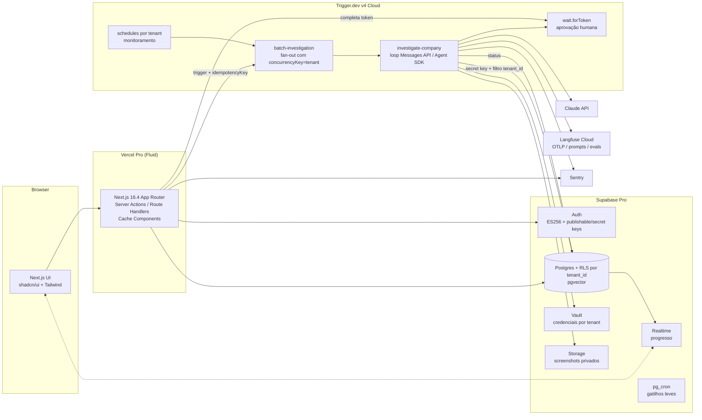

# 04 — Infraestrutura, execução assíncrona, observabilidade e segredos

> Pesquisa técnica de viabilidade. Data de consulta de todas as fontes: **2026-11-09**.
> Contexto: SaaS multi-tenant de prospecção comercial com agentes de IA (Claude API), em TypeScript (Next.js, React, Tailwind, shadcn/ui) e Supabase. Execuções de agentes duram de segundos a vários minutos, têm fan-out paralelo (investigar N empresas), podem esperar aprovação humana e rodam em agenda (monitoramento periódico).
>
> Convenções deste documento:
> - Cada afirmação sobre preço, limite ou disponibilidade traz a URL da fonte (lista completa na seção 5, com os IDs `[Fn]`).
> - **[não verificado]** = não confirmado em fonte oficial nesta pesquisa.
> - **[inferência]** = conclusão minha a partir das fontes, não uma afirmação da fonte.
> - **[fonte secundária]** = vem de blog/agregador de terceiros, não de documentação oficial.
> - Preços em USD, sem impostos. Preços por token da Messages API estão fora do escopo.

---

## 1. Tabela-resumo

| Tecnologia | Propósito | Custo (referência) | Limites relevantes | Riscos | Veredito MVP |
|---|---|---|---|---|---|
| **Supabase Pro** (Postgres, Auth, Storage, Realtime) | Banco, auth, arquivos, tempo real | $25/mês, inclui $10 de crédito de compute (cobre 1 Micro) [F1][F2] | 8 GB de DB, 100 GB de storage, 250 GB de egress, 100k MAU incluídos [F1]; Micro: 1 GB de RAM, 60 conexões diretas e 200 no pooler [F2] | Plano Free pausa após 1 semana inativo [F1]; cada projeto extra paga o próprio compute [F1] | **Adotar** |
| **RLS multi-tenant** (`tenant_id` + funções `security definer` + `(select auth.uid())`) | Isolamento entre tenants no banco | Incluído | Sem índice e sem o `select` envolvendo a função, as políticas ficam ordens de grandeza mais lentas (ex.: 178.000 → 12 ms) [F5] | Workers com secret key ignoram a RLS (`BYPASSRLS`) [F8] | **Adotar** |
| **Custom claims** (Custom Access Token Hook) | Papel/tenant no JWT | Incluído | Claims só mudam quando o token é renovado [F4] | Claim desatualizado após troca de papel; `user_metadata` é editável pelo usuário [F4] | **Avaliar** (só para papel; o tenant ativo vem da tabela) |
| **Chaves novas + JWT assimétrico** (`sb_publishable`/`sb_secret`, ES256) | Chaves de API e assinatura de JWT | Incluído | Chaves legadas `anon`/`service_role` deprecadas "até o fim de 2026" [F8] | Prazo iminente: projeto novo deve nascer no modelo novo | **Adotar** |
| **Supabase Queues (pgmq)** | Fila dentro do Postgres | Incluído (custa compute do DB) | Estágio **"Public Alpha"** [F10]; entrega única dentro da janela de visibilidade [F9] | Maturidade baixa; o worker é por sua conta | **Avaliar** (não usar como orquestrador principal) |
| **Supabase Cron (pg_cron)** | Agendamento no banco | Incluído | Recomendação oficial: até 8 jobs simultâneos e até 10 min por job [F12] | Não é orquestrador; só serve para disparar | **Adotar** (gatilhos leves) |
| **Supabase Edge Functions** | Webhooks e tarefas curtas | 2M invocações incluídas no Pro, depois $2 por milhão [F1] | 256 MB de memória; 2 s de CPU por requisição; wall clock de 400 s nos planos pagos [F6] | Sem multithreading [F6]; não serve para hospedar o Agent SDK [inferência] | **Avaliar** (webhooks), **evitar** para rodar agentes |
| **Supabase Vault** | Segredos por tenant (OAuth, API keys) | Incluído | Criptografia AEAD (libsodium), chave raiz fora do banco [F13] | Quem lê a view `decrypted_secrets` vê tudo [F13]; rotação da chave raiz não documentada na página [não verificado] | **Adotar** |
| **pgsodium / TCE** | Criptografia de colunas | — | "pending deprecation" [F14] | Será deprecado | **Evitar** |
| **pgvector** | Embeddings / similaridade | Incluído | HNSW e IVFFlat indexam até 2.000 dimensões (`vector`) e 4.000 (`halfvec`) [F17] | — | **Adotar** (se houver busca semântica) |
| **Supabase Storage** | Screenshots | 100 GB incluídos, depois $0.0213/GB [F1] | Upload de até 500 GB (Pro) e 50 MB (Free) [F16] | — | **Adotar** |
| **Supabase Realtime** | Progresso das execuções na UI | 5M mensagens e 500 conexões incluídas no Pro [F1] | Pro: 500 conexões e 500 mensagens/s com spend cap [F15] | Teto baixo com spend cap ligado | **Adotar** |
| **Supabase Branching** | Ambientes de preview/staging | $0.01344 por branch-hora [F1] | Branch nasce sem dados; segredos de auth recebem placeholders [F18] | Branching pelo Dashboard ainda em beta [F18] | **Avaliar** |
| **Supabase CLI local** | Desenvolvimento local | Grátis | Exige Docker ou runtime compatível [F19] | No Windows é preciso expor o socket do daemon para coleta de logs [F19] | **Adotar** |
| **Next.js 16.4** (App Router, Cache Components, Server Actions) | Frontend e BFF | OSS | 16.4 é a minor mais recente (2026-10-06); release de segurança em 2026-11-03 [F20][F21] | Releases de segurança frequentes | **Adotar** |
| **Vercel Pro** (Fluid compute) | Hospedar o Next.js e funções | $20 por seat/mês com $20 de crédito [F23] | Duração máxima: 800 s (1.800 s em beta); 4 GB; payload de 4,5 MB [F22] | Hobby é apenas uso não comercial [F23] | **Adotar** |
| **Vercel Cron Jobs / Schedules** | Agenda | Incluído (paga a função) | Pro: 100 crons por projeto, a cada minuto [F24] | Cron Jobs é recurso "legacy", substituído por Schedules [F24] | **Avaliar** |
| **Vercel Workflows** (Workflow SDK) | Execução durável | $0.02 por 1k eventos; $0.50/GB gravado; $0.50/GB-mês retido [F26] | Cada step é limitado à duração da função; até 25k eventos por run [F26] | Agent SDK só roda dentro do Vercel Sandbox (experimental) [F31] | **Avaliar** (alternativa forte) |
| **Vercel Sandbox** | Container isolado para o Agent SDK | $0.128 por hora de CPU ativa; $0.0212 por GB-hora [F30] | Pro: sessão de até 24 h, 8 vCPU, 16 GB [F30] | — | **Avaliar** |
| **Inngest** | Orquestrador durável | Free $0 (50k execuções); Pro a partir de $99 (1M execuções) [F33] | Free: 5 steps simultâneos e 24 h de histórico [F33]; 1.000 steps por função [F34] | Steps rodam na sua função e herdam o limite da Vercel [F36]; servidor sob SSPL [F38] | **Avaliar** (alternativa) |
| **Trigger.dev v4** | Orquestrador durável com compute próprio | Hobby $10/mês e Pro $50/mês, cada um com crédito igual de uso; compute por segundo [F39] | Sem duração máxima por run [F40]; lote de 1.000 itens; payload de 3 MB [F40] | Self-host não tem checkpoints [F42] | **Adotar** (recomendado) |
| **pg-boss** | Fila no Postgres | OSS (MIT) [F44] | Node 22.12+ e Postgres 13+ [F44] | Exige worker sempre ligado [inferência] | **Avaliar** (plano B barato) |
| **Temporal** | Orquestração durável "enterprise" | Pay-as-you-go a partir de $50 por milhão de actions; Business a partir de $500/mês [F45] | — | Complexidade operacional para o MVP [inferência] | **Evitar** no MVP |
| **BullMQ + Redis** | Fila | OSS (MIT); Redis à parte [F46] | Entrega "at least once" [F46] | Mais uma peça (Redis) e worker sempre ligado | **Evitar** no MVP |
| **Railway / Fly.io / Render** | Worker de longa duração em container | Railway ~$20 por vCPU-mês e $10 por GB-mês [F47]; Fly 1 GB $6,70/mês [F48]; Render 1 CPU/2 GB $25/mês [F49] | — | Mais um provedor para operar | **Avaliar** (só se sair do Trigger.dev) |
| **Claude Agent SDK (TS)** | Loop de agente com ferramentas | Container ~$0,05/h; tokens dominam o custo [F50] | 1 GiB de RAM, 5 GiB de disco e 1 CPU por agente como ponto de partida [F50] | Processo filho do CLI, estado em disco, sem timeout de sessão [F50] | **Avaliar** (só em container) |
| **Claude Managed Agents** | Loop de agente hospedado pela Anthropic | $0.08 por hora de sessão em `running`, mais tokens [F53] | 300 criações/min e 1.200 leituras/min [F54] | Beta; sem elegibilidade a ZDR [F52] | **Avaliar** |
| **Langfuse Cloud** | Traces de LLM, prompts, datasets e evals | Hobby $0 (50k unidades); Core $29; Pro $199; $8 por 100k unidades extras [F56] | Hobby: 30 dias de dados e 2 usuários [F56]; OTLP só via HTTP [F58] | Self-host pesado (Postgres, ClickHouse, Redis, S3) [F57] | **Adotar** |
| **Braintrust** | Evals e observabilidade | Starter $0; Pro $249/mês [F61] | Starter: 1 GB, 10k scores, 14 dias [F61] | Caro para o MVP | **Avaliar** (mais tarde) |
| **Helicone** | Gateway e observabilidade | Pro $79/mês [F62] | — | Comprada pela Mintlify e em modo manutenção [F63][fonte secundária] | **Evitar** |
| **Arize Phoenix** | Tracing e evals self-hosted | OSS sob ELv2; Arize AX Free $0, AX Pro $50 [F64][F65] | AX Free: 25k spans e 15 dias [F65] | Licença ELv2 (não OSI) [F64] | **Avaliar** |
| **Sentry** | Erros e performance | Developer $0; Team $29; Business $89 [F66] | Developer: 5k erros e 1 usuário [F66] | — | **Adotar** |
| **OTel GenAI semconv** | Convenção de atributos de LLM | — | Mudou para repositório próprio [F67]; status "Development" [F68][fonte secundária] | Atributos ainda podem mudar | **Adotar** como convenção, sem depender de estabilidade |
| **Variáveis de ambiente da Vercel** | Segredos da plataforma | Incluído | 64 KB no total por deploy; mudança exige redeploy [F70] | Não serve para segredos por tenant | **Adotar** (só para segredos da plataforma) |
| **Doppler / Infisical** | Gerenciamento central de segredos | Doppler: 3 usuários grátis, Team $21 por usuário [F71]; Infisical: Free (MIT), Pro $20 por identidade [F72] | Rotação e segredos dinâmicos só em planos pagos [F71][F72] | Mais um fornecedor | **Avaliar** (pós-MVP) |

---

## 2. Seções por tema

### A. Supabase (estado em novembro de 2026)

#### A.1 Planos e preços

- **Planos** [F1]:
  - Free: $0.
  - Pro: a partir de $25/mês.
  - Team: a partir de $599/mês.
  - Enterprise: sob consulta.
- **Itens incluídos no Pro/Team** [F1]:
  - 8 GB de banco por projeto, depois $0.125/GB.
  - 250 GB de egress, depois $0.09/GB.
  - 100 GB de storage de arquivos, depois $0.0213/GB.
  - 100.000 MAU, depois $0.00325 por MAU.
  - 2M invocações de Edge Function, depois $2 por milhão.
  - Realtime: 500 conexões simultâneas (depois $10 por 1.000) e 5M mensagens (depois $2.50 por milhão).
- **Logs e backups** [F1]:
  - Retenção de logs: 1 dia (Free), 7 dias (Pro), 28 dias (Team).
  - Backups diários, guardados por 7 dias (Pro) ou 14 dias (Team).
- **Plano Free** [F1]: projeto pausa após 1 semana de inatividade, com no máximo 2 projetos Free ativos. Projetos pagos nunca pausam. O spend cap vem ligado por padrão no Pro.
- **Compute** [F2]:

  | Tamanho | Preço/mês | RAM | Conexões diretas / pooler |
  |---|---|---|---|
  | Micro | ~$10 | 1 GB | 60 / 200 |
  | Small | ~$15 | 2 GB | 90 / 400 |
  | Medium | ~$60 | 4 GB | 120 / 600 |
  | Large | ~$110 | 8 GB (2 vCPU dedicadas) | 160 / 800 |

  O crédito de $10 do Pro cobre um Micro. Cada projeto adicional paga o próprio compute [F1].
- **Disco gp3** [F2]: 8 GB incluídos, depois $0.125/GB, com 3.000 IOPS incluídos.

#### A.2 RLS para multi-tenant

**Padrões oficiais de performance** (benchmark do artigo oficial) [F5]:
- **Indexar a coluna usada na política:** 171 ms → menos de 0,1 ms.
- **Envolver funções em `select`:** escrever `(select auth.uid())` em vez de `auth.uid()` faz o Postgres rodar um `initPlan` e reaproveitar o resultado por statement [F3].
  - Com `auth.uid()`: 179 → 9 ms.
  - Com `is_admin()` envolvido: 11.000 → 7 ms.
  - Com `has_role()`: 178.000 → 12 ms.
  - Com `= any(array(select user_teams()))`: 173.000 → 16 ms.
- **Repetir o filtro na query do cliente** (além da RLS): 171 → 9 ms.
- **Declarar o papel com `TO authenticated`:** 170 → menos de 0,1 ms, porque a política nem é avaliada para `anon`.
- **Funções `security definer`:** leem outras tabelas sem a penalidade de RLS. A documentação manda usar `set search_path = ''` e qualificar todos os nomes com o schema [F3].

**JWT** [F3]:
- Use `app_metadata` (o usuário não altera) e nunca `user_metadata` (o usuário altera) para autorização.
- Mudanças em `app_metadata` só aparecem em `auth.jwt()` depois da renovação do token.

**Custom claims via Custom Access Token Hook** [F4]: o hook roda antes da emissão do token e injeta, por exemplo, um claim `user_role`. A função `authorize()` (declarada `security definer`) é então chamada nas políticas como `(SELECT authorize('perm'))`. A página trata de RBAC, não de multi-tenancy [F4].

**Padrão recomendado para o MVP** [inferência, a partir de F3–F5]:
- Coluna `tenant_id` em todas as tabelas de negócio, com índice (de preferência composto, começando por `tenant_id`).
- Tabela `memberships(user_id, tenant_id, role)`.
- Função `private.user_tenant_ids()` com `security definer`.
- Políticas no formato `to authenticated using (tenant_id = any (array(select private.user_tenant_ids())))`.
- Não depender do tenant no JWT, porque ele fica desatualizado até o token ser renovado. Usar claims só para dados que mudam pouco.

**Risco crítico: workers.** Chaves secretas mapeiam para `service_role`, que tem `BYPASSRLS` [F8]. Todo código de worker (Trigger.dev, Edge Function) precisa filtrar por `tenant_id` explicitamente. Mitigações [inferência]:
- Camada de acesso a dados que exige `tenantId` em toda chamada.
- Testes automatizados de isolamento entre tenants.
- Avaliar RPCs `security definer` que validam o tenant.

#### A.3 Modelo novo de chaves e JWT assimétrico

**Chaves de API** [F8]:
- **Publishable** (`sb_publishable_...`): para o cliente; respeita a RLS (papel `anon` ou `authenticated`).
- **Secret** (`sb_secret_...`): para o backend; mapeia para `service_role`. Requisições vindas de navegador recebem 401.
- **Legadas** (`anon`/`service_role`): "Supabase is deprecating the `anon` and `service_role` keys by the end of 2026" [F8]. A data exata de desligamento não aparece na página [não verificado].

**Chaves de assinatura de JWT** [F7]:
- Algoritmos: ES256 (recomendado), RS256, EdDSA ("coming soon") e HS256 ("not recommended for production").
- As chaves públicas ficam em `/auth/v1/.well-known/jwks.json`, com cache de 10 minutos na borda.
- A recomendação é verificar tokens com `supabase.auth.getClaims()`, que valida localmente, sem depender do servidor de Auth.
- Rotação sem downtime e reversível.

**Implicação:** como hoje é 2026-11-09, o projeto deve nascer com chaves publishable/secret e ES256.

#### A.4 Supabase Queues (pgmq)

- **O que é:** fila dentro do Postgres, baseada na extensão pgmq [F9].
- **Garantias:** "exactly once" dentro da janela de visibilidade, mensagens duráveis, arquivamento opcional, RLS e dashboard [F9].
- **API** (`pgmq_public`) [F11]: `send`, `send_batch` (com `sleep_seconds` para atraso), `read` (com timeout de visibilidade), `pop`, `archive` e `delete`. Pode ser exposta pela Data API, se você optar por isso.
- **Maturidade:** a página de features mostra **"Public Alpha"** [F10]. Não encontrei anúncio de GA [fonte secundária: busca].
  - O pgmq em si aparece como "Stable" na versão 1.12.0 [não verificado em fonte oficial do projeto].
- **Limites e preço:** não documentados. O custo é o do compute do Postgres [F9].
- **Uso possível** [inferência]: fila de eventos simples (ex.: webhook recebido → processar) consumida por Edge Function acionada via pg_cron. Não substitui um orquestrador com steps, fan-out e espera humana.

#### A.5 pg_cron (Supabase Cron)

- Executa SQL, funções ou requisições HTTP (ex.: chamar uma Edge Function), com agendas de "every second to once a year" [F12].
- Recomendação oficial [F12]:
  - "no more than 8 Jobs run concurrently";
  - "Each Job should run no more than 10 minutes".
- Os jobs ficam em `cron.job` e o histórico em `cron.job_run_details`.
- **Uso no MVP:** gatilho de monitoramento ("a cada 6 h, enfileire reavaliação dos tenants X"), delegando o trabalho ao orquestrador.

#### A.6 Edge Functions

**Limites** [F6]:
- 256 MB de memória.
- Wall clock de 150 s (Free) e 400 s (pagos).
- 2 s de CPU por requisição, sem contar I/O assíncrono.
- Timeout de inatividade da requisição de 150 s (o cliente recebe 504).
- Bundle de 20 MB pela CLI.
- 1.000 funções por projeto no Pro.
- 100 secrets por projeto.
- Sem Web Worker API, sem `vm` e sem bibliotecas que exigem multithreading (ex.: sharp).

**Background tasks** [F27]:
- `EdgeRuntime.waitUntil(promise)` mantém a instância viva após a resposta, dentro dos limites de wall clock, CPU e memória.
- Existe o evento `beforeunload` para salvar estado antes do desligamento.

**Avaliação** [inferência]:
- Servem para webhooks, chamadas curtas à Claude API (I/O não conta CPU) e consumidores de pgmq.
- **Não** servem para hospedar o Claude Agent SDK, que exige um processo filho `claude`, disco e ~1 GiB de RAM [F50]. Também não servem para pipelines de vários minutos com estado.

#### A.7 Supabase Vault e pgsodium

**Vault** [F13]:
- Extensão para segredos criptografados com AEAD baseado em libsodium. A assinatura é verificada antes de decriptar.
- A chave raiz fica fora do banco, uma por projeto, gerenciada pela Supabase e recuperável pela Management API.
- Os segredos ficam criptografados também em backups e replicação.
- API:
  - `vault.create_secret()` retorna um UUID;
  - `vault.update_secret()` atualiza;
  - a view `vault.decrypted_secrets` decripta na consulta.
- Recomendação explícita: restringir com privilégios SQL o acesso a `decrypted_secrets`.
- Migração via `pg_dump` para outro projeto exige copiar a chave raiz, senão os segredos não decriptam [F13].

**pgsodium:** "pending deprecation". A Supabase não recomenda pgsodium nem Transparent Column Encryption. O Vault "doesn't depend on pgsodium and is not affected by this deprecation" [F14].

#### A.8 pgvector

- Extensão `vector`, habilitada pelo Dashboard ou com `create extension vector with schema extensions` [F17b].
- Limites de índice (README oficial) [F17]:
  - HNSW e IVFFlat: até 2.000 dimensões em `vector` e 4.000 em `halfvec`;
  - HNSW: até 64.000 em `bit`.
- Com filtros, a busca pode retornar menos linhas que o `LIMIT`. A Supabase sugere iterative index scans [F17b].

#### A.9 Storage (screenshots)

- Upload: até 500 GB no Pro, 50 MB no Free [F16].
- Preço: 100 GB incluídos, depois $0.0213/GB [F1].
- Controle de acesso por bucket privado e RLS em `storage.objects` [não verificado nesta pesquisa].
- Padrão sugerido de caminho: `tenant_id/company_id/...` [inferência].

#### A.10 Realtime

| Plano | Conexões simultâneas | Mensagens/s | Payload de Broadcast |
|---|---|---|---|
| Free | 200 | 100 | 256 KB |
| Pro (com spend cap) | 500 | 500 | 3.000 KB |
| Pro sem spend cap / Team | 10.000 | 2.500 | 3.000 KB |

Fonte: [F15]. O payload de Postgres Changes é de 1.024 KB. Atende à exibição do progresso das execuções no MVP [inferência].

#### A.11 Branching

- Cada branch é uma instância separada, com credenciais próprias [F18].
- Tipos [F18]:
  - preview: criada por PR e apagada no merge;
  - persistente: para staging;
  - pelo Dashboard: sem git, ainda em beta.
- Branches nascem sem dados (seed opcional). Segredos de auth recebem placeholders [F18].
- Preço: $0.01344 por branch-hora [F1], o que dá ~$9,80/mês para uma branch persistente 24×7 [inferência: 730 h × $0.01344].

#### A.12 CLI e desenvolvimento local

- O stack local roda em containers, então **exige Docker** (Docker Desktop, Rancher, Podman ou OrbStack) [F19].
- Existe um runtime nativo experimental sem containers, só para Linux e macOS Apple silicon [F19].
- **Windows** [F19]: instalar a CLI via Scoop e expor `tcp://localhost:2375` para a coleta de logs.
- Para testar background tasks localmente, configurar `policy = "per_worker"` [F27].

---

### B. Next.js e Vercel

#### B.1 Next.js

- **Versão:** a linha estável é a 16.x. A minor mais recente é a **16.4** (2026-10-06). Houve release de segurança em 2026-11-03 [F20].
  - O número exato do patch não foi verificado; confirmar com `npm view next version` [não verificado].
  - Next.js 15 teria EOL em 21/10/2026 [fonte secundária: versio.io, não verificado].
- **Cache Components** (`'use cache'`, `cacheLife`) [F21]:
  - Passa a ser recomendado para todo app a partir da 16.4.
  - Vem habilitado por padrão em apps novos do `create-next-app`.
  - "will become the default in Next.js 17".
  - Substitui o caching implícito das versões anteriores do App Router.
- **React:** 16.4 traz React 19.3 [F21].
- **Server Actions:** estáveis desde o Next.js 14 [F20, índice do blog].
- **Trabalho pós-resposta:** `after()` serve para tarefas curtas depois da resposta, limitadas à duração da função. Para retries ou trabalho que precisa sobreviver a interrupção, a recomendação é fila ou workflow [F28].

#### B.2 Vercel: funções, preços e cron

**Planos** [F23]:
- Hobby: $0, "for personal, non-commercial use".
- Pro: $20 por seat/mês com $20 de crédito de uso.
- Preços de uso do Pro:
  - CPU ativa: $0.128/h;
  - memória provisionada: $0.0106 por GB-hora;
  - invocações: $0.60 por milhão;
  - Fast Data Transfer: 1 TB incluído, depois $0.15/GB.

**Funções com Fluid compute** [F22]:

| | Hobby | Pro / Enterprise |
|---|---|---|
| Duração padrão | 300 s | 300 s |
| Duração máxima | 300 s | 800 s (GA); 1.800 s em beta |
| Memória máxima | 2 GB | 4 GB / 2 vCPU |

Outros limites [F22]:
- Payload de 4,5 MB.
- Bundle de 250 MB (até 5 GB em beta).
- 1.024 file descriptors.
- Concorrência de até 30.000.
- Cobrança por CPU ativa e memória provisionada; espera de I/O (ex.: chamadas a LLM) **não** conta como CPU ativa.

**Cron Jobs** [F24]:
- Pro: 100 crons por projeto, intervalo mínimo de 1 minuto.
- Hobby: uma execução por dia, com precisão de ±59 min.
- A página marca Cron Jobs como "legacy feature", com migração para **Schedules** (timezones, alvos privados e criação em runtime).

**Daemons:** workers contínuos em container, em beta, com instâncias configuradas manualmente [F28]. Não recomendado para o MVP [inferência].

#### B.3 Alternativas para workers de longa duração

| Provedor | Preço base | Exemplo de preço de recurso |
|---|---|---|
| Railway | Hobby $5 (inclui $5 de uso); Pro $20 por workspace | ~$20 por vCPU-mês; ~$10 por GB-mês de RAM; egress $0.05/GB [F47] |
| Fly.io | Sem taxa de plataforma; sem free tier (só $1 de trial) | shared-cpu-1x: 512 MB $3,69/mês, 1 GB $6,70/mês; performance-1x 2 GB $33/mês; egress $0.02/GB na América do Norte e Europa [F48] |
| Render | Workspace Pro $25/mês | 0,5 CPU/512 MB $7/mês; 1 CPU/2 GB $25/mês; 2 CPU/4 GB $85/mês [F49] |

Notas:
- O Render mudou a nomenclatura dos planos em agosto de 2026 [fonte secundária]; os valores acima são da página oficial `pricing.md` [F49].
- O Render também oferece "Workflows" ($0.20 por hora de CPU ativa no plano flex) [F49].

**Veredito:** só faz sentido se o orquestrador escolhido não tiver compute próprio (ex.: pg-boss ou BullMQ) [inferência].

---

### C. Execução durável e orquestração para pipelines de agentes

#### C.1 Inngest

- **Planos** [F33]:

  | | Free | Pro |
  |---|---|---|
  | Preço | $0 | a partir de $99/mês |
  | Execuções/mês | 50k | 1M, depois $50 por 1M (escalonado) |
  | Steps simultâneos | 5 | 100, depois $25 por mais 25 |
  | Histórico | 24 h | 7 dias |
  | Duração máxima de run | 30 dias | 90 dias |

  Execução = run + cada step: uma função com 5 `step.run()` gasta 6 execuções.
- **Limites** [F34]:
  - 1.000 steps por função;
  - timeout de step de até 2 h, "but your function host's timeout can be shorter";
  - estado do run de 32 MiB;
  - retorno de step de 4 MiB;
  - evento de 3 MiB no Pro.
- **Recursos:**
  - `step.waitForEvent` com `timeout`, `match` ou `if` (CEL), retornando `null` quando nada chega [F35];
  - concorrência por chave (ex.: `event.data.tenantId`), com escopos fn, env e account e até 2 restrições por função [F37];
  - throttling e rate limiting [F37];
  - retries independentes por step [F36b];
  - cron.
- **Com Vercel:** o Inngest chama suas funções via HTTP, e cada step fica limitado ao `maxDuration` da função (800 s no Pro) [F36][F22]. Com streaming, a função pode passar desse limite [F36].
- **Self-host:** binário único (`inngest start`, marcado como "[Beta]"), com SQLite por padrão e Postgres + Redis para escalar. Sem suporte garantido [F38b].
  - Licença do servidor: **SSPL**, com publicação open source atrasada sob Apache 2.0. SDKs sob Apache 2.0 [F38].

#### C.2 Trigger.dev v4

- **Planos** [F39]:

  | | Free | Hobby | Pro |
  |---|---|---|---|
  | Preço | $0 | $10/mês | $50/mês |
  | Crédito de uso | $5 | $10 | $50 |
  | Runs simultâneos | 20 | 50 | 200+ |
  | Schedules | 10 | 100 | 1.000+ |
  | Retenção de logs | 1 dia | 7 dias | 30 dias |

- **Compute por segundo** [F39]:
  - Micro (0,25 vCPU / 0,25 GB): $0.0000169;
  - Small 1x (0,5 / 0,5, padrão): $0.0000338;
  - Small 2x (1 / 1): $0.0000675;
  - Medium 1x (1 / 2): $0.0000850.
  - Mais $0.000025 por run ($0,25 a cada 10k runs).
- **Limites** [F40]:
  - **sem duração máxima de run** (`maxDuration` configurável);
  - payload de 3 MB e output de 10 MB;
  - `batchTrigger` de até 1.000 itens;
  - fila de até 1M runs no Pro;
  - TTL de fila de 14 dias.
- **Espera humana** [F41]:
  - `wait.createToken()` / `wait.forToken()`, com `timeout` opcional e `idempotencyKey`;
  - o token pode ser completado pelo SDK, por POST na URL do token ou pelo browser com `publicAccessToken`.
- **Custo durante a espera** [F43]:
  - esperas por subtasks fazem checkpoint e não contam compute;
  - `wait.for` acima de 5 s não conta compute;
  - o slot de concorrência só é liberado quando a máquina desliga, cerca de 60 s depois.
- **Concorrência por tenant** [F43b]:
  - `concurrencyKey` cria um pool por chave, por exemplo `{ perKey: 1, total: 10 }`;
  - só runs em execução ativa contam para o limite.
- **Idempotência** [F43c]:
  - `idempotencyKey` com escopos `run`, `attempt` e `global`, TTL padrão de 30 dias;
  - a chave **não** torna idempotente o código dentro do `run()`.
- **Agenda** [F43d]:
  - schedules imperativas por usuário ou tenant via `schedules.create({ externalId, deduplicationKey, timezone })`;
  - no plano Free, no máximo 1 execução por hora;
  - sem suporte a segundos.
- **Agent SDK:** guia oficial para rodar `@anthropic-ai/claude-agent-sdk` dentro de tasks, marcando o pacote como `build.external`; o exemplo usa máquina `small-2x` [F51].
- **Self-host:** Apache-2.0 [F42b]. Recursos exclusivos da Cloud: warm starts, autoscaling, **checkpoints (esperas não bloqueantes)** e suporte dedicado [F42].

#### C.3 Vercel Workflows / Workflow SDK

- **Existe e está em GA desde abril de 2026**, segundo o post de lançamento da Vercel (resultado de busca no domínio vercel.com) [F25b]. O SDK Python segue em beta [F25].
- **Modelo:**
  - diretivas `'use workflow'` e `'use step'`;
  - sleeps e hooks de minutos a meses;
  - steps despachados por Vercel Queues;
  - observabilidade embutida no dashboard [F25].
- **Preços** [F26]:
  - $0.02 por 1k eventos (Hobby inclui 50k/mês);
  - $0.50 por GB gravado (Hobby inclui 1 GB);
  - $0.50 por GB-mês retido;
  - mais o compute das funções e as operações de Queues.
  - Um step bem-sucedido gera 3 eventos.
  - **Sem compute durante sleep ou hook.**
- **Limites** [F26]:
  - runs e sleeps sem limite de duração;
  - 25.000 eventos e 10.000 steps por run (no runtime Node);
  - payload de 50 MB;
  - replay de no máximo 240 s;
  - **duração de cada step = limite da função** (800 s no Pro).
- **Portabilidade:**
  - o SDK é open source e roda em "Worlds": Local, Vercel e **Postgres World** (`@workflow/world-postgres`) [F25][F29];
  - maturidade do Postgres World [não verificado].
- **Agentes:**
  - `WorkflowAgent` (AI SDK) e "durable harness" [F25];
  - o harness do **Claude Code roda só dentro de um Vercel Sandbox e está marcado como experimental** [F31].
- **Espera humana:** hooks e `requestApproval` do Chat SDK [F25].

#### C.4 pg-boss

- Fila em Node.js sobre PostgreSQL, usando `SKIP LOCKED` [F44].
- Recursos: cron/RRULE, retries com backoff exponencial, prioridade, dead letter com redrive, políticas para rate limiting, debounce e concorrência [F44].
- Requisitos: Node 22.12+ (ou Bun) e Postgres 13+. Licença MIT [F44].
- **Lacunas** [inferência]:
  - exige processo worker sempre ligado (Railway, Fly ou Render);
  - não tem steps duráveis nem espera humana nativa;
  - observabilidade fica por sua conta.
- Conexão via pooler do Supabase em modo transação pode não ser compatível com `LISTEN/NOTIFY` [não verificado].

#### C.5 Supabase Queues + worker próprio

- Fila em alpha [F10].
- Worker possível em Edge Function (até 400 s) [F6], acionada por pg_cron (até 8 jobs simultâneos recomendados) [F12], ou em container externo.
- Tudo o que um orquestrador oferece (steps, fan-out com join, retries por step, espera humana, painel de runs) teria de ser construído [inferência].

#### C.6 Temporal

- Temporal Cloud [F45]:
  - Pay-as-you-go a partir de $50 por milhão de actions, com descontos de volume até $25;
  - storage ativo a $0.042 por GB-hora;
  - Business a partir de $500/mês, ou 10% do uso.
- Exige workers próprios sempre ligados e um modelo de programação determinístico [não verificado nesta pesquisa]. Excessivo para o MVP [inferência].

#### C.7 BullMQ + Redis

- MIT. Redis 6.2+ ou Postgres 13+ como backend [F46].
- Entrega "at least once", então os processadores precisam ser idempotentes [F46].
- Recursos: flows (pai e filho), rate limiting, job schedulers com cron e retries. Grupos (concorrência por chave) só na versão Pro comercial [F46].
- Exige Redis gerenciado e worker contínuo; a Vercel indica Daemons (beta) para BullMQ [F28]. Não recomendado no MVP [inferência].

#### C.8 Comparação para os requisitos do produto

| Critério | Trigger.dev v4 (Cloud) | Inngest (Cloud) + Vercel | Vercel Workflows | pg-boss + container | Supabase Queues + Edge |
|---|---|---|---|---|---|
| Pipelines de minutos | Sim: compute próprio, sem duração máxima [F40] | Cada step ≤ maxDuration da Vercel (800 s) [F36] | Cada step ≤ duração da função (800 s) [F26] | Sim (container) | ≤ 400 s por invocação [F6] |
| Fan-out N empresas | `batchTrigger` de 1.000 itens; `triggerAndWait` libera concorrência [F40][F43b] | Eventos ou steps paralelos; Free com só 5 steps simultâneos [F33] | Steps e workflows filhos; 10k steps por run [F26] | Manual | Manual |
| Idempotência | `idempotencyKey` com escopo e TTL [F43c] | Memoização por ID de step [F36b]; idempotência de evento [não verificado] | Replay determinístico [F25] | Manual (singleton) [não verificado] | Visibilidade e arquivamento [F11] |
| Espera humana | `wait.forToken` [F41] | `step.waitForEvent` [F35] | Hooks e `requestApproval` [F25] | Manual | Manual |
| Agenda | Schedules imperativas por tenant [F43d] | Cron [F33] | Schedules e Cron [F24][F25] | Cron [F44] | pg_cron [F12] |
| Concorrência por tenant | `concurrencyKey` [F43b] | `concurrency.key` [F37] | [não verificado] | Políticas de fila [F44] | Manual |
| Observabilidade | Dashboard; logs de 7 a 30 dias [F39] | Traces de 24 h a 7 dias [F33] | Dashboard e traces [F25] | Manual | Dashboard básico [F9] |
| Agent SDK (processo filho e disco) | Sim, guia oficial [F51] | Não na Vercel Function [inferência]; exige host separado | Só via Sandbox (experimental) [F31] | Sim (container) | Não [inferência] |
| Custo em pequena escala | $10–50/mês mais compute [F39] | $0 até 50k execuções [F33]; depois $99 | Centavos de eventos mais funções [F26] | ~$5–25/mês de worker [F47][F48] | ~$0 a mais |
| Lock-in | Médio; self-host Apache-2.0 sem checkpoints [F42] | Médio; servidor sob SSPL [F38] | Baixo a médio; SDK aberto e Postgres World [F29] | Baixo | Baixo |

**Recomendação para o MVP:**
- **Trigger.dev v4 Cloud** como orquestrador principal. É o único que atende a todos os requisitos (minutos, fan-out, espera humana, agenda por tenant, concorrência por tenant) **e** roda o Agent SDK em container, sem acoplar tudo ao limite de 800 s da Vercel.
- **Vercel Workflows** como alternativa forte, se a equipe decidir usar apenas loops próprios sobre a Messages API (cada chamada vira um step curto).
- **Inngest**, se o controle de fluxo (throttling, debounce, prioridade) pesar mais.

---

### D. Observabilidade de LLM e avaliações

#### D.1 Langfuse

- **Cloud** [F56]:

  | | Hobby | Core | Pro | Enterprise |
  |---|---|---|---|---|
  | Preço | $0 | $29/mês | $199/mês | $2.499/mês |
  | Unidades incluídas | 50k | 100k | 100k | 100k |
  | Retenção dos dados | 30 dias | 90 dias | 3 anos | 3 anos |
  | Usuários | 2 | ilimitados | ilimitados | ilimitados |

  Unidades extras custam $8 por 100k (escalonado até $6). O Pro tem relatórios SOC2/ISO27001 e BAA HIPAA disponível.
- **Recursos** [F56][F59]:
  - versionamento de prompts com labels e playground;
  - datasets e experiments;
  - LLM-as-judge e anotação humana.
- **OpenTelemetry** [F58]:
  - endpoint OTLP em `/api/public/otel`, apenas HTTP (JSON ou protobuf), sem gRPC;
  - "aims to be compliant" com as convenções GenAI do OTel e também mapeia atributos OpenInference;
  - o SDK JS/TS é uma camada fina sobre o OTel.
- **Self-host** [F57][F59]:
  - MIT, exceto as pastas `ee`;
  - exige PostgreSQL, Redis/Valkey, ClickHouse e S3, mais containers Web e Worker;
  - Docker Compose não tem HA nem backups.
- **Veredito:** usar Cloud (Hobby no início, Core em produção). Self-host não compensa no MVP [inferência].

#### D.2 Braintrust

- Starter $0: 1 GB processado, 10k scores, 14 dias [F61].
- Pro $249/mês: 5 GB, 50k scores, 30 dias [F61].
- Self-host só no Enterprise [F61].
- Forte em evals. Caro para o MVP.

#### D.3 Helicone

- Pro $79/mês [F62].
- Comprada pela Mintlify em março de 2026 e em "maintenance mode" (correções de segurança, bugs e novos modelos, sem features novas) [F63][fonte secundária, com link para o post da Mintlify].
- A página de preços mostra o banner "Helicone is no longer part of Mintlify. Details to come soon" [F62].
- **Evitar** por incerteza de continuidade.

#### D.4 Arize Phoenix

- Licença **Elastic License 2.0** [F64].
- Recursos: tracing OTel/OpenInference, evals, datasets versionados e gestão de prompts. Self-host via Docker ou Helm [F64].
- Arize AX Free: $0, 25k spans/mês, 15 dias. AX Pro: $50/mês, 50k spans, 30 dias [F65].

#### D.5 Sentry

| Plano | Preço | Erros | Spans | Usuários |
|---|---|---|---|---|
| Developer | $0 | 5k | 5M | 1 |
| Team | $29/mês ($26 anual) | 50k | 5M | ilimitados |
| Business | $89/mês | 50k | 5M | ilimitados |

Fonte: [F66]. "Agent tracing" está disponível em todos os planos. Logs extras custam $0.50/GB.

#### D.6 Convenções semânticas OpenTelemetry GenAI

- As convenções GenAI (spans, agent spans, métricas, eventos, convenções específicas da Anthropic e de MCP) **saíram do repositório principal** e vivem em `open-telemetry/semantic-conventions-genai` [F67][F68].
- Status: "Development" (antigo "experimental"), sem release marcada até agosto de 2026 [fonte secundária: F69]. O repositório oficial não exibe status nem release [F68].
- **Implicação:** usar os atributos `gen_ai.*` via SDKs que os emitem (Langfuse aceita), mas tratar nomes como instáveis [inferência].
- **Agent SDK:** exporta traces, métricas e logs via OTLP com variáveis de ambiente [F50]:
  - `CLAUDE_CODE_ENABLE_TELEMETRY=1`;
  - `CLAUDE_CODE_ENHANCED_TELEMETRY_BETA=1`, necessária para traces;
  - `OTEL_EXPORTER_OTLP_*`.
  - Prompts e inputs de ferramentas **não** são exportados por padrão.
  - Enviar para o endpoint OTLP do Langfuse é tecnicamente plausível (http/protobuf dos dois lados), mas a qualidade do mapeamento não foi verificada [não verificado].

---

### E. Claude Agent SDK (TypeScript) e Claude Managed Agents

#### E.1 Requisitos de hospedagem do Agent SDK

**Arquitetura** [F50]:
- `query()` inicia um **processo filho do CLI `claude`** que fala por stdio e controla shell, diretório de trabalho e transcripts JSONL em disco.
- Uma sessão corresponde a um processo filho.
- "Hosting it is not like hosting a stateless API wrapper."

**Runtime** [F50]:
- Node.js 18.14+ (TS) ou Python 3.10+.
- O SDK traz embutido o binário nativo do Claude Code, com a versão travada à do SDK.

**Recursos** [F50]:
- Ponto de partida: "1 GiB RAM, 5 GiB disk, and 1 CPU per agent".
- A memória cresce com a duração da sessão.
- Dimensionamento: agentes por host = (RAM − overhead) / teto de RAM por sessão.

**Estado** [F50]:
- Transcripts, `CLAUDE.md` e artefatos ficam em disco local e se perdem em restart.
- Para retomar sessões, usar um `SessionStore` (objeto, chave-valor ou banco). A escrita no store é best-effort e emite `mirror_error` em falha.

**Padrões de sessão** [F50]: efêmero (um container por tarefa), longa duração, híbrido (efêmero + `SessionStore`) e multiagente.

**Sandbox:** container (Docker, gVisor, Firecracker) ou sandbox-as-a-service. Saída de rede por proxy com allowlist de domínios, que injeta credenciais [F50].

**Isolamento multi-tenant no mesmo container** [F50]:
- `settingSources: []`;
- `CLAUDE_CODE_DISABLE_AUTO_MEMORY=1`;
- `CLAUDE_CONFIG_DIR` e `cwd` por tenant;
- regras de egress por tenant.

**Limitações conhecidas** [F50]:
- sem timeout de sessão (usar `maxTurns`);
- crescimento de memória;
- fan-outs grandes de subagentes podem estourar rate limits.

**Custo:** "A minimally provisioned container runs roughly $0.05 per hour", enquanto o custo de tokens "typically dominates ... by an order of magnitude or more" [F50].

**Serverless vs container:**
- **Container** é o modelo suportado [F50].
- Vercel Functions: o próprio harness durável da Vercel para Claude Code só roda em **Vercel Sandbox** (experimental) [F31]. O Sandbox no Pro custa $0.128 por hora de CPU ativa e $0.0212 por GB-hora, com sessões de até 24 h [F30].
- Supabase Edge Functions: incompatível (256 MB, sem multithreading) [F6][inferência].
- Trigger.dev: compatível, com guia oficial [F51].

**Recomendação** [inferência]: no MVP, preferir um **loop de agente próprio sobre a Messages API (tool use)** dentro de steps duráveis para a investigação de empresas. É mais barato em RAM, cabe em serverless e é mais simples de tornar idempotente. Reservar o Agent SDK para tarefas que realmente precisam de shell ou filesystem, executadas em tasks do Trigger.dev ou num sandbox.

#### E.2 Claude Managed Agents

- **O que é:** harness de agente gerenciado pela Anthropic, com conceitos de agent, environment, session e events. Sandbox na nuvem da Anthropic ou **self-hosted sandbox** (o worker roda as ferramentas na sua infraestrutura) [F52][F55].
  - Ferramentas embutidas: bash, arquivos, web search/fetch e MCP.
  - Suporta execução agendada (scheduled deployments) [F52].
- **Status:** **beta**, header `managed-agents-2026-04-01`. **Não elegível a ZDR nem a BAA HIPAA**, porque as sessões são stateful e persistem até serem apagadas [F52].
- **O que é cobrado** [F53]:
  - tokens às tarifas normais, com multiplicadores de cache; sem desconto de Batch API;
  - **session runtime a $0.08 por hora de sessão**, medido em milissegundos e só enquanto o status é `running`. Tempo `idle` (esperando input ou confirmação de ferramenta), `rescheduling` e `terminated` não conta;
  - "You are not separately billed for container hours on top of session runtime";
  - web search a $10 por 1.000 buscas.
- **Rate limits:** 300 criações/min e 1.200 leituras/min por organização [F54].
- **Self-hosted sandbox:** se a session runtime continua sendo cobrada nesse modo [não verificado].
- **Avaliação** [inferência]:
  - 10.000 investigações × 4 min ≈ 667 h × $0.08 ≈ $53/mês de runtime, competitivo com o compute de container;
  - porém é beta, sem ZDR (relevante para LGPD e clientes) e não elimina a necessidade de um orquestrador para fan-out, agenda e aprovação.
  - Bom candidato para POC paralela, não para o caminho crítico do MVP.

---

### F. Segredos e credenciais de terceiros por tenant

| Opção | Bom para | Limitações | Rotação |
|---|---|---|---|
| **Variáveis de ambiente da Vercel** | Segredos **da plataforma** (Anthropic API key, chave secreta do Supabase, chaves do Langfuse e Sentry) | 64 KB no total por deploy; mudança só vale em novo deploy; criptografadas em repouso; tipo "Secret" é write-only [F70] | Guia de rotação sem downtime [F70]; inviável por tenant |
| **Secrets das Edge Functions** | Segredos das Edge Functions | 100 por projeto; 48 KiB cada [F6] | Inviável por tenant |
| **Supabase Vault** | **Credenciais por tenant** (OAuth access/refresh tokens, API keys de CRM e e-mail) | Acesso à view decriptada precisa de controle rígido [F13] | `vault.update_secret()` [F13]; rotação da chave raiz [não verificado] |
| **Doppler** | Gestão central de segredos da plataforma entre ambientes | Developer: 3 usuários grátis, 10 projetos, auditoria de 3 dias; Team $21 por usuário com rotação automática; segredos dinâmicos só no Enterprise [F71] | Team ou superior |
| **Infisical** | O mesmo, com opção self-host (MIT) | Free: 3 ambientes, sem rotação; Pro $20 por identidade (rotação só de bancos públicos); segredos dinâmicos a partir do Advanced ($40) [F72] | Pago |

**Recomendação** [inferência]:

1. **Segredos da plataforma:** variáveis da Vercel (tipo Secret) e variáveis do projeto Trigger.dev. A sincronização entre Vercel e Trigger.dev não foi verificada [não verificado]. Doppler ou Infisical só quando houver vários serviços e ambientes.
2. **Credenciais por tenant:**
   - Valor no **Supabase Vault**.
   - Tabela de metadados `tenant_integrations(tenant_id, provider, vault_secret_id, scopes, expires_at, status, rotated_at)` sob RLS.
   - Leitura do segredo **somente** por função `security definer` executável pelo papel do worker (secret key), **nunca** exposta ao cliente.
   - Revogar `decrypted_secrets` de `anon` e `authenticated`.
   - Registrar cada acesso numa tabela de auditoria.
3. **OAuth:** renovar o access token pelo refresh token num step dedicado e idempotente do orquestrador. Gravar com `vault.update_secret()`. Tratar `invalid_grant` marcando a integração como `needs_reauth`.
4. **Princípio do Agent SDK:** "keep tool credentials out of the agent environment"; usar um proxy que injeta a credencial depois que a requisição sai do container [F50]. Para o loop próprio, isso significa que as ferramentas recebem `tenantId` e buscam a credencial no momento da chamada, sem que o token entre no contexto do modelo.
5. **Criptografia em repouso:** o Vault já criptografa, com a chave raiz fora do banco [F13]. Criptografia em nível de aplicação com KMS externo fica para clientes enterprise (pós-MVP).

---

## 3. Arquitetura de referência recomendada (MVP)

**Decisões principais** [inferência, fundamentadas nas seções acima]:

1. **Frontend e BFF:** Next.js 16.4 com Cache Components ligado desde o início [F21], na Vercel Pro (o Hobby não permite uso comercial) [F23].
   - Server Actions criam a "investigação" no banco e disparam a task no Trigger.dev com `idempotencyKey = tenantId:investigationId` [F43c].
   - Colocar as funções da Vercel, o banco do Supabase e o Trigger.dev na mesma região (ou na mais próxima) [não verificado: disponibilidade de regiões no Brasil em cada provedor].
2. **Dados:** Supabase Pro, começando no Micro e indo para Small ou Medium conforme a carga [F2].
   - RLS por `tenant_id` com os padrões de performance oficiais [F5].
   - Chaves novas e ES256 [F7][F8].
   - Storage privado para screenshots e Realtime para o progresso [F15].
3. **Orquestração:** Trigger.dev v4 Cloud.
   - Task "lote" com `batchTrigger` de até 1.000 empresas e `concurrencyKey` por tenant, para que um tenant não monopolize a capacidade [F40][F43b].
   - Task "investigar empresa" com retries e checkpoints.
   - `wait.forToken` para aprovação humana antes de ações irreversíveis (ex.: enviar e-mail) [F41].
   - Schedules imperativas por tenant para monitoramento [F43d].
   - Estado de negócio (status, resultados) **sempre** gravado no Postgres; o orquestrador guarda só o estado de execução.
4. **Agentes:** loop próprio sobre a Messages API no MVP. Agent SDK apenas em tasks que precisam de filesystem ou shell, com `build.external` e máquina ≥ 1 GiB [F50][F51]. Managed Agents como POC separada [F52][F53].
5. **Observabilidade:** Langfuse Cloud via OTel (atributos `tenant_id`, `investigation_id`, `run_id`, `prompt_version`) [F58]; Sentry no Next.js e nas tasks [F66]; logs do Trigger.dev.
6. **Segredos:** variáveis da Vercel e do Trigger.dev para a plataforma; Supabase Vault com acesso via `security definer` para credenciais por tenant [F13][F70].
7. **Fora do MVP:** Temporal, BullMQ/Redis, Supabase Queues como espinha dorsal (alpha), Vercel Daemons (beta), qualquer self-host, Helicone e pgsodium.

**Plano B (tudo na Vercel)** [inferência]:
- Trocar o Trigger.dev por **Vercel Workflows** (GA, ~$0.02 por 1k eventos, sem compute durante esperas) [F26].
- Requisito: cada step precisa caber em 800 s [F22].
- O Agent SDK passaria a exigir o Vercel Sandbox (experimental para Claude Code) [F30][F31].
- O SDK é aberto e tem Postgres World, o que reduz o lock-in [F29].

### 3.1 Estimativa de custo mensal de infraestrutura (sem LLM)

**Premissas** [inferência; ajuste com dados reais]:
- **Duração:** cada investigação leva em média 4 min de relógio, a maior parte esperando LLM ou HTTP.
- **Steps:** ~10 steps duráveis por empresa.
- **Screenshots:** 3 por empresa × ~300 KB, ou seja, ~0,9 MB por empresa.
- **Dados no banco:** ~200 KB estruturados por empresa.
- **Langfuse:** ~30 observações por empresa, mais ~20% de monitoramento periódico.
- **Volume:** 1 tenant = 500 empresas/mês; 20 tenants = 10.000 empresas/mês.

**Compute do Trigger.dev** [cálculo sobre F39]:
- Small 1x: 500 × 240 s = 120.000 s × $0.0000338 ≈ **$4**/mês (1 tenant); 10.000 empresas ≈ **$81**/mês.
- Com Agent SDK em Medium 1x (2 GB): ≈ **$10** (1 tenant) e ≈ **$204** (20 tenants).
- Runs (2 a 11 por empresa) a $0.000025: menos de $3/mês nos dois cenários.

**Cenário recomendado (Vercel + Supabase + Trigger.dev + Langfuse + Sentry):**

| Item | 1 tenant (~500 empresas/mês) | 20 tenants (~10.000 empresas/mês) | Base |
|---|---|---|---|
| Vercel Pro | $20 (1 seat; uso cabe no crédito de $20) | $20–60 (1 a 3 seats) mais $0–10 de uso | [F23] |
| Supabase Pro | $25 (Micro incluído; storage ~0,45 GB/mês e DB ~0,1 GB/mês dentro da franquia) | $30–75 (Small ou Medium) mais ~$1–5 de excedente de DB e storage crescendo mês a mês | [F1][F2] |
| Trigger.dev | $10 (Hobby; compute de $4–10 cabe no crédito) | $85–210 (Pro $50 com crédito de $50; compute de $81–204) | [F39] |
| Langfuse | $0 (Hobby, 15–20k unidades) ou $29 (Core, retenção de 90 dias) | ~$45–53 (Core mais 200–300k unidades a $8 por 100k) | [F56] |
| Sentry | $0 (Developer) ou $29 (Team) | $29 (Team) | [F66] |
| **Total estimado** | **~$55–115/mês** (mínimo ~$55) | **~$210–440/mês** | — |

**Alternativas** [cálculo sobre as fontes citadas]:
- **Inngest + Vercel em vez do Trigger.dev:**
  - 1 tenant: ~5,5k execuções cabem no Free ($0), mas com só 5 steps simultâneos [F33].
  - 20 tenants: ~110k execuções exigem o Pro ($99) [F33].
  - Compute na Vercel, no pior caso de 1 invocação por instância: 10.000 × 4 min × 2 GB ≈ 1.333 GB-hora ≈ $14, mais ~$8,50 de CPU ativa (10%) [F23].
  - Totais: ~$45–105/mês (1 tenant) e ~$230–330/mês (20 tenants).
- **Vercel Workflows:**
  - ~33 eventos por empresa: 16,5k eventos ≈ $0,33/mês (1 tenant) e 330k ≈ $6,60/mês (20 tenants) [F26].
  - Mais compute das funções (como no Inngest) e operações de Queues (preço regional [não verificado]).
  - Totais: ~$45–105/mês (1 tenant) e ~$140–250/mês (20 tenants).
- **Managed Agents (POC):** 667 h × $0.08 ≈ $53/mês de runtime no cenário de 20 tenants, mais tokens [F53]. Ainda exige orquestração.
- **Itens opcionais:**
  - branch persistente de staging: ~$9,80/mês [F1];
  - Doppler Team: $21 por usuário [F71];
  - serviço de screenshots / headless browser [não verificado; ver lacunas].

**Observação:** o custo de LLM deve dominar com folga. A própria documentação do Agent SDK diz que tokens custam "an order of magnitude or more" acima do container [F50]. A infraestrutura acima tende a ficar abaixo de 10–20% do custo total [inferência].

---

## 4. Lacunas e perguntas abertas

1. **Agent SDK vs loop próprio:** a decisão muda a hospedagem (container vs serverless) e o custo de RAM. É preciso definir quais etapas exigem filesystem ou shell de verdade.
2. **Captura de screenshots:** a infraestrutura de headless browser (Chromium em função da Vercel, Vercel Sandbox, task do Trigger.dev ou serviço terceiro) não foi pesquisada. O bundle da Vercel é limitado a 250 MB, ou 5 GB em beta [F22] [não verificado: viabilidade de Chromium em cada opção].
3. **Residência de dados e LGPD:** não verifiquei regiões no Brasil para Supabase, Vercel Functions, Trigger.dev Cloud ou Vercel Workflows. As regiões cloud listadas pelo Langfuse são EU, US, Japão e HIPAA [F58], sem Brasil. Managed Agents não é elegível a ZDR [F52].
4. **Supabase Queues:** o rótulo "Public Alpha" [F10] contradiz a ausência de rótulo na documentação [F9]. Confirmar no changelog antes de qualquer uso relevante.
5. **Chaves legadas do Supabase:** data exata em que `anon`/`service_role` param de funcionar ("by the end of 2026") [F8].
6. **Vault:** procedimento de rotação da chave raiz e trilha de auditoria de leitura não documentados na página [F13].
7. **Trigger.dev:**
   - termos de uso comercial do plano Hobby [não verificado];
   - regiões de execução [não verificado];
   - integração e sincronização de variáveis com a Vercel [não verificado].
8. **Inngest:** preço do plano Business não listado na página de pricing (aparece só na página de limites) [F33][F34]; mecanismo exato de reinvocação por step não documentado na referência [F36b].
9. **Vercel Workflows:**
   - maturidade do Postgres World [F29];
   - concorrência por tenant nativa [não verificado];
   - preço regional de Vercel Queues [F27b].
10. **Managed Agents:** se a session runtime é cobrada com self-hosted sandbox [não verificado]; quando sai do beta.
11. **OTel GenAI:** status oficial e opt-in `OTEL_SEMCONV_STABILITY_OPT_IN` não confirmados em fonte primária [F67][F68]; a qualidade do mapeamento Agent SDK → Langfuse não foi testada.
12. **Helicone:** situação corporativa ambígua (banner "no longer part of Mintlify") [F62].
13. **Next.js:** número exato do patch estável atual (16.4.x) [não verificado].
14. **Fluid compute:** a economia real com concorrência dentro da mesma instância (que reduz GB-hora) depende da carga. As estimativas assumem o pior caso.
15. **Render:** a mudança de nomenclatura dos planos (agosto de 2026) torna comparações antigas não confiáveis [fonte secundária].
16. **Pergunta de produto:** qual SLA de latência por investigação é aceitável? Isso define a concorrência por tenant (`perKey`) e, portanto, o plano do orquestrador.

---

## 5. Fontes (todas consultadas em 2026-11-09)

**Supabase**
- [F1] Supabase Pricing — https://supabase.com/pricing
- [F2] Supabase Compute and Disk — https://supabase.com/docs/guides/platform/compute-and-disk
- [F3] Row Level Security — https://supabase.com/docs/guides/database/postgres/row-level-security
- [F4] Custom Claims & RBAC — https://supabase.com/docs/guides/database/postgres/custom-claims-and-role-based-access-control-rbac
- [F5] RLS Performance and Best Practices — https://supabase.com/docs/guides/troubleshooting/rls-performance-and-best-practices-Z5Jjwv
- [F6] Edge Functions Limits — https://supabase.com/docs/guides/functions/limits
- [F7] JWT Signing Keys — https://supabase.com/docs/guides/auth/signing-keys
- [F8] API Keys — https://supabase.com/docs/guides/api/api-keys
- [F9] Supabase Queues — https://supabase.com/docs/guides/queues
- [F10] Supabase Queues (feature page, "Public Alpha") — https://supabase.com/features/queues
- [F11] Queues API — https://supabase.com/docs/guides/queues/api
- [F12] Supabase Cron — https://supabase.com/docs/guides/cron
- [F13] Supabase Vault — https://supabase.com/docs/guides/database/vault
- [F14] pgsodium (pending deprecation) — https://supabase.com/docs/guides/database/extensions/pgsodium
- [F15] Realtime Limits — https://supabase.com/docs/guides/realtime/limits
- [F16] Storage File Limits — https://supabase.com/docs/guides/storage/uploads/file-limits
- [F17] pgvector README — https://github.com/pgvector/pgvector
- [F17b] pgvector no Supabase — https://supabase.com/docs/guides/database/extensions/pgvector
- [F18] Branching — https://supabase.com/docs/guides/deployment/branching
- [F19] CLI Getting Started (local dev) — https://supabase.com/docs/guides/local-development/cli/getting-started
- [F27] Edge Functions Background Tasks — https://supabase.com/docs/guides/functions/background-tasks

**Next.js e Vercel**
- [F20] Next.js Blog (índice) — https://nextjs.org/blog
- [F21] Next.js 16.4 — https://nextjs.org/blog/next-16-4
- [F22] Vercel Functions Limits — https://vercel.com/docs/functions/limitations
- [F23] Vercel Pricing — https://vercel.com/pricing
- [F24] Vercel Cron Jobs Usage & Pricing — https://vercel.com/docs/cron-jobs/usage-and-pricing
- [F25] Vercel Workflows — https://vercel.com/docs/workflows
- [F25b] "A new programming model for durable execution" (post de GA, via busca) — https://vercel.com/blog/a-new-programming-model-for-durable-execution
- [F26] Vercel Workflows Pricing and Limits — https://vercel.com/docs/workflows/pricing
- [F27b] Vercel Queues Pricing and Limits — https://vercel.com/docs/queues/pricing
- [F28] Background Workers on Vercel — https://vercel.com/docs/background-workers
- [F29] Workflow SDK — Deploying / Worlds — https://workflow-sdk.dev/docs/deploying
- [F30] Vercel Sandbox Pricing — https://vercel.com/docs/vercel-sandbox/pricing
- [F31] Running Agent Harnesses Durably on Vercel — https://vercel.com/docs/agent-harnesses

**Orquestradores**
- [F33] Inngest Pricing — https://www.inngest.com/pricing
- [F34] Inngest Usage Limits — https://www.inngest.com/docs/usage-limits/inngest
- [F35] Inngest step.waitForEvent — https://www.inngest.com/docs/reference/functions/step-wait-for-event
- [F36] Inngest on Vercel — https://www.inngest.com/docs/deploy/vercel
- [F36b] Inngest step.run — https://www.inngest.com/docs/reference/functions/step-run
- [F37] Inngest Concurrency — https://www.inngest.com/docs/guides/concurrency
- [F38] Inngest GitHub (licença SSPL) — https://github.com/inngest/inngest
- [F38b] Inngest Self-hosting — https://www.inngest.com/docs/self-hosting
- [F39] Trigger.dev Pricing — https://trigger.dev/pricing
- [F40] Trigger.dev Limits — https://trigger.dev/docs/limits
- [F41] Trigger.dev Wait for token — https://trigger.dev/docs/wait-for-token
- [F42] Trigger.dev Self-hosting overview — https://trigger.dev/docs/self-hosting/overview
- [F42b] Trigger.dev GitHub (Apache-2.0) — https://github.com/triggerdotdev/trigger.dev
- [F43] Trigger.dev Wait (checkpointing e cobrança) — https://trigger.dev/docs/wait
- [F43b] Trigger.dev Queue & Concurrency — https://trigger.dev/docs/queue-concurrency
- [F43c] Trigger.dev Idempotency — https://trigger.dev/docs/idempotency
- [F43d] Trigger.dev Scheduled tasks — https://trigger.dev/docs/tasks/scheduled
- [F44] pg-boss GitHub — https://github.com/timgit/pg-boss
- [F45] Temporal Pricing — https://temporal.io/pricing
- [F46] BullMQ Docs — https://docs.bullmq.io/

**Hospedagem de workers**
- [F47] Railway Pricing — https://railway.com/pricing
- [F48] Fly.io Pricing — https://docs.fly.io/about/pricing
- [F49] Render Pricing (markdown) — https://render.com/pricing.md

**Claude**
- [F50] Hosting the Agent SDK — https://code.claude.com/docs/en/agent-sdk/hosting
- [F51] Trigger.dev — Claude Agent SDK guide — https://trigger.dev/docs/guides/ai-agents/claude-code-trigger
- [F52] Claude Managed Agents overview — https://platform.claude.com/docs/en/managed-agents/overview
- [F53] Claude Pricing (seção Managed Agents) — https://platform.claude.com/docs/en/about-claude/pricing
- [F54] Managed Agents Reference (rate limits) — https://platform.claude.com/docs/en/managed-agents/reference
- [F55] Managed Agents Self-hosted sandboxes — https://platform.claude.com/docs/en/managed-agents/self-hosted-sandboxes

**Observabilidade**
- [F56] Langfuse Pricing — https://langfuse.com/pricing
- [F57] Langfuse Self-hosting — https://langfuse.com/self-hosting
- [F58] Langfuse OpenTelemetry — https://langfuse.com/docs/opentelemetry/get-started
- [F59] Langfuse GitHub (licença MIT/ee) — https://github.com/langfuse/langfuse
- [F61] Braintrust Pricing — https://www.braintrust.dev/pricing
- [F62] Helicone Pricing — https://www.helicone.ai/pricing
- [F63] Mintlify acquires Helicone (via busca; status de manutenção em fontes secundárias) — https://mintlify.com/blog/mintlify-acquires-helicone
- [F64] Arize Phoenix GitHub (ELv2) — https://github.com/Arize-ai/phoenix
- [F65] Arize Pricing — https://arize.com/pricing/
- [F66] Sentry Pricing — https://sentry.io/pricing/
- [F67] OTel GenAI semconv (página de "moved") — https://opentelemetry.io/docs/specs/semconv/gen-ai/
- [F68] open-telemetry/semantic-conventions-genai — https://github.com/open-telemetry/semantic-conventions-genai
- [F69] Fonte secundária sobre o status "Development" — https://dev.to/azena-ai/opentelemetrys-genai-semantic-conventions-are-not-stable-yet-heres-what-actually-shipped-in-2026-3mke e https://www.dash0.com/knowledge/opentelemetry-genai-semantic-conventions-explained

**Segredos**
- [F70] Vercel Environment Variables — https://vercel.com/docs/environment-variables
- [F71] Doppler Pricing — https://www.doppler.com/pricing
- [F72] Infisical Pricing — https://infisical.com/pricing

**Fontes secundárias citadas pontualmente** (não usadas como base de números)
- Next.js: datas de EOL — https://www.versio.io/en/product-release-end-of-life-eol-vercel-nextjs.html
- pgmq 1.12.0 — https://pgxn.org/dist/pgmq/
- Render: mudança de planos — https://render.com/docs/compute-plans-update
